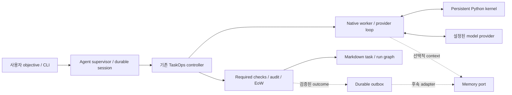

# TaskOps 독립 CLI agent 전환 설계 — 2026-10-11

상태: **사용자 검토용 제안. 구현 전 설계 확인 대기.**
사용자는 자체 모델 호출·세션·실행 루프를 관리하는 독립 CLI agent 방향을 선택했다.
현재 코드 검토와 실행 증거는
[2026-10-11-taskops-agent-review.md](/home/jimmy/workspace/taskops/docs/reviews/2026-10-11-taskops-agent-review.md)에 있다.

## 1. 목표와 완료 기준

TaskOps를 objective를 받아 작업을 실행하고 검증·재개할 수 있는 독립 CLI agent로 전환한다.
Prime의 programmatic context와 continual harness 원리를 자체 runtime에 적용한다.
Melete와 나중에 연동할 수 있는 versioned memory 경계를 첫 구현에서 마련한다.

전환 완료는 다음을 모두 만족하는 것으로 정의한다.

1. 사용자가 skill을 로드하지 않고 `taskops-agent`로 실행한다.
2. native runtime이 provider를 직접 호출하고 tool loop를 소유한다.
3. 실행 중인 task worker의 Python namespace가 여러 tool call에 걸쳐 유지된다.
4. session·usage·checkpoint를 저장하고 재개 시 side effect를 자동 replay하지 않는다.
5. TaskOps의 기존 검증과 EoW를 통과한 상태만 완료로 보고한다.
6. 모델 호출·tool 실행·wall-clock 상한을 work session 전체에 적용한다.
7. 검증 증거가 연결된 supplemental harness revision과 rollback을 지원한다.
8. 선택적 memory port와 신뢰 등급이 있는 outcome outbox를 fake adapter로 검증한다.
9. 새 agent tests, 관련 기존 회귀, 문서/버전/실행 검사와 fixture E2E를 통과한다.

## 2. 접근 방식 비교

| 방식 | 이점 | 비용과 제약 | 판단 |
| --- | --- | --- | --- |
| 자체 native executor + 기존 TaskOps control engine | direct model loop·kernel·세션을 TaskOps가 소유하고 기존 검증 경계를 재사용한다. | provider/tool protocol과 process lifecycle을 직접 구현·검증해야 한다. | 권장 |
| Prime SDK를 runtime으로 사용 | Prime의 현재 RLM·session·provider 기능을 활용할 수 있다. | 큰 dependency와 kernel provisioning을 도입하고 두 제품의 session/authority 경계를 관리해야 한다. | 대안 |
| host agent 정의만 추가 | 전환 비용이 작다. | 모델·세션·실행 루프를 외부 host가 소유한다. | 사용자가 선택한 독립 CLI 범위에 부족 |

권장안은 별도 감독 LLM을 하나 더 붙이는 방식보다,
기존 deterministic runner에 **자체 native model executor**를 연결하는 데 집중한다.
objective의 분해·탐색·실행에는 현재 task prompt와 readiness 경계를 활용한다.

## 3. 책임과 데이터 흐름



- **Supervisor**: session ID, config, aggregate budget, async process lifecycle,
  status/resume/stop, 최종 audit 판정을 소유한다.
- **TaskOps controller**: task/version 선택, readiness, worker prompt,
  graph mutation, verification, EoW를 소유한다.
- **Native worker**: 외부 coding CLI에 작업을 넘기지 않고 provider를 직접 호출한다.
  task의 model/tool loop와 대화 checkpoint를 소유한다.
- **Python kernel**: model-facing programmatic execution과 작업 중 namespace를 유지한다.
  큰 graph·context·출력은 변수/파일에 놓고 필요한 부분만 모델에 반환한다.
- **Memory port**: 기억 후보의 조회와 검증 결과의 전달 경계다.
  graph나 완료 상태를 소유하지 않는다.

기존 동기 runner는 supervisor가 관리하는 별도 process에서 실행한다.
native worker를 새 runtime adapter로 연결하므로 기존 checks/retry/closure 흐름을 재사용한다.
동기 runner 전체를 async로 바꾸는 광범위한 refactor는 첫 변경에서 하지 않는다.

kernel과 worker는 lifecycle 및 장애 격리를 위한 process다.
OS 권한을 제한하는 security sandbox로 설명하지 않는다.

## 4. CLI와 초기 objective

새 private `agent/` npm workspace와 `taskops-agent` binary를 추가한다.
첫 진입점은 다음으로 고정한다.

```text
taskops-agent init <work-dir> --id <work-id> --objective <text>
taskops-agent run <work-dir> --model <model> --base-url <url> [budget options]
taskops-agent status <work-dir> [--json]
taskops-agent resume <work-dir> [budget extension options]
taskops-agent stop <work-dir>
taskops-agent harness propose|show|apply|rollback <work-dir> [revision options]
```

`init`는 기존 initializer로 work를 만들고 미완료 planning task를 seed한다.
기존 경로/식별자가 존재하면 overwrite하지 않고 명시적으로 실패한다.
초기 root task는 사용자 objective를 그대로 보존하고 `needs_decomposition`으로 시작한다.
objective를 모델의 임의 요약으로 교체하지 않는다.

첫 provider 경로는 명시적으로 설정된 OpenAI-compatible chat/tool endpoint다.
model과 endpoint는 사용자 설정이고 특정 model을 제품 기본값으로 박지 않는다.
credential은 지정된 환경변수에서 host가 해석하며 config/checkpoint/log에 복제하지 않는다.
설정 누락·인증 실패는 work 완료로 처리하지 않는다.

foreground run과 durable resume를 첫 범위로 한다.
자동 daemon 설치, terminal UI, schedule, recursive parallel spawning은 후속 범위다.

## 5. Native worker와 typed execution context

기존 executor 호출에 다음 metadata를 가진 versioned context를 전달한다.

```text
schemaVersion, workId, workDir, taskId, taskGroupVersionId,
runId, runNodeId, actionKind, attemptId, artifactWorkspacePath,
agentSessionId, budgetStateRef
```

task/session identity를 prompt 본문이나 model 답변에서 추출하지 않는다.
context path는 work-owned 경계와 실제 artifact workspace를 검증한다.
새 adapter는 현재 task의 prompt와 context를 native worker에 전달한다.
worker stdout의 최종 output과 기존 partial/surprise/request protocol은 runner와 호환한다.

worker는 한 개의 programmatic tool `python`을 제공한다.
기본 namespace에 `task_context`, 현재 prompt/context 원문, bounded file/command helpers를 놓는다.
Python cell은 serialize해 실행하고, stdout/stderr/error와 실행 식별자를 반환한다.
큰 출력은 work-owned artifact로 남기고 model readout에는 제한된 창과 artifact reference를 제공한다.
잘못된 tool 이름, JSON, cell 요청, provider response를 엄격하게 거절한다.

graph 제어·closure는 controller의 책임이라는 기존 worker 계약을 native prompt에 포함한다.
model은 작업 산출물을 만들고 host가 독립 검증한다.
worker의 final answer나 “테스트가 통과했다”는 문장은 완료 증거가 아니다.

## 6. Session, checkpoint, budget, 취소

agent 상태는 `<work-dir>/.taskops/agent/` 아래 non-canonical runtime 상태로 저장한다.
Markdown graph의 source of truth를 이 directory로 옮기지 않는다.

```text
.taskops/agent/
  session.json
  events.jsonl
  budget.json
  workers/<worker-id>/
    transcript.jsonl
    checkpoint.json
    namespace.json
    artifacts/
  harness/revisions/
  memory/outbox/
  memory/receipts/
```

- session은 schema version, stable ID, work/snapshot identity, model config reference,
  process identity, current action, status, consumed budget를 기록한다.
- worker checkpoint identity는 task/version/action/attempt와 연결한다.
- namespace checkpoint는 bounded JSON-safe data만 저장한다.
  함수·open handle 등 복원 불가 항목은 dropped 목록에 표시한다.
- transcript의 model/tool 대응은 tool-call ID로 연결하고 복원 시 protocol consistency를 검사한다.
- current context는 resume 때 최신 Markdown에서 다시 구성한다.
  오래된 namespace가 새로운 task version의 사실을 덮어쓰게 하지 않는다.
- 재개는 완료된 Python cell이나 shell/file side effect를 자동 replay하지 않는다.
  in-flight action은 graph/run evidence를 재확인하고 불명확하면 interrupted 상태로 남긴다.
- 하나의 work에 active supervisor는 하나만 허용한다.
  stale lock은 PID만이 아니라 process identity와 소유 token을 확인한다.
- provider 호출은 시작 전에 durable budget reservation을 기록한다.
  실패·재시작·새 worker가 consumed model calls를 초기화하지 않는다.
- 최초 기본 상한은 model calls 64, worker당 tool cells 32,
  전체 runner steps 12, wall-clock 15분, model-facing tool readout 16 KiB다.
  값은 명시적 설정으로 변경할 수 있고 session에 기록한다.
- token/cost는 provider가 반환한 실제 usage만 기록한다.
  usage가 없으면 unknown으로 남기며 가상의 비용을 기재하지 않는다.
- `resume`은 기존 상한을 유지한다.
  상한 연장은 명시적인 인자를 받아 extension event로 남긴다.
- SIGINT/stop/timeout은 supervisor가 runner·worker·kernel process group을 종료한다.
  중단을 done이나 내용 실패의 학습 신호로 기록하지 않는다.

마지막 상태는 `completed | blocked | waiting | budget_exhausted | interrupted | failed`다.
`completed`는 current graph의 policy-approved closure와 audit `claimSafe`를 모두 요구한다.
구조적 종결만 된 경우는 완료되지 않은 상태와 원인을 명시한다.

## 7. Prime continual harness의 첫 구현 범위

base AGENT 계약과 prompt는 immutable이고 hash를 session에 기록한다.
supplemental harness만 versioned revision으로 관리한다.

revision에는 scope, source revision, proposal text, evidence references/hashes,
task/run/attempt identity, 생성 시각, 적용 상태를 담는다.
첫 구현은 propose/show/apply/rollback의 명시적 경로를 제공한다.
proposal 생성은 모델 작업이며 사용한 calls는 같은 session budget에 포함한다.

apply는 현재 scope의 실제 evidence를 확인하고 base prompt/graph/EoW/검증 정책 변경을 거절한다.
검증되지 않은 model 서술을 성과 evidence로 승격하지 않는다.
revision은 session-local이며 다른 work나 사용자 전역 prompt로 자동 확장하지 않는다.
rollback은 이전 supplemental revision을 가리키고 관련 실행 이력을 삭제하지 않는다.

자동 refinement, 일반 학습 효용, model capability 개선은 후속 실험이다.
첫 구현의 PASS는 revision/evidence/rollback의 software contract에 대한 판정이다.

## 8. Melete를 위한 memory 경계

첫 구현에서는 versioned `MemoryPort`, disabled adapter, fake adapter,
durable outbox/receipt를 만든다.
live Melete 설치·전역 hook 설정·원격 송신은 이 increment에 포함하지 않는다.

```text
MemoryPort.capabilities()
MemoryPort.retrieve(context) -> source-backed bounded context
MemoryPort.deliver(outcomeEnvelope) -> receipt
```

이는 TaskOps 내부 port다. 같은 이름의 Melete MCP tool이 존재한다고 가정하지 않는다.
후속 Melete adapter가 actual capability를 확인하고 실제 host/runtime API에 매핑한다.
현재 `melete_query`의 artifact/task/frame identity는 조회 경로의 참고 기준이며
`melete_feedback`을 검증된 outcome 학습용 write API로 사용하지 않는다.

outcome envelope에는 다음을 넣는다.

```text
schemaVersion, eventId, eventType, workId, taskId, taskGroupVersionId,
runId, runNodeId, attemptId, workRevision, sourceActor, scope,
sourceRefs, evidenceRefs, contentDigests, verificationStatus,
assurance, failureTier, observedAt, queryArtifactId?, frameId?
```

- `sourceActor`는 host가 결정한다. assistant/tool 기록을 user 발화로 등록하지 않는다.
- 정본 source reference와 digest를 보존하며 요약 문장을 원본 span으로 가장하지 않는다.
- 검증된 성공·검증된 content failure만 trusted outcome candidate가 된다.
- `self_verified` 성공, undetermined/flaky 실패, infra/protocol failure,
  취소·예산 종료는 trusted learning outcome으로 내보내지 않는다.
- negative gate의 최소 tier는 `runner_rejected`이며,
  `verified_failure`도 source/evidence 연결을 요구한다.
- event ID는 안정된 source/attempt identity에 연결한다.
  중복 deliver는 동일 receipt를 반환하고 중복 학습을 유발하지 않아야 한다.
- stale work revision/frame, 다른 scope/task, 잘못된 digest는 quarantine 또는 거절한다.
- receipt를 받기 전까지 outbox event를 전달 완료로 지우지 않는다.
- adapter 장애·미설정은 memory 상태에 기록하고 TaskOps의 완료 evidence를 바꾸지 않는다.
- retrieval 결과는 참고 context다. 사용자 지시나 graph/검증 권한이 아니다.
- 첫 구현의 조회 상한은 8 KiB이며 비활성 adapter는 명시적인 빈 결과를 반환한다.
- 삭제/replay는 후속 live adapter 검수 항목으로 남긴다.
  mock outbox PASS를 live Melete의 삭제/학습 효용 PASS로 확대하지 않는다.

## 9. skill에서 agent로의 저장소 전환

`agent/AGENT.md`를 새 행동 계약으로 작성하고 native runtime이 이를 실제로 로드한다.
현재 skill의 핵심 truth/readiness/closure 규칙은 이 계약과 core docs로 통합한다.
root README·활성 workspace·CI·version check·contract check를 agent 진입점 기준으로 갱신한다.

기존 graph fixture와 core storage contract를 유지한다.
skill의 기존 reference를 일괄 삭제하지 않고 migration 안내를 남긴다.
첫 변경에서 관련 없는 eval data·UI·plugin·참조 저장소·사용자 전역 파일을 수정하지 않는다.

예상 수정 범위:

- 신규 `agent/` runtime, CLI, worker, kernel, contract와 tests.
- 기존 runtime adapter 및 호출 context를 연결하는 CLI의 제한된 부분.
- root package/lock, workspace scope/version/contract/verification scripts, CI.
- root/CLI/skill migration 문서와 이 설계·검토 기록.

## 10. 구현 순서와 검수

| 순서 | 산출물 | 필수 검수 |
| --- | --- | --- |
| 1 | agent contract·config·session/budget schemas | version/path validation, 비밀값 비저장, atomic writes, session ownership |
| 2 | provider + worker + Python kernel | 직접 model/tool 왕복, namespace 유지, bounded output, malformed reply, auth/timeout, clean shutdown |
| 3 | native adapter + supervisor + objective seed | init→decompose→execute→verify→close fixture E2E, cancellation, stale lock, stdout protocol |
| 4 | checkpoint/resume와 cumulative budget | JSON namespace 복구, dropped values 표시, side-effect replay 방지, version mismatch, resume 후 budget 유지 |
| 5 | supplemental harness | evidence/scope rejection, immutable base, revision apply/rollback, 이력 보존 |
| 6 | memory port/outbox | disabled path, bounded query, idempotency, trusted failure/success gate, stale/frame/scope/quarantine, retry receipt |
| 7 | repository migration와 최종 검증 | 관련 기존 회귀·새 agent tests·문서/버전/실행 검사·fixture E2E |

provider tests는 local HTTP fixture와 deterministic scripted responses를 사용한다.
실제 모델이 코드/분해를 생성하는 test와 fixture가 protocol을 검증하는 test의 결과를 분리한다.
Python kernel은 실제 Python process를 실행하여 persistence/cancel/output behavior를 검증한다.
critical negative tests는 구현 전에 실패하는 것을 확인한 뒤 green으로 만든다.

구체적인 acceptance cases:

1. 한 worker의 cell 1에서 만든 변수를 cell 2가 읽는다.
2. 큰 context를 namespace에 유지하면서 provider에게 전체를 다시 보내지 않는다.
3. tool failure의 진단이 다음 모델 호출에 전달된다.
4. task worker의 success text와 exit 0만으로 work가 completed가 되지 않는다.
5. 새 objective가 빈 work의 `no_runnable`에서 멈추지 않고 planning task를 만든다.
6. guarded checks가 실패하면 EoW 완료가 생기지 않고 retry/blocked evidence가 남는다.
7. malformed/partial/waiting/unapproved graph를 agent가 completed로 보고하지 않는다.
8. stop/timeout 뒤 child/kernel process와 mutation lock이 남지 않는다.
9. resume이 이미 실행된 file append/command를 반복하지 않는다.
10. 다른 task/version의 checkpoint와 stale memory frame을 거절한다.
11. 여러 workers와 resume의 calls가 같은 aggregate 상한에 포함된다.
12. provider 인증/응답 오류·budget 종료가 content failure memory가 되지 않는다.
13. evidence 없는 harness proposal과 base/policy 변경을 거절한다.
14. rollback이 이전 supplemental 내용을 복원하고 실행 이력을 보존한다.
15. verified success와 runner-rejected content failure의 outbox가 안정된 identity를 가진다.
16. duplicate receipt와 adapter 실패가 duplicate learning이나 false completion을 만들지 않는다.

장기 soak·일반 의미 학습·사용자 효용·실제 model lift는 별도 증거가 필요한 후속 검수다.
첫 구현 완료 보고에는 실행 명령, 실제 summary, 통과/실패 수, commit SHA와 미검증 범위를 기재한다.

## 11. 설계 자체 검토

- 독립 CLI 선택은 사용자 답변으로 확인됐다.
- 모델 실행과 task verification의 책임을 분리했다.
- native worker·현재 runner·aggregate budgets 사이의 경계를 명시했다.
- 새 objective의 초기 planning task와 빈 work의 기존 동작을 구분했다.
- 지속 kernel과 제한된 JSON checkpoint의 복구 보장을 구분했다.
- supplemental harness와 base/graph authority의 경계를 명시했다.
- 내부 MemoryPort와 actual Melete tools/API의 차이를 명시했다.
- 첫 구현의 software PASS와 live model/learning efficacy를 구분했다.

이 문서의 구현 범위는 아직 사용자 확인을 받지 않았다.
확인 후 상세 implementation plan을 작성하고 이 세션에서 구현·검증한다.
