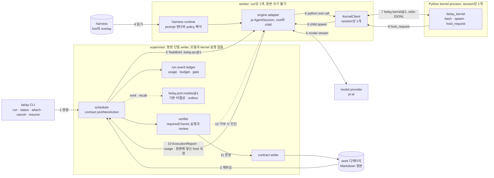

# Belay harness CLI 설계 — 2026-10-13

상태: **사용자 검토용 설계 v2. 구현 전 확인 대기.**
범위는 설계까지다. 구현 코드, scaffold, 저장소 내 rename, 패키지 설치는 이 문서의 범위가 아니다.
이 문서는 [2026-10-11-taskops-agent-transition-design.md](/home/jimmy/workspace/taskops/docs/superpowers/specs/2026-10-11-taskops-agent-transition-design.md)를 대체한다.

**구현 시작 전에 사용자가 정할 것.** 아래 일곱 개가 정해져야 구현을 시작한다. Q1은 방향을 먼저 정하고 spike S1·S8 결과로 확정한다. 근거는 12.3절에 있다.

| # | 질문 | 권장안 |
|---|---|---|
| Q1 | pi의 scope와 pin | `@earendil-works/pi-coding-agent@1.1.0` exact pin. S1·S8이 실패하면 `0.74.0` |
| Q2 | npm scope | `@jimmylegendary/belay` |
| Q3 | evolve가 고칠 수 없는 영역 | 5.11절 표 전부 고정 |
| Q4 | 기존 자산 삭제 범위 | 8.1절 표대로 |
| Q9 | 기존 work 처리 | `belay migrate` 복사 변환만 지원하고 EoW v2인 work만 받는다 |
| Q10 | 구현 언어 | TypeScript |
| Q23 | 제품명 Belay 유지 여부 | 유지. 이름을 고른 뒤 PyPI `belay`가 활성 프로젝트로 확인돼 다시 묻는다 |

나머지 열린 질문 16개(Q5~Q8, Q11~Q22)는 해당 increment에 들어가기 전에 정하면 된다.

**구현 전에 사용자가 할 일**(11절 I0, 12.2절 RK-12): `/home/jimmy/repos/taskops` clone의 commit되지 않은 수정과 untracked eval 데이터를 보관하고, 사용자 systemd unit `taskopsd-*.service` 2개를 정지한다.

**근거 표기.** 서술마다 확인 수준을 구분한다.

- 코드 확인: 적힌 경로와 줄을 열어 읽었다. 실행하지는 않았다.
- 실행 확인: 읽기 전용 명령으로 실행해 관측했다.
- 문서 서술: 문서에만 있고 코드로 확인하지 않았다.
- 미검증(U-nn): 확인하지 못했다. 전부 12.1절 표에 같은 번호로 모았다.

**기준 revision.**

| 대상 | 기준 | 비고 |
|---|---|---|
| TaskOps 저장소 | HEAD `5267886` (branch `codex/taskops-native-agent`) | 이 문서가 사는 저장소 |
| pi 로컬 설치본 | `@mariozechner/pi-coding-agent` 0.67.68 | 동작 근거는 이 설치본의 컴파일된 소스 |
| pi npm 최신 | `@earendil-works/pi-coding-agent` 1.1.0 | 타입과 문서 근거는 unpkg URL |
| Prime Agent | `/home/jimmy/repos/prime-agent` HEAD `f5dede19` (`v0.9.2-2`) | 로컬 tag `v0.9.5`는 `a7d791bc`, 126 commit 앞 |
| Melete | `/home/jimmy/repos/melete` HEAD `8c9f8cf` | |
| RRSI | `be50316e1db05914068a973f322770ef08ed7ba1` (단일 commit, tag 없음) | GitHub permalink로 인용 |

## 1. 목표와 완료 기준, 사용자 확정 결정 6개

### 1.1 목표

TaskOps를 독립 harness CLI **Belay**로 전면 전환한다. Belay는 objective를 받아 Markdown task graph로 작업을 쪼개고, 모델 실행은 pi 엔진에 맡기고, 완료 여부는 deterministic verification으로만 판정한다. 모델이 보는 도구는 Python kernel 하나다. harness(prompt, 제어 정책, 설정, skill, memory 등)는 Belay가 소유하는 편집 가능한 층으로 분리하고, 이 층만 두 가지 자기개선 경로(session-local refine, offline regularized evolve)가 고친다.

### 1.2 사용자 확정 결정 (변경 금지)

| # | 결정 | 이 문서에서의 반영 |
|---|---|---|
| 1 | 전면 전환. 제품 자체를 독립 harness 구조의 CLI로 바꾼다. skill 진입점은 제거한다. 기존 구조 보존을 기본값으로 두지 않는다. | 2절 구조, 8절 자산 처리, 11절 I2(skill 삭제)와 I6(구 실행 계층 삭제) |
| 2 | 제품명은 Belay. npm과 PyPI의 `belay` 이름은 다른 package가 쓰고 있으므로 scoped package + bin 이름 `belay`를 쓴다. | 8.2절, 9절. 패키지 `@jimmylegendary/belay`(scope 확정은 12.3절 Q2), bin `belay` |
| 3 | base는 pi agent 패키지를 npm dependency로 쓴다(fork 아님). | 3절 |
| 4 | Prime Agent(MIT)의 구조를 적극 차용하되 Belay 자체 모듈로 이식한다. | 4절 |
| 5 | RRSI(arXiv 2609.24972)를 harness 자기개선의 핵심 축으로 적용한다. | 5절 |
| 6 | Melete 연결 interface를 열어둔다. live 연동은 후속이다. | 7절 |

계획 단계에서 확인된 사실 네 가지도 반영했다.

- npm의 `@mariozechner/pi-coding-agent`는 latest 0.73.1이고 deprecated 문구가 "please use @earendil-works/pi-coding-agent instead going forward"다. `@earendil-works/pi-coding-agent`의 latest는 1.1.0이다(실행 확인: `npm view`, 2026-10-13). 3.7절 pin 정책과 12.3절 Q1에 반영했다.
- unscoped npm `belay`는 1.5.0에서 멈춘 다른 package다(modified 2022-06-13). PyPI `belay`는 0.30.1(2026-03-03 업로드)로 활성 프로젝트다(실행 확인). 8.2절과 12.2절에 반영했다.
- Melete는 문서가 서술한 표면과 코드에 구현된 표면이 다르다. 7.2절에서 구분했다.
- `github.com/google-research/rrsi`는 접근된다. 5절은 위 commit SHA의 permalink로 인용한다.

### 1.3 완료 기준

이 설계 문서의 완료 기준은 "구현자가 12개 절만 읽고 increment 0부터 시작할 수 있고, 추정으로 메운 곳이 없다"이다. 제품(Belay 첫 릴리스)의 완료 기준은 아래 여덟 가지이고, 각각 10절의 acceptance case로 검증한다.

1. `belay run`이 objective를 받아 Markdown task graph를 만들고 supervisor, worker, Python kernel 구조로 실행한다. `belay audit`은 `claimSafe ∧ externallySafe`일 때만 완료로 보고하고 exit 0을 낸다.
2. provider에 전달되는 tool 목록은 Python kernel tool 하나다.
3. pi는 수정하지 않은 npm dependency다. pi를 import하는 모듈은 `src/engine/` 하나다.
4. harness 층의 9개 디렉터리가 RRSI component 어휘 K와 1:1로 대응한다. refine과 evolve는 계약 층을 고치지 못하고, 이 점을 테스트가 강제한다.
5. session-local refine과 offline evolve가 각자의 ledger와 rollback을 가진다.
6. `belay.port.melete@1`이 기본 비활성으로 존재하고 fake transport 계약 테스트를 통과한다.
7. skill 진입점, 기존 runner, queue, daemon, runtime adapter가 저장소와 배포물에 없다.
8. 기존 TaskOps work는 `belay migrate`가 변환하거나 거절 사유를 보고한다.

### 1.4 비목표

pi fork, provider 호출이나 tool loop의 자체 구현, TUI, Melete live 연동(후속), Windows와 macOS 지원(첫 릴리스), 다중 사용자 권한 모델.

## 2. 아키텍처

### 2.1 세 층과 경계

| 층 | 소유 | 고칠 수 있는 주체 | 내용 |
|---|---|---|---|
| 엔진 층 | pi 패키지 (고정, 외부) | 없음. Belay는 pin을 올리는 것만 한다 | provider 호출과 stream, usage와 cost 계산, agent loop(tool 실행, steer/followUp 큐, abort), `AgentSession`, `SessionManager`(JSONL tree), `ExtensionRunner`, `SettingsManager`, `DefaultResourceLoader`, compaction |
| Belay 고정 층 | Belay (계약과 프로세스) | 사람이 코드 변경으로만. refine과 evolve는 불가 | Markdown task graph 계약, deterministic verification, EoW/claimSafe 판정, 예산과 usage 원장, supervisor/worker/kernel 프로세스, pi adapter, hermetic 구성, Melete port, refine과 evolve 엔진 자체 |
| Belay harness 층 | Belay (편집 가능) | 사람, session-local refine(일부), offline evolve | K의 9개 component. 2.3절 |

경계 규칙은 여섯 가지다.

1. pi import는 `src/engine/` 한 모듈에서만 한다. 다른 모듈이 pi 패키지명을 import하면 테스트가 실패한다.
2. pi 소스를 수정하거나 patch하지 않는다. 버전 차이와 결함 우회는 adapter 안에서 처리한다.
3. harness 층은 고정 층을 import만 할 수 있고, 고정 층의 판정 함수와 입력 schema를 대체하지 못한다.
4. pi session JSONL은 참조와 replay용 artifact다. 완료와 gate 판정의 근거는 Markdown 정본과 Belay ledger다.
5. pi 이벤트는 Belay 이벤트로 변환해서만 process 밖으로 보낸다.
6. 정본(Markdown work 트리)을 쓰는 process는 supervisor 하나다.

엔진에서 쓰지 않거나 금지하는 것: 내장 tool(`read`, `bash`, `edit`, `write` 등), InteractiveMode와 TUI, pi CLI와 print/RPC mode, pi package manager, pi의 skill/prompt/theme/context-file discovery, `~/.pi/agent/*`, 확장 command와 shortcut, OAuth login, 1.x의 codemode·MCP·tool_search(SDK 세션은 기본 미로드다. 근거: 1.1.0 [sdk.md 116행](https://unpkg.com/@earendil-works/pi-coding-agent@1.1.0/docs/sdk.md)), `session.reload()`.

### 2.2 harness 층 디렉터리와 K 대응

RRSI는 K를 상수로 정의한다: `K = ["prompt", "control_flow", "config", "output_plumbing", "context_mgmt", "client_tool", "skill", "memory", "subagent"]`([components.py L44-46](https://github.com/google-research/rrsi/blob/be50316e1db05914068a973f322770ef08ed7ba1/rrsi/components.py#L44-L46), 코드 확인). Belay의 harness 디렉터리 이름은 이 9개와 같다.

| 디렉터리 | 담는 것 | 형식 | refine(1계층) | evolve(2계층) |
|---|---|---|---|---|
| `harness/prompt/` | system prompt, kernel tool 설명문, TaskBrief·분해·탐색·재시도 문구, refine planner 문구 | `*.md` | note 추가만 (`prompt/notes/`) | 가능 |
| `harness/control_flow/` | 허용된 후보 사이의 선택 순위, 수렴 사다리 순서, 이어가기 횟수, child 위임 정책 | `policy.json` | 불가 | 가능 (계약 clamp 안) |
| `harness/config/` | 임계값, 역할별 thinking 수준, 예산 배분 비율, 재시도 floor | `harness.json` | 불가 | 가능 (허용 키와 clamp 안) |
| `harness/output_plumbing/` | kernel 출력 절단 한도와 형식, ExecutionReport 요약 규칙 | `plumbing.json` | 불가 | 가능 |
| `harness/context_mgmt/` | 상위 맥락 주입 범위, compaction 지시문, recall packet 배치와 크기 상한 | `context.json`, `*.md` | 불가 | 가능 |
| `harness/client_tool/` | kernel namespace에 추가로 올리는 Python helper | Python package | 불가 | 가능 (수락 전 사람 확인. 5.10절) |
| `harness/skill/` | skill 설명과 Python-backed skill | `<name>/SKILL.md`, 선택적 `pyproject.toml` | 설명과 참조만 | 가능 (Python 코드 변경은 수락 전 사람 확인) |
| `harness/memory/` | 과제에 독립적인 절차 기억 | `<id>.md` (front matter: id, version, scope, source, created_at) | 가능 | 가능 |
| `harness/subagent/` | child session spec(역할, prompt, 권한 범위) | `<id>.md` | 가능 | 가능 |

`control_flow`, `output_plumbing`, `context_mgmt`는 첫 릴리스에서 선언형 정책 파일이고, 고정 층의 interpreter가 해석한다. RRSI에서 이 세 component의 편집은 agent loop 소스를 직접 고치는 것이었으므로, 선언형 표면만으로는 표현력이 모자랄 수 있다. code hook(ESM 모듈)을 여는 것은 격리 실행 방식이 확인된 뒤로 미룬다. 격리 방식은 미검증(U-17)이고 spike S11과 12.3절 Q7로 올렸다.

분류는 경로로 결정한다. 변경된 파일의 `harness/` 바로 아래 디렉터리 이름이 곧 component다. RRSI는 proposer가 신고한 태그를 diff 정규식 증거로 검증하고 증거가 없으면 재태깅한다([components.py L95-100](https://github.com/google-research/rrsi/blob/be50316e1db05914068a973f322770ef08ed7ba1/rrsi/components.py#L95-L100), 코드 확인). Belay의 경로 규칙은 그보다 결정적이다.

harness는 세 위치에 있다.

| 위치 | 경로 | 역할 | 쓰는 주체 |
|---|---|---|---|
| base | 패키지 동봉 `harness/` | 설치 직후의 seed. 읽기 전용 | 릴리스 |
| live | `~/.belay/harness/` (git 저장소. `main`이 live, `evolve/<suite>`가 후보 계보, tag `h<t>`) | 실제 run이 읽는 harness | 사람, `belay evolve promote` |
| overlay | `<work>/.belay/overlay/<run-id>/<K>/` | 한 run 안에서만 유효한 copy-on-write 덧층 | session-local refine |

각 위치에는 `manifest.json`이 있고 schema id, harness version, component별 파일 목록과 sha256을 담는다. worker는 run 시작 시 live의 commit을 run에 기록하고(`harnessCommit`) 그 run이 끝날 때까지 같은 commit을 쓴다.

### 2.3 process 구성

| process | 수 | 하는 일 | 하지 않는 일 |
|---|---|---|---|
| `belay` CLI (client) | 명령당 1 | 명령 해석, supervisor 기동 또는 접속, 출력 | 판정, 모델 호출 |
| supervisor | work당 1 | scheduler(계약의 `pickNextAction`), 정본 단일 writer, verifier 실행, 예산과 usage 원장, lease, Melete port와 outbox | 모델 호출, kernel 실행 |
| worker | run당 1 | pi `AgentSession` 호스팅(attempt의 root session과 child session), harness 렌더, KernelClient, host-request 분배 | 정본 쓰기, 완료 판정 |
| Python kernel | session당 1 | 모델이 낸 Python 실행, `bash()`, host-request 발신 | 정본 쓰기, 자격 증명 접근 |

supervisor는 두 방식으로 뜬다. foreground 방식은 `belay run`을 실행한 CLI process가 그 run 동안 supervisor 역할을 맡는다. daemon 방식은 `belay daemon start`가 detached supervisor를 띄우고 CLI는 unix socket으로 붙는다. 두 방식은 같은 supervisor 모듈과 같은 worker IPC를 쓴다. foreground 방식이 먼저 구현되고(I5) daemon 방식은 뒤에 온다(I9). 어느 방식에서도 worker는 별도 process이고 정본을 쓰지 못한다.

Prime의 구성과 같은 점과 다른 점은 이렇다. Prime도 client, supervisor, worker, kernel로 나뉘고 supervisor는 provider·tool·kernel을 실행하지 않는다(문서 서술: [daemon.md](/home/jimmy/repos/prime-agent/packages/coding-agent/docs/daemon.md) 23행). child는 별도 process가 아니라 같은 worker 안의 runtime이고, session별로 kernel을 따로 가진다(문서 서술: [architecture.md](/home/jimmy/repos/prime-agent/packages/coding-agent/docs/architecture.md) 20행의 "session + optional kernel"). Belay는 이 둘을 따른다. 다른 점은 Belay의 supervisor가 정본 writer와 verifier를 겸한다는 것이다.

supervisor와 worker 사이의 IPC는 `belay.ipc@1`이다. frame 형식은 Prime의 private framing(앞 8바이트가 header 길이와 payload 길이)을 이식한다(코드 확인: [private-framing.ts](/home/jimmy/repos/prime-agent/packages/coding-agent/src/modes/session-worker/private-framing.ts) 3-13행). pi의 RPC mode는 worker IPC로 쓰지 않는다. `runRpcMode`는 stdout을 점유하고(코드 확인: [rpc-mode.js](/home/jimmy/.npm-global/lib/node_modules/@mariozechner/pi-coding-agent/dist/modes/rpc/rpc-mode.js) 22-23행) command 목록에 tool 등록이나 system prompt 변경이 없기 때문이다(코드 확인: [rpc-types.d.ts](/home/jimmy/.npm-global/lib/node_modules/@mariozechner/pi-coding-agent/dist/modes/rpc/rpc-types.d.ts) 13-118행).

### 2.4 데이터 흐름



한 attempt의 순서는 이렇다.

1. supervisor가 정본을 재파싱하고 `pickNextAction`으로 다음 action(실행, 분해, 탐색, prototype)을 고른다. run node를 만들고 `TaskBrief`를 worker에 보낸다.
2. worker가 harness를 렌더해 hermetic `AgentSession`을 만들고 brief를 prompt로 넣는다.
3. 모델은 `python` tool만 호출한다. kernel이 코드를 실행하고, 권한이 필요한 동작은 host-request로 올린다.
4. 정본에 닿는 host-request(`plan.decompose`, `exploration.record`, `partial.request`, `surprise.report`, `budget.extend`)는 worker가 supervisor로 넘기고 supervisor가 검증해 기록한다. `child.spawn`과 `refine.run`은 worker가 처리한다.
5. session이 멈추면 worker가 `ExecutionReport`를 보낸다.
6. supervisor의 verifier가 attempt workspace의 읽기 전용 스냅샷에서 check를 실행하고 review 보고서를 만든다.
7. 승인이면 writer가 EoW를 쓴다. 거부이고 재시도 예산이 남으면 진단을 worker로 돌려보내 같은 session을 이어간다. 그 밖에는 실패 인증서와 함께 `blocked`로 둔다.

### 2.5 소스 배치

```text
bin/belay.js          bin 진입점
src/cli/              명령 해석, foreground supervisor 기동, daemon 접속
src/contract/         graph, identity, closure, readiness, verify, verdict, certificate, budget, writer, convergence
src/supervisor/       scheduler, verifier 실행, lease, journal, IPC, daemon
src/worker/           attempt loop, session 수명, host-request 분배, child registry
src/engine/           pi adapter (pi를 import하는 유일한 모듈)
src/kernel-host/      KernelClient, bootstrap, boot gate, state snapshot
src/durability/       event-log, session-lease, journal, private framing, socket
src/harness-runtime/  loader, manifest 검증, policy interpreter, prompt 렌더
src/refine/           session-local refine 엔진
src/evolve/           RRSI 재구현 (schedule, selection, history, components, calibrate, evaluate, critic, propose)
src/port/melete/      port, outbox, receipt, transport
kernel/               Python package belay_kernel (repl, bash, host wrapper)
harness/              패키지 동봉 base harness (9개 디렉터리와 manifest.json)
tests/                contract, engine, kernel, supervisor, harness, evolve, port, fixtures
```

구현 언어는 TypeScript(ESM)이고 배포물은 컴파일된 JS와 `.d.ts`다. Prime에서 이식할 코드가 TypeScript이고, pi의 타입을 adapter 계약으로 쓰기 때문이다. 기존 계약 모듈은 plain ESM JS이므로 이식 시 그대로 들여와 단계적으로 타입을 붙인다. 이 선택은 12.3절 Q10에 올렸다.

### 2.6 상태 디렉터리

```text
~/.belay/                       사용자 전역 (0700)
  config.json                   사용자 설정 (engine.*, budget.*, refine.*, melete.*)
  pi-agent/                     pi에 주입하는 agentDir (auth.json, models.json)
  kernel-venv/                  uv로 만든 kernel Python 환경과 bootstrap lock
  harness/                      live harness git 저장소
  evolve/<suite>/               suite.lock, calibration.json, frontier.json, history.jsonl, attribution.jsonl, r<t>/
  outbox/melete/                Melete port outbox
  run/                          daemon socket과 supervisor descriptor
<work>/                         Markdown task graph 정본 (index.md, task-groups/, snapshots/, runs/)
<work>/.belay/                  work 단위 런타임 상태. 정본이 아니다
  config.json                   work 단위 설정. 전역 설정을 끌 수만 있다
  sessions/<session-id>/        pi session JSONL, kernel-state snapshot
  overlay/<run-id>/<K>/         session-local refine overlay와 refinements.jsonl
  supervisor/                   lease, worker descriptor, command journal, orphan journal
  legacy/                       belay migrate가 보존한 구 상태
```

상태 디렉터리 이름은 `.belay/`다. pi의 `piConfig`로는 이 이름을 만들 수 없다. pi는 import 시점에 자기 `package.json`에서 `piConfig`를 읽어 `APP_NAME`과 `CONFIG_DIR_NAME`을 고정하기 때문이다(코드 확인: [config.js](/home/jimmy/.npm-global/lib/node_modules/@mariozechner/pi-coding-agent/dist/config.js) 157-162행. 1.1.0도 같은 방식이다: [config.js 469-477행](https://unpkg.com/@earendil-works/pi-coding-agent@1.1.0/dist/config.js)). Prime이 `.prime/agent`를 쓰는 것은 fork라서 자기 `package.json`에 `piConfig`를 두기 때문이다(코드 확인: [package.json](/home/jimmy/repos/prime-agent/packages/coding-agent/package.json) 6-9행). Belay는 dependency이므로 `cwd`, `agentDir`, `sessionDir`를 전부 명시 주입해 `.belay/` 아래로 보내고, pi의 `<cwd>/.pi/` 자동 발견은 3.3절의 플래그로 끈다.

run event ledger는 `<work>/runs/<run-id>/events.jsonl`이다. supervisor만 쓰고, usage·예산·gate 결과·port 상태 전이가 여기에 남는다.

## 3. pi 위에 올리는 방식

### 3.1 원칙

- pi는 수정하지 않는 npm dependency다. Belay가 쓰는 것은 SDK(`createAgentSession`)이고 pi CLI나 mode는 쓰지 않는다. pi 문서도 같은 Node process 안에서 tool과 extension을 코드로 구성하려면 SDK를 쓰라고 한다(문서 서술: [sdk.md](/home/jimmy/.npm-global/lib/node_modules/@mariozechner/pi-coding-agent/docs/sdk.md) 1085-1094행).
- 경로는 전부 명시 주입한다. pi 기본값이나 ambient 값(`process.cwd()`, 홈 디렉터리)에 기대지 않는다. `createAgentSession`은 옵션이 없으면 `process.cwd()`, 기본 agentDir, 파일 기반 settings와 session 디렉터리로 떨어진다(코드 확인: [sdk.js](/home/jimmy/.npm-global/lib/node_modules/@mariozechner/pi-coding-agent/dist/core/sdk.js) 62-78행).
- pi를 bundle하거나 vendor하지 않는다. pi는 import 시점에 자기 `package.json`과 자산 경로를 읽는다(코드 확인: config.js 157-162행, 위 링크).
- 설계 기준 pin은 `@earendil-works/pi-coding-agent@1.1.0`이다(3.7절). 아래에서 "1.1.0 타입 확인"은 npm tarball의 `.d.ts`와 문서를 읽었다는 뜻이고, "0.67.68 코드 확인"은 로컬 설치본의 컴파일된 JS를 읽었다는 뜻이다. 1.1.0을 설치해 실행한 적은 없다.

### 3.2 사용하는 API와 근거

| adapter 능력 | 쓰는 API (pin 1.1.0) | 근거 | 확인 수준 |
|---|---|---|---|
| session 생성 | `createAgentSession({cwd, agentDir, modelRuntime, model, thinkingLevel, tools, customTools, resourceLoader, sessionManager, settingsManager})` | 1.1.0 [sdk.d.ts 10-60행](https://unpkg.com/@earendil-works/pi-coding-agent@1.1.0/dist/core/sdk.d.ts). 0.67.68 기본값 동작은 sdk.js 62-78행 | 1.1.0 타입 확인, 0.67.68 코드 확인. 실행은 미검증(U-02) |
| tool을 하나로 제한 | `tools: ["python"]`(allowlist) + `customTools: [pythonTool]` | 1.1.0 sdk.d.ts 26-56행: allowlist를 주면 일치하는 tool만 켜진다. `noTools: "all"`은 custom tool까지 끄므로 쓰지 않는다. 0.67.68에서는 `tools: []`가 내장 0개가 된다([sdk.js](/home/jimmy/.npm-global/lib/node_modules/@mariozechner/pi-coding-agent/dist/core/sdk.js) 127-130행) | 1.1.0 타입 확인, 0.67.68 코드 확인. provider에 실제로 전달되는 목록은 미검증(U-01) |
| tool 정의 | `defineTool({name, label, description, parameters, executionMode: "sequential", execute(toolCallId, params, signal, onUpdate, ctx)})` | 0.67.68 [types.d.ts](/home/jimmy/.npm-global/lib/node_modules/@mariozechner/pi-coding-agent/dist/core/extensions/types.d.ts) 281-312행. 1.1.0 tool result에는 `usage?`, `isError?`, `terminate?`가 있다([types.d.ts 374-392행](https://unpkg.com/@earendil-works/pi-agent-core@1.1.0/dist/types.d.ts)) | 코드 확인, 1.1.0 타입 확인 |
| 격리 loader | `new DefaultResourceLoader({cwd, agentDir, settingsManager, noExtensions, noSkills, noPromptTemplates, noThemes, noContextFiles, systemPrompt, extensionFactories})` 뒤 `await reload()` | 0.67.68 [resource-loader.d.ts](/home/jimmy/.npm-global/lib/node_modules/@mariozechner/pi-coding-agent/dist/core/resource-loader.d.ts) 65-71행. 1.1.0 [resource-loader.d.ts 79-87행](https://unpkg.com/@earendil-works/pi-coding-agent@1.1.0/dist/core/resource-loader.d.ts) | 타입 확인. 0.67.68에서 플래그와 `systemPrompt`를 주면 skill 0개가 되는 것은 실행 확인. 1.1.0 실행은 미검증(U-02) |
| inline extension | `extensionFactories: [(pi) => { pi.on(...) }]` | 문서 서술: [sdk.md](/home/jimmy/.npm-global/lib/node_modules/@mariozechner/pi-coding-agent/docs/sdk.md) 565-575행. 이벤트 overload는 types.d.ts 718-745행 | 코드 확인 |
| 설정 | `SettingsManager.inMemory({compaction: {enabled: false}, ...})` | 1.1.0 [settings-manager.d.ts 213행](https://unpkg.com/@earendil-works/pi-coding-agent@1.1.0/dist/core/settings-manager.d.ts). 0.67.68은 초기값이 `reload()`에서 사라지는 결함이 있었고 0.70.0에서 고쳐졌다([CHANGELOG.md 288행](https://unpkg.com/@mariozechner/pi-coding-agent@0.73.1/CHANGELOG.md)) | 타입 확인, 결함은 0.67.68에서 실행 확인 |
| 인증과 모델 | `await ModelRuntime.create({authPath, modelsPath})`를 `modelRuntime`으로 전달 | 1.1.0 [model-runtime.d.ts 4-8, 56행](https://unpkg.com/@earendil-works/pi-coding-agent@1.1.0/dist/core/model-runtime.d.ts). 0.80.8에서 `authStorage`와 `modelRegistry` 옵션이 `modelRuntime`으로 바뀌었다([CHANGELOG.md 1212-1219행](https://unpkg.com/@earendil-works/pi-coding-agent@1.1.0/CHANGELOG.md)) | 타입 확인. 실행은 미검증(U-02) |
| prompt와 중단 | `session.prompt(text)`, `session.followUp(text)`, `session.abort()`, `session.waitForIdle()` | 1.1.0 [agent-session.d.ts 534, 566, 635, 636행](https://unpkg.com/@earendil-works/pi-coding-agent@1.1.0/dist/core/agent-session.d.ts) | 타입 확인 |
| 이벤트와 usage | `session.subscribe(listener)`로 assistant `message_end`의 `message.usage`를 누적 | 0.67.68 `getSessionStats()`는 현재 `state.messages`만 합산한다([agent-session.js](/home/jimmy/.npm-global/lib/node_modules/@mariozechner/pi-coding-agent/dist/core/agent-session.js) 2334-2345행) | 코드 확인. 합산 정합은 미검증(U-06) |
| system prompt 주입 | loader의 `systemPrompt`로 base를 주고, attempt마다 `before_agent_start`가 `{systemPrompt}`를 반환해 통째로 교체 | 0.67.68 agent-session.js 757-781행, types.d.ts 669-673행. 1.1.0 types.d.ts 1101-1105행("Replace the complete system prompt for this turn") | 코드 확인, 1.1.0 타입 확인. provider 도달 형태는 미검증(U-08) |
| checkpoint 기록 | `session.sessionManager.appendCustomEntry("belay.checkpoint", data)` | 0.67.68 [session-manager.d.ts](/home/jimmy/.npm-global/lib/node_modules/@mariozechner/pi-coding-agent/dist/core/session-manager.d.ts) 208행. 1.1.0 [session-manager.d.ts 273행](https://unpkg.com/@earendil-works/pi-coding-agent@1.1.0/dist/core/session-manager.d.ts) | 타입 확인 |
| child 연결 | `SessionManager.create(cwd, sessionDir, {parentSession})` | header의 `parentSession`: 0.67.68 session-manager.d.ts 5-16행. 1.1.0 session-manager.d.ts 371행 | 타입 확인 |
| 재개 | `SessionManager.open(path, sessionDir)`을 `createAgentSession({sessionManager})`에 전달 | 1.1.0 session-manager.d.ts 378행 | 타입 확인 |
| 이어가기 hook | `pi.on("agent_before_settle", handler)`가 `{entries?, continue?}` 반환 | 1.1.0 [types.d.ts 762-775, 1186행](https://unpkg.com/@earendil-works/pi-coding-agent@1.1.0/dist/core/extensions/types.d.ts). 0.87.0에서 추가([CHANGELOG.md 374-381행](https://unpkg.com/@earendil-works/pi-coding-agent@1.1.0/CHANGELOG.md)) | 타입 확인. 동작은 미검증(U-05) |
| 테스트 provider | `fauxProvider(options)` | 1.1.0 [faux.d.ts 93-102행](https://unpkg.com/@earendil-works/pi-ai@1.1.0/dist/providers/faux.d.ts). `registerFauxProvider`는 [compat.d.ts 55행](https://unpkg.com/@earendil-works/pi-ai@1.1.0/dist/compat.d.ts)으로 옮겨졌다. 0.67.68은 pi-ai root가 faux를 export한다([index.d.ts](/home/jimmy/.npm-global/lib/node_modules/@mariozechner/pi-coding-agent/node_modules/@mariozechner/pi-ai/dist/index.d.ts) 9행) | 타입 확인. 1.1.0에서 `AgentSession`을 구동하는 절차는 미검증(U-29) |
| 버전 확인 | `VERSION` export를 pin 값과 비교, 다르면 시작 거부 | 0.67.68 config.js 160행. 1.1.0 config.js 474행 | 코드 확인 |

쓰지 않기로 한 API와 이유.

- `AgentSessionRuntime`과 `createAgentSessionRuntime`: session을 교체할 때 `process.chdir`를 호출한다(코드 확인: [agent-session-runtime.js](/home/jimmy/.npm-global/lib/node_modules/@mariozechner/pi-coding-agent/dist/core/agent-session-runtime.js) 88-91, 249행). 한 worker에 여러 session을 두는 구조와 충돌한다.
- `session.reload()`: 전역 provider registry를 초기화하고 settings를 다시 읽는다(R1 조사, 0.67.68 코드 확인).
- `runRpcMode`, `RpcClient`: 2.3절의 이유.
- pi-ai와 pi-agent-core만 직접 쓰는 구성: `AgentSession`, `SessionManager`, `ExtensionRunner`를 잃는다. 채택하지 않는다.

### 3.3 hermetic 구성

pi 기본 discovery는 Belay 밖의 자원을 끌어온다. 0.67.68에서 확인한 누출 경로는 다음과 같다.

| 누출 경로 | 근거 | 차단 |
|---|---|---|
| `~/.agents/skills` (agentDir와 무관하게 자동 발견. 이 머신에서 기본 loader가 skill 22개를 로드했다) | 코드 확인: [package-manager.js](/home/jimmy/.npm-global/lib/node_modules/@mariozechner/pi-coding-agent/dist/core/package-manager.js) 1668-1685행. 개수는 실행 확인 | `noSkills` |
| cwd 조상의 `AGENTS.md`, `CLAUDE.md`와 `SYSTEM.md` | R1 조사, 0.67.68 코드 확인 | `noContextFiles`, `systemPrompt` 명시 |
| `<cwd>/.pi/{extensions,skills,prompts,themes}` | package-manager.js 1662-1667행 | `noExtensions`, `noSkills`, `noPromptTemplates`, `noThemes` |
| 기본 `~/.pi/agent/{auth,models,settings}.json` | sdk.js 64-71행 | `agentDir`를 `~/.belay/pi-agent/`로 명시, in-memory settings |
| settings의 `packages` 자동 설치 | R1 조사, 0.67.68 코드 확인 | in-memory settings, `PI_OFFLINE=1` |
| provider API key 환경변수 | R1 조사 | 끌 수 없다. worker env는 Belay가 정한 key만 남기고, kernel env에는 넘기지 않는다 |

worker 시작 시 체크리스트.

1. worker env에서 기존 `PI_*`를 지우고 `PI_CODING_AGENT_DIR=~/.belay/pi-agent`, `PI_OFFLINE=1`을 설정한다.
2. 모든 factory에 `cwd`, `agentDir`, `sessionDir`를 넘긴다. `SessionManager.create(cwd)`를 sessionDir 없이 부르지 않는다.
3. `compaction.enabled=false`로 시작한다. compaction과 retry는 Belay가 제어한다.
4. session마다 `DefaultResourceLoader`를 새로 만들고 inline factory를 새로 호출한다. `ExtensionRunner.bindCore`가 action을 공유 runtime 객체에 복사하므로(코드 확인: [runner.js](/home/jimmy/.npm-global/lib/node_modules/@mariozechner/pi-coding-agent/dist/core/extensions/runner.js) 117-132행) loader를 두 session이 공유하면 `appendEntry` 같은 호출이 나중에 묶인 session으로 간다.
5. `session.reload()`와 `AgentSessionRuntime`을 쓰지 않는다.
6. 누출 회귀 테스트를 CI에 둔다. loader를 만들어 skill, context file, extension 개수가 0인지 단언한다.

system prompt는 두 단계로 다룬다. loader의 `systemPrompt`만 쓰면 pi가 뒤에 내용을 덧붙인다. custom prompt 분기도 context file, skill 목록(`read` tool이 있을 때), `Current date`, `Current working directory`를 붙인다(코드 확인: [system-prompt.js](/home/jimmy/.npm-global/lib/node_modules/@mariozechner/pi-coding-agent/dist/core/system-prompt.js) 19-41행). Belay는 `before_agent_start`에서 완성된 prompt를 반환해 통째로 교체한다. 내장 `read` tool이 없으므로 pi는 skill 목록을 prompt에 넣지 않는다. skill 목록은 harness runtime이 직접 렌더한다.

### 3.4 Python kernel tool

모델에 노출하는 tool은 `python` 하나다. 이름, schema(`{code: string}`), `executionMode: "sequential"`은 고정 층의 상수이고, 모델이 읽는 설명문은 `harness/prompt/`에 둔다. Prime도 같은 형태다. built-in tool이 `ipython` 하나이고(코드 확인: [index.ts](/home/jimmy/repos/prime-agent/packages/coding-agent/src/core/tools/index.ts) 47-57행), schema는 `code` 문자열 하나, 실행 방식은 sequential이다(코드 확인: [ipython.ts](/home/jimmy/repos/prime-agent/packages/coding-agent/src/core/tools/ipython.ts) 145-150, 617-623행).

- 오류: tool이 throw하면 오류 결과가 된다. 1.1.0에서는 결과에 `isError`를 실을 수도 있다(3.2절).
- 출력 절단: pi는 tool 출력을 자동으로 자르지 않는다. tool이 직접 자른다. 한도는 `harness/output_plumbing/`이 정하고 고정 층이 상한을 clamp한다.
- 중단: `execute`의 세 번째 인자 `signal`을 kernel `interrupt`에 연결한다. signal을 무시하는 tool은 `session.abort()`를 tool 종료까지 붙잡는다. 전파 지연은 미검증(U-04)이고 spike S2로 잰다.
- kernel env: allowlist만 넘긴다. Prime은 worker의 `process.env` 전체를 kernel에 상속한다(코드 확인: [repl-manager.ts](/home/jimmy/repos/prime-agent/packages/coding-agent/src/core/kernel/repl-manager.ts) 308-318행). Belay는 이 부분을 따르지 않는다.

kernel namespace에 미리 올리는 이름과 host-request 대응.

| Python 이름 | host-request type | 처리 주체 | 비고 |
|---|---|---|---|
| `bash(command)` | 없음 (kernel 안 실행) | kernel | handle 반환. orphan journal로 자식 process 추적 |
| `spawn(prompt, *, name, model=None, thinking=None)` | `child.spawn` | worker | admission만 하고 handle을 즉시 반환 |
| `plan.decompose(spec)` | `plan.decompose` | supervisor | 모델은 파일을 쓰지 않고 구조화 spec을 낸다 |
| `report.exploration(path, summary)` | `exploration.record` | supervisor | supporting closure |
| `report.partial(completed, remaining)` | `partial.request` | supervisor | |
| `report.surprise(expected, observed)` | `surprise.report` | supervisor | |
| `budget.extend(reason, observed, remaining_work)` | `budget.extend` | supervisor | |
| `refine.run(instructions=None)` | `refine.run` | worker | attempt 경계에서 소비 |
| `host_request(type, payload=None)`, `emit(data)` | 저수준 | worker | 모르는 type은 오류 |

어느 host-request도 task를 `done`으로 만들거나 EoW를 쓰지 못한다.

### 3.5 gate 이어가기와 예산 중단

gate 판정은 supervisor가 하고, 이어가기는 worker의 outer loop가 한다. worker는 `await session.prompt(brief)`와 `await session.waitForIdle()` 뒤에 `ExecutionReport`를 보내고, supervisor의 `verify.result`가 거부와 진단을 실어 오면 `session.prompt(feedback)`으로 같은 session을 잇는다. 이 경로는 pi 버전과 무관하다.

extension handler 안에서 이어가기를 구현하지 않는 이유가 있다. 0.67.68에서 `agent_end`와 `turn_end` 같은 lifecycle handler는 agent loop가 기다리지 않는다. loop는 follow-up 큐가 비면 `agent_end`를 내고 끝나며(코드 확인: [agent-loop.js](/home/jimmy/.npm-global/lib/node_modules/@mariozechner/pi-coding-agent/node_modules/@mariozechner/pi-agent-core/dist/agent-loop.js) 124-134행), `session.prompt()`는 `agent.prompt` 뒤 retry 대기까지만 기다린다(코드 확인: agent-session.js 791-792행). 1.1.0의 `agent_before_settle`은 공식 hook이지만 실행으로 확인하지 못했으므로 보조 수단으로만 둔다.

예산 중단은 기다려지는 경로에서만 한다. supervisor는 dispatch 사이에서 예산을 판정한다. worker 안에서는 `tool_call` handler의 `{block: true, reason}`과 `context` handler 안의 `ctx.abort()`를 쓴다(types.d.ts 652-656행과 이벤트 overload 727, 742행). `turn_end` handler에서 abort하는 방식은 쓰지 않는다.

### 3.6 재귀 child session

- child는 같은 worker 안에서 `createAgentSession`을 직접 호출해 만든다. session마다 loader, extension 인스턴스, `SessionManager`, KernelClient를 따로 둔다.
- 깊이 한도는 2다. Prime의 기본값과 같고 host가 강제한다(코드 확인: [agent-session.ts](/home/jimmy/repos/prime-agent/packages/coding-agent/src/core/agent-session.ts) 1648, 10568-10572행).
- child의 usage는 child session의 `subscribe`에서 누적해 run event ledger에 `usage` 이벤트로 남기고 부모 attempt에 귀속한다. Prime은 fork에 추가한 session entry `child_usage_attributed`로 이를 영속한다(코드 확인: [session-manager.ts](/home/jimmy/repos/prime-agent/packages/coding-agent/src/core/session-manager.ts) 162-168행). npm pi에는 이 entry가 없으므로 Belay는 ledger 이벤트로 대신한다.
- pi의 session 파일에는 락이 없다. 같은 session을 두 process가 열지 못하게 Prime의 session lease를 이식한다(4절).
- 한 process 안에서 여러 `AgentSession`을 동시에 돌리는 안정성과 메모리는 미검증(U-03)이다. spike S4에서 3~10개를 동시에 돌려 교차오염과 RSS를 잰다. 다른 cwd에서 오래 도는 대량 child를 별도 worker로 보내는 구조는 첫 릴리스 범위 밖이다.

### 3.7 버전 고정 정책

| 항목 | 정책 |
|---|---|
| scope | `@earendil-works`. `@mariozechner` scope는 deprecated이고 0.73.1에서 멈췄다(실행 확인: `npm view`). `@earendil-works@0.74.0`은 scope 이름만 바꾼 연속선이다([CHANGELOG.md 2039-2043행](https://unpkg.com/@earendil-works/pi-coding-agent@1.1.0/CHANGELOG.md)) |
| pin | `@earendil-works/pi-coding-agent@1.1.0`, `@earendil-works/pi-ai@1.1.0`, `@earendil-works/pi-agent-core@1.1.0`을 Belay의 직접 dependency로 exact pin한다. `^`와 `~`를 쓰지 않는다 |
| 하위 패키지 | pi-coding-agent 1.1.0은 pi-agent-core, pi-ai, pi-tui 등을 `^1.1.0`으로 끌어온다([package.json](https://unpkg.com/@earendil-works/pi-coding-agent@1.1.0/package.json)). `overrides`로 같은 버전에 고정하고 lockfile을 commit한다. 설치는 `npm ci`만 쓴다 |
| Node | `engines.node >=22.19.0`. pi 1.1.0의 요구다(실행 확인: `npm view`). 0.75.0에서 올랐다(CHANGELOG.md 1984-1988행) |
| 시작 검사 | adapter가 `VERSION`을 pin 값과 비교하고 다르면 시작을 거부한다 |
| upgrade | 별도 branch에서 pin 변경 → CHANGELOG의 Breaking Changes 검토 → adapter contract test(export 이름 snapshot, 옵션 snapshot, faux E2E) → spike S1~S5 재실행 → 병합 |
| 자동 갱신 | pi 패키지는 자동 갱신 대상에서 뺀다. 0.74.0에서 1.1.0까지 5개월 동안 Breaking Changes가 여러 번 있었다(3.2절의 0.80.8, 0.87.0) |
| 폴백 | spike S1 또는 S8이 실패하면 `@earendil-works/pi-coding-agent@0.74.0`(Node >=20.6.0, 0.73.1과 같은 API)으로 내린다. 이 경우 `agent_before_settle`과 tool result `usage`가 없고 `SettingsManager`는 0.70.0 이후라 결함이 없다. adapter의 API 표를 다시 쓴다 |

1.1.0을 기준으로 삼는 근거는 세 가지다. 구 scope가 멈췄다. 1.1.0은 이어가기 hook과 tool result `usage`를 공식 API로 갖는다. 0.67.68의 settings 결함이 없다. 비용도 있다. 내부가 이동 중이다(pi-ai의 `/compat` 진입점은 임시라고 명시돼 있고, 0.87.0에서 `SessionManager`가 provider context의 기준이 됐다). 최종 선택은 사용자 결정이며 12.3절 Q1에 올렸다.

### 3.8 feasibility 판정과 위험

종합 판정은 **조건부 가능**이다. 불가능으로 판정된 요소는 없다.

| 요소 | 판정 | 조건 | spike |
|---|---|---|---|
| 단일 Python kernel tool | 가능 | allowlist와 `customTools` 조합. 출력 절단과 abort 연결은 tool이 직접 한다 | S1, S2, S10 |
| 재귀 child session | 조건부 가능 | `AgentSessionRuntime` 미사용, session별 loader와 extension 인스턴스, usage 직접 합산, 깊이 2 이하 | S4, S5 |
| supervisor/daemon과 worker | 가능 | pi API 장벽이 없다. 전부 Belay 코드다. pi RPC mode는 쓰지 않고, session 파일 소유권은 lease로 관리한다 | S6 |
| gate 이어가기 | 조건부 가능 | worker outer loop가 기본, `agent_before_settle`은 보조 | S3 |
| hermetic 격리 | 조건부 가능 | 3.3절 체크리스트 전부 | S1 |
| run 중 harness 재구성 | 조건부 가능 | attempt 경계에서 `before_agent_start`로 prompt 교체 | S9 |
| 결정적 테스트 | 가능 | pi-ai faux provider | S7 |

| ID | 위험 | 심각도 | 완화 |
|---|---|---|---|
| ER-1 | 기본 discovery 누출 | 높음 | 3.3절, 누출 회귀 테스트 |
| ER-2 | lifecycle handler 비동기. extension 안 이어가기 불안정 | 높음 | outer loop |
| ER-3 | 버전 변동이 잦고 구 scope가 멈춤 | 높음 | adapter 경계, exact pin, upgrade 절차 |
| ER-4 | 한 process 다중 session (`chdir`, 공유 runtime, 단일 event loop, 메모리) | 중간 | Runtime 미사용, session별 loader, 깊이 제한 |
| ER-5 | usage 부정확(compaction과 retry로 사라진 메시지) | 중간 | `message_end` 누적, compaction 끔 |
| ER-6 | session 파일 무락, 첫 assistant 메시지 전에는 파일에 쓰지 않음(코드 확인: [session-manager.js](/home/jimmy/.npm-global/lib/node_modules/@mariozechner/pi-coding-agent/dist/core/session-manager.js) 549-567행) | 중간 | lease, 판정 근거는 Belay ledger |
| ER-7 | tool이 abort를 무시하면 `session.abort()`가 대기 | 중간 | signal을 kernel interrupt와 kill에 연결, 시한 뒤 강제 종료 |
| ER-8 | import 비용(0.67.68에서 약 0.57초, RSS 약 150MB)과 설치 크기(0.67.68 전역 설치본 185MB). R1 조사의 실행 확인 값이다. 1.1.0 수치는 미검증(U-07) | 낮음~중간 | worker 재사용 |

### 3.9 구현 전 spike

전부 샌드박스 HOME과 agentDir에서 돌리고, 끝난 뒤 `~/.pi`가 그대로인지 확인한다. 결과물은 저장소에 병합하지 않는다.

| ID | 목적 | 성공 기준 |
|---|---|---|
| S1 | 1.1.0 격리 최소 session. allowlist + kernel stub + faux provider | provider에 전달된 tool이 `python` 하나, system prompt 전문이 의도와 일치(faux 응답 factory로 캡처), 파일이 지정 디렉터리에만 생김, project trust 질의 없음 |
| S2 | kernel abort 전파 | `session.abort()`에서 Python interrupt까지의 지연이 정한 시한 안. signal을 무시하는 tool에서 대기가 재현됨 |
| S3 | gate loop | outer loop가 안정적으로 이어짐. `agent_before_settle`의 `continue`가 1회 요청으로 동작하고 loop guard가 걸림 |
| S4 | 한 process에서 session 3~10개 동시 실행 | 이벤트, 파일, usage 교차오염 없음. RSS 증가량 기록 |
| S5 | usage 정합 | `message_end` 합산이 session 파일 합계와 같음. `getSessionStats`와의 차이를 기록. Anthropic 외 provider의 `totalTokens` 구성 확인 |
| S6 | session 파일 수명 | 첫 assistant 메시지 전 `custom` entry가 파일에 없음을 확인. crash 뒤 resume, 결과 없는 tool call 보정 확인 |
| S7 | adapter contract test 골격 | pin을 바꾸면 export 이름 diff가 실패로 드러남. `fauxProvider`로 `AgentSession` 구동. `tsc --noEmit`이 pi 타입에 통과 |
| S8 | 1.1.0 설치 크기와 transitive 수, Node 22.19 CI | 수치 기록 |
| S9 | refine용 prompt 교체 | `before_agent_start`의 `systemPrompt`가 provider에 도달. 다음 prompt에서 이전 교체가 남지 않음 |
| S10 | 병렬 tool call | 한 assistant 메시지에 `python` 호출이 2개일 때 순차 실행 |
| S11 | harness code hook 격리 | policy host process가 파일과 네트워크 접근 없이 hook을 실행하고, hook이 격리를 벗어나려 하면 실패 |
| S12 | worker와 kernel의 파일 격리 | bubblewrap으로 정본을 읽기 전용 bind하고 attempt workspace만 쓰기 가능. kernel의 `bash()`가 정본을 고치려 하면 실패 |

## 4. Prime 구조 이식 매핑과 MIT 고지

### 4.1 원칙

Prime Agent는 Belay의 dependency가 아니다. Prime의 coding-agent 패키지는 이름이 `@earendil-works/pi-coding-agent`, 버전이 0.9.2인 fork이고(코드 확인: [package.json](/home/jimmy/repos/prime-agent/packages/coding-agent/package.json) 2-3행) npm에 게시돼 있지 않다(R1 조사, 실행 확인: `npm view`가 E404). API도 npm pi와 다르다. Belay는 필요한 파일을 복사해 고치거나 구조만 빌려 새로 쓴다.

판정 용어는 셋이다.

- 이식: Prime 파일을 복사해 수정한다. MIT 고지 의무가 생긴다(4.5절).
- 재구현: 구조, 상수, 의미만 빌려 새로 쓴다.
- 제외: 가져오지 않는다.

재구현이 많은 이유는 Prime의 핵심 기능이 fork 전용 지점 위에 있기 때문이다.

- refine, goal, child spawn, usage 귀속은 12,136줄짜리 `AgentSession` 안에 있다(실행 확인: `wc -l` [agent-session.ts](/home/jimmy/repos/prime-agent/packages/coding-agent/src/core/agent-session.ts)).
- agent loop hook `shouldStopAfterTurn`, `getContinuationMessages`는 Prime의 agent fork에만 있다(코드 확인: [types.ts](/home/jimmy/repos/prime-agent/packages/agent/src/types.ts) 194, 243행). pi-agent-core 0.67.68 선언에는 없다(실행 확인: grep 0건).
- extension 이벤트 `session_before_refine`, `refine_complete`는 fork 전용이다(코드 확인: [types.ts](/home/jimmy/repos/prime-agent/packages/coding-agent/src/core/extensions/types.ts) 539, 652행). pi 0.67.68의 extension 선언에는 "refine"이 없다(실행 확인: grep 0건).

### 4.2 매핑 표

줄 수는 HEAD `f5dede19`의 `wc -l` 값이다.

| 항목 (Prime 출처, 규모) | Belay 모듈 | 판정 | 근거와 메모 |
|---|---|---|---|
| kernel Python runtime: [repl.py](/home/jimmy/repos/prime-agent/prime-agent-runtime/src/rlm/repl.py) 1,166줄, 프로토콜 문서 [repl.md](/home/jimmy/repos/prime-agent/prime-agent-runtime/src/rlm/repl.md) | `kernel/` (`belay_kernel`) | 이식 | 순수 Python. stdio newline-delimited JSON, protocol 3(repl.md 3-7행, repl.py 34행). `rlm` 이름을 치환한다 |
| `bash()`: [bash.py](/home/jimmy/repos/prime-agent/prime-agent-runtime/src/rlm/bash.py) 890줄 | `kernel/` | 이식 | 25행이 Windows 모듈 `_winjob`을 무조건 import하므로 그 분기를 뺀다 |
| KernelClient: [repl-manager.ts](/home/jimmy/repos/prime-agent/packages/coding-agent/src/core/kernel/repl-manager.ts) 1,615줄, [shared.ts](/home/jimmy/repos/prime-agent/packages/coding-agent/src/core/kernel/shared.ts), [boot-gate.ts](/home/jimmy/repos/prime-agent/packages/coding-agent/src/core/kernel/boot-gate.ts), [state-snapshot.ts](/home/jimmy/repos/prime-agent/packages/coding-agent/src/core/kernel/state-snapshot.ts) | `src/kernel-host/` | 이식 | fork 전용 import는 shared.ts 1행의 `registerSessionResourceCleanup` 하나다. Belay의 dispose registry로 바꾼다. env 상속은 allowlist로 바꾼다 |
| kernel bootstrap: [bootstrap.ts](/home/jimmy/repos/prime-agent/packages/coding-agent/src/core/kernel/bootstrap.ts) 916줄 | `src/kernel-host/` | 이식 (수정) | uv venv, lock, runtime identity hash. uv 자동 설치(37행의 `curl ... \| sh`)는 뺀다. Python 버전 상수는 15행의 3.11 |
| 내구성 부품: [event-log.ts](/home/jimmy/repos/prime-agent/packages/coding-agent/src/core/event-log.ts) 184, [session-lease.ts](/home/jimmy/repos/prime-agent/packages/coding-agent/src/core/session-lease.ts) 318, [orphan-process-journal.ts](/home/jimmy/repos/prime-agent/packages/coding-agent/src/core/orphan-process-journal.ts) 176, [command-recovery-journal.ts](/home/jimmy/repos/prime-agent/packages/coding-agent/src/modes/daemon/command-recovery-journal.ts) 217, [worker-recovery-journal.ts](/home/jimmy/repos/prime-agent/packages/coding-agent/src/modes/daemon/worker-recovery-journal.ts) 114, [private-framing.ts](/home/jimmy/repos/prime-agent/packages/coding-agent/src/modes/session-worker/private-framing.ts) 200, [daemon-socket.ts](/home/jimmy/repos/prime-agent/packages/coding-agent/src/modes/daemon/daemon-socket.ts) 332 | `src/durability/` | 이식 | 합계 1,541줄. Node 내장 모듈 위주라 pi 의존이 거의 없다 |
| usage 요약: [usage.ts](/home/jimmy/repos/prime-agent/packages/coding-agent/src/core/usage.ts) 76줄 | `src/contract/` (budget) | 이식 | `Usage` 타입은 pi-ai 공개 타입. 토큰 정의는 5.7절의 하나로 통일한다 |
| host-request 인자 검증: [rlm-runtime.ts](/home/jimmy/repos/prime-agent/packages/coding-agent/src/core/rlm-runtime.ts) 257줄 중 검증부 | `src/worker/` | 이식 (부분) | 하단의 `AgentSession` 의존 interface는 버린다 |
| host handler 레지스트리(type → handler, 기능별 gating) | `src/worker/` | 재구현 | `AgentSession` private 위에 있다. 구조만 빌린다 |
| `ipython` tool 정의: [ipython.ts](/home/jimmy/repos/prime-agent/packages/coding-agent/src/core/tools/ipython.ts) | `src/engine/`의 `python` tool, 설명문은 `harness/prompt/` | 재구현 | pi `ToolDefinition`으로 표현된다(3.2절). busy-kernel UI 질의는 버린다 |
| system prompt 조립: [rlm.ts](/home/jimmy/repos/prime-agent/packages/coding-agent/src/core/prompts/rlm.ts), [system-prompt.ts](/home/jimmy/repos/prime-agent/packages/coding-agent/src/core/system-prompt.ts) | `harness/prompt/`, `harness/context_mgmt/`, `src/harness-runtime/` | 재구현 | 문구는 새로 쓴다(4.5절). 데이터로 둬야 evolve가 편집할 수 있다 |
| child spawn, registry, 취소 전파 (`AgentSession` 내부) | `src/worker/`, spec은 `harness/subagent/` | 재구현 | 의미는 유지한다: admission만 하고 handle 즉시 반환, kwargs는 `name`·`model`·`thinking`만, 깊이 한도, 부모 abort 전파(agent-session.ts 10559-10572행) |
| spawn ledger: [rlm-ledger.ts](/home/jimmy/repos/prime-agent/packages/coding-agent/src/modes/daemon/rlm-ledger.ts) 822줄 | run event ledger (`src/durability/` 위) | 재구현 | `EventLog` 위의 버전 붙은 JSONL과 fail-closed 정책만 빌린다 |
| usage 귀속 (`child_usage_attributed` entry) | `src/contract/` (budget) | 재구현 | fork 전용 session entry다(3.6절). ledger 이벤트로 대신한다 |
| refinement 엔진: [refinement.ts](/home/jimmy/repos/prime-agent/packages/coding-agent/src/core/refinement/refinement.ts) 1,031줄 | `src/refine/` | 이식 + K 확장 | 편집 종류 4개(30행), 검증(673-714행). R2 조사상 쓰는 LLM 호출 함수가 pi 공개 API다 |
| refine 오케스트레이션(trigger, cooldown, turn 경계 적용) | `src/refine/`, `src/worker/` | 재구현 | fork 전용 hook과 이벤트에 묶여 있다 |
| harness 저장소: [harness.py](/home/jimmy/repos/prime-agent/prime-agent-runtime/src/rlm/harness.py) 820줄 | `harness/` 파일 트리와 host 중개 | 재구현 | kernel이 JSON store를 직접 쓰는 구조는 따르지 않는다 |
| gate: [autonomous.ts](/home/jimmy/repos/prime-agent/packages/coding-agent/src/core/autonomous.ts) 593줄 | `src/contract/` (verify) | 재구현 | 상수만 참고한다: gate 재시도 3회, 시한 5분, 출력 6,000자(57-63행) |
| goal: [goals.ts](/home/jimmy/repos/prime-agent/packages/coding-agent/src/core/goals.ts) 290줄 | 없음 | 제외 | Belay의 완료 판정은 task graph와 EoW다 |
| heartbeat와 schedule: [cron-jobs.ts](/home/jimmy/repos/prime-agent/packages/coding-agent/src/core/cron-jobs.ts) 1,746줄 | 없음 | 제외 | 첫 릴리스 범위 밖 |
| Python-backed skill 규약: [skills.ts](/home/jimmy/repos/prime-agent/packages/coding-agent/src/core/skills.ts) | `harness/skill/`, `src/harness-runtime/` | 재구현 | pi의 skill에는 Python 개념이 없다 |
| supervisor와 daemon: [daemon-supervisor.ts](/home/jimmy/repos/prime-agent/packages/coding-agent/src/modes/daemon/daemon-supervisor.ts) 등 | `src/supervisor/` | 재구현 (최소) | 필요한 것은 socket, lease, descriptor, journal, backoff다. 나머지는 TUI와 roster 지원이다 |
| agent 간 메시징, 관찰, MCP 계층 | 없음 | 제외 | 첫 릴리스 범위 밖 |
| TUI, agents-view, agent-connection, ACP, RPC, export-html | 없음 | 제외 | Belay는 headless CLI다 |
| Prime inference 인증, telemetry, trace 업로드, semantic-edges | 없음 | 제외 | Prime 서비스 전용 |
| `packages/ai`, `packages/agent`, `packages/tui` fork | 없음 | 제외 | pi npm package를 쓴다(결정 3) |

### 4.3 그대로 가져오는 의미와 상수

| 주제 | Prime의 값 | 근거 (코드 확인) | Belay |
|---|---|---|---|
| kernel 전송 | UTF-8 newline-delimited JSON, 한 줄에 객체 하나. 요청은 fd 0, 이벤트는 원래 fd 1의 dup. 사용자 출력은 `id: null` 이벤트로 분리 | repl.md 3-24행 | `belay.kernel@1`로 이름을 붙이고 같은 형식을 쓴다 |
| kernel 기동 | ready 대기 30초, protocol 버전 정확 일치 | repl-manager.ts 52-53행 | 같다 |
| kernel 출력 한도 | stdout, stderr, result 각 65,536자 | shared.ts 5행 | `harness/output_plumbing/`의 기본값, 고정 층이 상한 |
| 취소 | interrupt 뒤 1초 grace, 500ms 간격으로 최대 5초 대기 | shared.ts 10-12행 | 같다. 그래도 바쁘면 kill |
| snapshot | 성공한 cell 뒤 1,500ms debounce | shared.ts 8행 | 같다. 복원 가속용이고 판정 근거가 아니다 |
| child 깊이 | 기본 2 | agent-session.ts 1648행 | 같다 |
| worker 재시작 | `[250, 1000, 5000]` ms 뒤 재시도 | daemon-supervisor.ts 196행 | 같다 |
| command journal | `received` → `result` → `acknowledged` | command-recovery-journal.ts 5-30행 | 같다. 결과 없는 `received`는 재실행하지 않는다 |
| event log | 단일 append 쓰기, 잘린 마지막 줄 1개 허용, 중간의 깨진 줄은 fail-closed | event-log.ts 15-29행 | 같다 |
| session lease | `<agentDir>/session-leases/<sha256>.lock`, owner에 pid와 process 시작 id | session-lease.ts 10-18, 68-71행 | 경로만 `<work>/.belay/supervisor/` 아래로 옮긴다 |
| auto-refine 기본값 | enabled, 25 turn, compaction 뒤, cooldown 20분 | [settings-manager.ts](/home/jimmy/repos/prime-agent/packages/coding-agent/src/core/settings-manager.ts) 23-28행 | 간격 값만 참고한다. 기본은 꺼 둔다(5.2절) |

### 4.4 Prime에서 따르지 않는 것

| Prime의 동작 | 근거 | Belay의 선택 |
|---|---|---|
| kernel이 worker `process.env` 전체를 상속 | 코드 확인: repl-manager.ts 308-318행 | env allowlist |
| kernel 쪽 Python이 `auth.json`을 직접 읽음 | 코드 확인: [mcp_base.py](/home/jimmy/repos/prime-agent/prime-agent-runtime/src/rlm/mcp_base.py) 56-71행 | Python은 자격 증명 파일을 읽지 않는다. host 중개만 |
| uv가 없으면 설치 스크립트를 내려받아 실행 | 코드 확인: bootstrap.ts 37행 | 뺀다. uv가 없으면 오류와 안내 |
| refine 적용 직후 system prompt 재구성 | 코드 확인: agent-session.ts 8495-8496행 | attempt 경계에서만 반영 |
| kernel이 harness store를 직접 쓰는 API | 코드 확인: harness.py | 노출하지 않는다. host 중개 `refine.run`만 |
| kernel이 sandbox가 아님 | 문서 서술: [rlm.md](/home/jimmy/repos/prime-agent/packages/coding-agent/docs/rlm.md) 143행 | 정본을 읽기 전용으로 두는 파일 격리를 추가한다(6.7절). 동작은 미검증(U-18) |
| kernel 비정상 종료 뒤 자동 재기동 경로가 보이지 않음 | R2의 코드 독해. 실행으로 확인하지 못해 미검증(U-10) | 재기동, snapshot restore, bootstrap 재실행을 넣는다 |

### 4.5 MIT 고지 방식

Prime의 [LICENSE](/home/jimmy/repos/prime-agent/LICENSE)는 MIT이고 저작권 줄이 둘이다: `Copyright (c) 2025 Mario Zechner`, `Copyright (c) 2026 Prime Intellect`(3-4행, 코드 확인). 소스 파일 단위 header는 없다(R2 조사). 아래는 MIT 문언에 맞춘 정리이며 법률 자문이 아니다.

- 저장소 루트에 `LICENSE`(Belay 자체), `THIRD_PARTY_NOTICES.md`, `LICENSES/MIT-prime-agent.txt`(Prime LICENSE 원문 전체)를 둔다.
- `THIRD_PARTY_NOTICES.md`의 Prime 항목에는 출처 URL `https://github.com/PrimeIntellect-ai/prime-agent`, 고정한 commit SHA, 복사한 파일 목록, 저작권 두 줄을 적는다.
- 이식한 파일마다 첫 줄에 header를 넣는다. 형식: `// Derived from PrimeIntellect-ai/prime-agent @<sha> <path>. MIT, (c) 2025 Mario Zechner, (c) 2026 Prime Intellect. See THIRD_PARTY_NOTICES.md.` Python 파일에는 `# SPDX-License-Identifier: MIT`도 넣는다.
- npm 배포물의 `files`에 `LICENSE`, `THIRD_PARTY_NOTICES.md`, `LICENSES/`를 넣는다.
- 재구현 항목은 `docs/`의 acknowledgements에 "Prime Agent의 구조를 참고했다"고 적는다.
- prompt 문구는 복사하지 않고 새로 쓴다. Prime의 REPL 제어 prompt는 외부 `rlm-harness`의 문구를 맞춘 것이라고 changelog가 밝힌다(문서 서술: [CHANGELOG.md](/home/jimmy/repos/prime-agent/packages/coding-agent/CHANGELOG.md) 578, 663, 741행). 그쪽 라이선스는 미검증(U-11)이다.
- 복사 원본의 SHA는 이식 increment를 시작할 때 고정한다. 권장은 tag `v0.9.5`(`a7d791bc`)다(12.3절 Q5). 이 절의 줄 번호는 HEAD `f5dede19` 기준이고, `v0.9.5` 기준의 줄 단위 내용은 미검증(U-09)이다. `v0.9.5`에서는 child 생성 API가 `rlm.spawn(prompt, *, name, ...)`으로 바뀌었다(R2 조사, `git show`로 일부 확인). Belay의 `spawn`은 이 방향(name 필수)을 따른다.
- pi는 dependency로만 쓰므로 Belay 배포물에 pi 코드가 들어가지 않는다. 로컬 pi 설치본에는 LICENSE 파일이 없고 `package.json`의 `"license": "MIT"` 선언만 있다(실행 확인). upstream LICENSE 전문은 미검증(U-12)이다.

## 5. 자기개선 2계층: session-local refine과 offline regularized evolve

### 5.1 두 계층의 구분

| | 1계층: session-local refine | 2계층: offline regularized evolve |
|---|---|---|
| 원형 | Prime continual harness | RRSI |
| 시점 | run 도중, attempt 경계 | run 밖, `belay evolve` 명령 |
| 증거 | 그 run의 trajectory | evolve set에 대한 반복 측정 S와 C |
| 쓰기 대상 | `<work>/.belay/overlay/<run-id>/<K>/` | live harness 저장소의 `evolve/<suite>` branch |
| 편집 가능한 K | `prompt`(note), `memory`, `skill`(설명), `subagent` | 9개 전부 |
| 수락 규칙 | apply-time 검증 | noise-adjusted floor, complexity-aware 수락, guard |
| 되돌리기 | 역 edit를 새 refinement로 적용 | git ref 이동과 `ROLLBACK` 행 |
| live 반영 | 없다 | 사람 승인 뒤 `belay evolve promote` |

"session-local"의 session은 Prime의 root session에 해당하는 단위, 곧 Belay의 run이다. overlay는 그 run의 뒤따르는 attempt에만 영향을 준다.

### 5.2 1계층: session-local refine

편집 대상은 Prime과 같은 네 종류다. Prime의 `RefinementKind`는 `"prompt" | "memory" | "skill" | "subagent"`이고(코드 확인: refinement.ts 30행) base system prompt는 편집을 거부한다(680-682행). Belay에서 1계층이 고칠 수 없는 다섯 component(`control_flow`, `config`, `output_plumbing`, `context_mgmt`, `client_tool`)는 Prime에서 TypeScript 소스에 해당하던 부분이다.

- trigger: 수동(`belay refine <work-dir>`), kernel 요청(`refine.run`, attempt 경계에서 소비), auto(attempt N회마다 또는 compaction 뒤, cooldown 적용).
- auto의 기본값은 꺼짐이다. `~/.belay/config.json`의 `refine.auto=true`로만 켠다. evolve와 eval run에서는 설정과 무관하게 강제로 끈다. refine이 run 도중 prompt를 바꾸면 같은 harness H에 대한 S(H) 측정이 오염되기 때문이다. 12.3절 Q11.
- 절차: 검토 gate(고칠 가치가 있는지 묻는 짧은 LLM 호출) → 계획(JSON만 출력) → 대상 store 재읽기 → 검증 → 원자적 저장 → 기록 → 다음 attempt부터 반영.
- 검증 항목: action과 kind 열거, 필수 필드, baseline 충돌("계획하는 동안 항목이 바뀌었다"), 경로 whitelist(`<K>/` 밖 금지), 크기 상한, 간이 누출 screen(task 이름과 정답 문자열).
- 저장: 항목 하나가 파일 하나다(`<K>/<id>.md`). `refinements.jsonl`에 edit별 `before`와 `after`를 남긴다. pi session에는 `custom` entry `belay.refinement`로 포인터를 남긴다.
- rollback: `belay refine <work-dir> --rollback <refinement-id>`. 역 edit를 새 refinement로 적용하고 `rollbackOf`를 기록한다. Prime과 같은 방식이다(코드 확인: refinement.ts 813-845행).
- 계획 모델: 역할별 모델은 사용자가 `~/.belay/config.json`에서 정한다. 이 문서는 모델을 지정하지 않는다.
- 결과 측정: Prime의 refinement 기록에서 `outcome`은 계획이 낸 예측 문장이다(코드 확인: refinement.ts 792-799행). Belay는 여기에 다음 attempt들의 실제 gate 결과를 덧붙인다. 이 기록이 2계층 proposer의 증거가 된다.
- overlay에서 live harness로 가는 직접 승격 경로는 두지 않는다. overlay의 refinement 기록은 `belay evolve round`의 proposer 컨텍스트에 증거로만 들어간다.

### 5.3 2계층: RRSI A~G의 Belay 대응

RRSI 근거는 모두 commit `be50316e` permalink이고 코드 확인이다. 상태는 `~/.belay/evolve/<suite>/`에 둔다.

| 항목 | RRSI 근거 | Belay 메커니즘 | 저장 형식 | CLI |
|---|---|---|---|---|
| A. cosine edit budget | `b_t = ceil(b_min + (b_max - b_min) * 0.5 * (1 + cos(pi * t / T)))`. [schedule.py L43-54](https://github.com/google-research/rrsi/blob/be50316e1db05914068a973f322770ef08ed7ba1/rrsi/schedule.py#L43-L54). 강제는 선언 edit 수: [propose.py L336-348](https://github.com/google-research/rrsi/blob/be50316e1db05914068a973f322770ef08ed7ba1/rrsi/propose.py#L336-L348) | proposer가 host-request `evolve.done`으로 `edits` 배열을 선언한다. edit마다 `files`를 적고, 바뀐 파일이 정확히 한 edit에 속하는지 결정적으로 검사한다. `len(edits) > b_t`이면 되돌린다. 스케줄은 `t / (T - 1)`로 정규화한다(아래 주) | `r<t>/directives.json`의 `b_t` | `belay evolve status`가 예산표를 출력 |
| B. evidence-aware credit assignment | edit 하나가 한 행: [history.py L77-99](https://github.com/google-research/rrsi/blob/be50316e1db05914068a973f322770ef08ed7ba1/rrsi/history.py#L77-L99). proposer에게는 최근 기록을 요약해 준다: [history.py L166-185](https://github.com/google-research/rrsi/blob/be50316e1db05914068a973f322770ef08ed7ba1/rrsi/history.py#L166-L185) | 평가된 모든 후보의 모든 edit를 append-only ledger에 남긴다. proposer 컨텍스트에 최근 40행과 예측 대 결과 scoreboard를 넣는다. 기각된 메커니즘은 부정 증거로 표시한다 | `history.jsonl`, `attribution.jsonl` | `belay evolve status --history`, `belay evolve ledger export` |
| C. structured exploration | 정체 flag와 미탐색 component: [history.py L189-211](https://github.com/google-research/rrsi/blob/be50316e1db05914068a973f322770ef08ed7ba1/rrsi/history.py#L189-L211). 예약 슬롯: [loop.py L292-295](https://github.com/google-research/rrsi/blob/be50316e1db05914068a973f322770ef08ed7ba1/rrsi/loop.py#L292-L295) | `w` round 동안 진전이 δ 이내이면 미탐색 K 디렉터리에 후보 슬롯 `m_draft`개를 예약한다. 예약 충족 여부는 바뀐 파일의 디렉터리로 판정한다 | `directives.json`의 `sigma`, `untried`, `m_draft` | `belay evolve round` |
| D. leakage screening | 기각 사유 6종: [critic.py L62-94](https://github.com/google-research/rrsi/blob/be50316e1db05914068a973f322770ef08ed7ba1/rrsi/critic.py#L62-L94) | 2단. (1) suite manifest에서 자동 생성한 denylist(task id, verifier 경로, 고정 층 경로, 상태 디렉터리, 정답 식별자)에 대한 결정적 검사. (2) 읽기 전용 critic session이 diff와 선언 edit를 본다. 기각되면 proposer가 고치고, 5회까지 반복한다 | `r<t>/<v>/critic_a<n>.json`, `diff.patch` | `belay evolve screen <diff>` |
| E. noise-adjusted floor | `S' >= S* - delta`: [selection.py L97-121](https://github.com/google-research/rrsi/blob/be50316e1db05914068a973f322770ef08ed7ba1/rrsi/selection.py#L97-L121). δ 보정: [calibrate.py L85-108](https://github.com/google-research/rrsi/blob/be50316e1db05914068a973f322770ef08ed7ba1/rrsi/calibrate.py#L85-L108). `S*`는 내려가지 않는다: [loop.py L327-337](https://github.com/google-research/rrsi/blob/be50316e1db05914068a973f322770ef08ed7ba1/rrsi/loop.py#L327-L337) | 같은 floor에 둘을 더한다(이중 floor): `S' >= S_H0 - delta`, 그리고 held-out non-regression. 둘 다 다른 이득으로 상쇄되지 않는다 | `frontier.json`, `calibration.json` | `belay evolve baseline`, `belay evolve calibrate --runs 5` |
| F. complexity-aware acceptance | `delta_S > delta`이면 `delta_C <= beta0 + beta1 * delta_S`, 아니면 `w_s * delta_S - w_c * delta_C + w_n * nu > 0`: [selection.py L81-94](https://github.com/google-research/rrsi/blob/be50316e1db05914068a973f322770ef08ed7ba1/rrsi/selection.py#L81-L94) | 같은 규칙. 초기값은 RRSI coding 인스턴스의 값(`beta0=0.10`, `w_s=0`, `w_c=15`, `w_n=0.5`)과 환산식 `beta1 = 0.25 * k * N`. 비용이 측정되지 않으면 `eval_invalid` | `r<t>/decisions.json` | `belay evolve readjudicate --t <n>` |
| G. structural pruning | 최근 `n_prune` round의 최대 `delta_S`가 0 이하인 component: [history.py L143-163](https://github.com/google-research/rrsi/blob/be50316e1db05914068a973f322770ef08ed7ba1/rrsi/history.py#L143-L163) | 해당 component의 채택된 변경 목록을 proposer에 넘긴다. 삭제도 정당한 edit다 | `directives.json`의 `prune_set` | `belay evolve round` |
| 선택과 반영 | 통과 후보 중 최대 S: [selection.py L124-137](https://github.com/google-research/rrsi/blob/be50316e1db05914068a973f322770ef08ed7ba1/rrsi/selection.py#L124-L137) | 같다. 통과 후보가 없으면 incumbent 유지. `evolve/<suite>` branch의 fast-forward까지만 자동이다 | `frontier.json`, tag `h<t+1>` | `belay evolve run`, `belay evolve stop`, `belay evolve promote` |

주. RRSI의 식은 `t = 0..T-1`에서 계산되므로 `T=20`, `b` 1~4에서 마지막 round의 예산이 2다. 논문은 마지막 round가 edit 하나라고 서술한다. Belay는 `t / (T - 1)`로 나눠 마지막 round가 `b_min`이 되게 한다. 예: `T=8`, `b` 1~3이면 `3,3,3,3,2,2,2,1`. 이 변형은 12.3절 Q12에 올렸다.

evolve의 hyperparameter(`T`, `k`, `m`, `b_min`, `b_max`, `w`, `m_draft`, `n_prune`, `beta0`, `beta1`, `w_s`, `w_c`, `w_n`)는 `harness/config/`가 아니라 `suite.lock`에 둔다. evolve가 자기 수락 규칙을 고치지 못하게 하기 위해서다. 첫 run의 초기 권장값은 `T=8`, `k=2`, `m=2`, `b` 1~3, `w=2`, `n_prune=2`, `m_draft=1`이다. RRSI 기본값(`T=20`, `w=3`, `n_prune=4`: [config.py L56-85](https://github.com/google-research/rrsi/blob/be50316e1db05914068a973f322770ef08ed7ba1/rrsi/config.py#L56-L85))의 비율을 짧은 horizon에 맞춰 줄인 것이고, 검증된 값이 아니다.

### 5.4 round 절차와 후보 평가

1. 분석: 직전 평가의 실패 trajectory를 읽어 실패 유형을 요약한다.
2. 지시: `b_t`, 정체 flag, 미탐색 component, prune 집합을 계산해 `directives.json`에 쓴다.
3. 초안: 후보 `m`개를 만든다. 후보마다 `~/.belay/harness/`의 git worktree를 `evolve/<suite>`에서 따고, proposer session의 파일 접근을 그 worktree로 가둔다.
4. screen: denylist 검사, critic, smoke(후보 harness로 최소 과제 1개가 도는지).
5. 평가: 후보 harness로 evolve set의 과제를 `k`번씩 돈다. trial마다 새 work, 새 session, 빈 overlay를 쓴다. auto-refine과 Melete port는 끈다. verifier는 trial이 끝난 뒤 한 번만 돌고 결과를 정책 모델에 돌려주지 않는다(`oracle_access`는 `none` 또는 `judge_once`).
6. 선택: 5.3절의 E, F, guard를 적용한다.
7. 기록과 반영: 모든 edit를 ledger에 남기고, 수락된 후보가 있으면 branch를 fast-forward하고 tag를 단다.

평가에서 누락된 trial의 처리. harness에 귀속되는 실패(crash, 시한 초과)는 0점으로 세고 분모를 유지한다. RRSI도 누락된 trial을 0점으로 세고 분모를 유지한다([evaluate.py L28-36](https://github.com/google-research/rrsi/blob/be50316e1db05914068a973f322770ef08ed7ba1/rrsi/evaluate.py#L28-L36)). verifier infra 실패는 보존한 workspace를 다시 채점하고, 그래도 판정이 안 나면 무효 trial로 센다. 무효 비율이 한도를 넘으면 그 평가는 `eval_invalid`다.

proposer가 보는 verifier 출력은 실패 범주와 assertion 메시지까지다. 테스트 소스, 정답 값, 숨은 테스트 이름은 주지 않는다. 12.3절 Q13.

### 5.5 evolve set과 verifier의 출처

| 구성 | 출처 | 역할 | verifier | 주의 |
|---|---|---|---|---|
| E0 | 기존 계약 회귀 테스트(`cli/scripts`)와 dogfood 시나리오 16개를 Belay 계약 층 테스트로 이식한 것 | 모든 후보 평가 전후의 guard. S가 아니다 | Node assert, 모델 비의존 | 전부 통과해야 한다 |
| E1 | 직접 저작한 micro-task: [run_l3.mjs](/home/jimmy/workspace/taskops/eval/adapters/run_l3.mjs), [run_delegation_scenario.mjs](/home/jimmy/workspace/taskops/eval/adapters/run_delegation_scenario.mjs)의 과제 | evolve 배선 smoke | inline check, 결정적 | stub provider로 돌린다. 쉬워서 S로는 못 쓴다 |
| E2 | Hugging Face `fjzzq2002/impossible_livecodebench`의 `original` split 103개 ([dataset 페이지](https://huggingface.co/datasets/fjzzq2002/impossible_livecodebench)) | S | [lcb_grade.py](/home/jimmy/workspace/taskops/eval/adapters/lcb_grade.py)(in-process 실행) | split의 의미와 난이도, 이 split에서 채점기가 그대로 도는지는 미검증(U-14). pilot gate 필수 |
| E3 | 같은 dataset의 `conflicting` split | reward-hack guard | 같은 채점기 | 이 split에서 통과는 스펙 위반이다(문서 서술: [BENCH-RECIPES.md](/home/jimmy/workspace/taskops/eval/BENCH-RECIPES.md) 82-84행). S에 합산하지 않는다 |
| E4 | E2의 결정적 해시 분할 | in-distribution held-out | 같은 채점기 | 선택에 쓰지 않는다. RRSI에서도 held-out 평가는 frontier를 건드리지 않는다([loop.py L218-228](https://github.com/google-research/rrsi/blob/be50316e1db05914068a973f322770ef08ed7ba1/rrsi/loop.py#L218-L228)) |
| E5 | SWE-bench Lite 30개 | OOD. 승급 때 1회 | [swebench_grade.py](/home/jimmy/workspace/taskops/eval/adapters/swebench_grade.py)(Docker) | 재현 환경과 채점기 결정성의 일반화는 미검증(U-16) |

기존 자산에서 쓸 수 있는 것과 없는 것.

- 채점기(`*_grade.py`)는 TaskOps에 의존하지 않는다. 인자로 과제 id와 workspace를 받고 exit code로 답한다(코드 확인: lcb_grade.py 1-8행, swebench_grade.py 1-8행). verifier로 그대로 쓴다. 단 `lcb_grade.py`는 에이전트가 쓴 코드를 같은 process에서 실행하므로 격리 실행으로 감싼다.
- 실행 러너(`run_*.mjs`)는 다른 clone의 절대 경로를 import하고 구 runner를 직접 부른다(코드 확인: [run_swebench.mjs](/home/jimmy/workspace/taskops/eval/adapters/run_swebench.mjs) 11-12행). 전부 다시 쓴다.
- 평가 스케줄러 [run-stage.mjs](/home/jimmy/workspace/taskops/eval/soak/run-stage.mjs)(재개형 append-only ledger, 시도 상한, typed stop)와 통계 [mcnemar.mjs](/home/jimmy/workspace/taskops/eval/soak/mcnemar.mjs)는 구조를 이식한다.
- 기존 결과 JSON은 S나 δ의 자료가 아니다. 시간(`wallclock_s`)만 기록하고 token과 cost가 없으며(코드 확인: run_swebench.mjs 144-158행), 같은 설정을 반복한 실행도 없다(R3 조사). δ와 ΔC는 Belay에서 새로 잰다. 이 공백은 미검증(U-15)으로 올렸다.
- 기존 방식은 공식 채점기를 에이전트 loop 안에 뒀다. TaskOps 문서가 이를 오염으로 규정한다(문서 서술: [CONTAMINATION.md](/home/jimmy/workspace/taskops/eval/ale/CONTAMINATION.md) 5-16행). 코드는 이 소비 수준을 `none`, `judge_once`, `interactive`로 분류한다(코드 확인: [lib-runner.js](/home/jimmy/workspace/taskops/cli/lib-runner.js) 1758-1765행). evolve trial은 `interactive`를 무효로 한다.

### 5.6 noise band 추정 절차

1. suite를 잠근 뒤 pilot gate를 돈다. base harness로 20개 과제를 1회씩 돌려 `S_base`가 0.2~0.85 범위일 때만 진행한다. 범위 밖이면 과제가 너무 쉽거나 어려워 S가 움직이지 않는다.
2. base harness를 후보와 같은 `k`, 같은 조건으로 5회 독립 평가한다. trial마다 새 workspace와 새 session을 쓴다.
3. 두 값을 계산한다. `delta_R = 2 * sqrt(2) * sd(S_1..S_5)`, `delta_boot = 2 * sqrt(2) * se_boot`(과제 안에서 trial을 재표본한 bootstrap 2000회). 식은 RRSI의 보정식과 같다(calibrate.py L85-108: 반복 평가가 2개 이상이면 표준편차에 `sqrt(2)`를 곱하고 `z = 2`를 곱한다). RRSI는 반복 평가가 있으면 그 값만 쓰는데, Belay는 다음 단계에서 더 큰 쪽을 쓴다.
4. `delta = max(delta_R, delta_boot, 1 / (k * N))`을 `calibration.json`에 쓰고 사람이 승인한다.
5. 정책 모델, provider, verifier 버전, infra가 바뀌면 처음부터 다시 잰다. δ를 줄이는 방향의 재조정은 하지 않는다.

5회로 정한 근거는 표본 표준편차의 상대 오차가 반복 수 R에서 대략 `1 / sqrt(2 * (R - 1))`이라는 점이다. R=2에서 0.71, R=5에서 0.35다.

### 5.7 비용 지표

- 토큰 정의는 하나로 고정한다. `tokens = input + output + cacheRead + cacheWrite`이고 Belay가 pi의 `Usage` 네 필드에서 직접 더한다. provider가 채운 `totalTokens`를 믿지 않는 이유는 그 구성을 Anthropic provider에서만 확인했기 때문이다(나머지는 미검증(U-06)). 예산과 evolve의 C가 같은 정의를 쓴다.
- `C`는 trial별 `tokens`의 평균이다. root session과 모든 child session의 assistant 메시지를 합한다.
- `delta_C = (C' - C_t) / C_t`. RRSI와 같다([evaluate.py L131-135](https://github.com/google-research/rrsi/blob/be50316e1db05914068a973f322770ef08ed7ba1/rrsi/evaluate.py#L131-L135)). 다만 RRSI는 한쪽 C가 없으면 0을 돌려주는데, Belay는 그 경우를 `eval_invalid`로 처리한다. 계측 실패가 비용 규칙을 조용히 무력화하지 않게 하기 위해서다.
- 보조 지표 둘을 함께 기록한다. `usage.cost.total`(USD)과 정적 footprint(고정된 probe 과제 1회에서 첫 assistant 메시지의 입력 토큰). 선택에는 쓰지 않고 critic과 사람이 본다.

### 5.8 history ledger

`~/.belay/evolve/<suite>/history.jsonl`. edit 하나가 한 행이고 append-only다.

| 필드 | 형 | 비고 |
|---|---|---|
| `schema` | string | `belay.evolve.ledger@1` |
| `id`, `ts`, `suite` | string | |
| `t`, `variant`, `edit_id` | int, string, string | RRSI와 같다 |
| `component` | K의 값 | 경로 규칙으로 확정한 값 |
| `component_declared` | K의 값 | proposer가 신고한 값. RRSI는 덮어쓰지만 Belay는 둘 다 남긴다 |
| `hypothesis`, `targets_mode`, `predicted_affected` | string, string, string 배열 | RRSI와 같다 |
| `files` | string 배열 | edit별 파일 귀속 |
| `diff_ref`, `diff_sha256` | string | RRSI의 `diff`는 경로 문자열이다. hash를 더한다 |
| `parent_commit`, `commit` | string | |
| `bundle`, `b_t` | int | |
| `outcome` | enum | `BASELINE`, `ACCEPTED`, `LOST`, `REJECTED_FLOOR`, `REJECTED_COST`, `REJECTED_GUARD`, `CRITIC_REJECT`, `SMOKE_FAIL`, `EVAL_INVALID`, `NO_PROPOSAL`, `ROLLBACK` |
| `accepted` | bool | |
| `S`, `C`, `delta_S`, `delta_C` | number 또는 null | 측정 전 탈락은 null |
| `S_star`, `delta`, `nu` | number | 판정 시점의 값 |
| `n_trials`, `n_missing`, `n_invalid` | int | |
| `footprint_tokens` | int | |
| `guards` | string 배열 | 위반한 guard 이름 |
| `oracle_access` | `none` 또는 `judge_once` | |
| `policy` | object | `{provider, model, thinking}` |
| `suite_lock`, `contract_lock`, `harness_commit` | string | 평가 시점의 잠금 hash |
| `supersedes` | string 또는 null | 재판정 때 이전 행의 `id` |
| `detail` | string, 600자 이하 | |

RRSI는 재판정 때 JSONL을 다시 쓴다(R3 조사). Belay는 다시 쓰지 않고 새 행을 덧붙여 `supersedes`로 가리킨다.

### 5.9 rollback

- 후보 기각: worktree를 지우고 후보 branch는 감사용으로 남긴다.
- 채택 이력 되돌리기: `belay evolve rollback --to h<k>`. `evolve/<suite>` 참조를 옮기고 `ROLLBACK` 행을 덧붙인다. 이후 round의 산출물은 지우지 않는다.
- live 되돌리기: `belay harness rollback`. `main`을 직전 commit으로 되돌린다. 전후로 `contract_lock`이 같은지 검사한다.
- run은 시작할 때의 `harnessCommit`을 계속 쓰므로 promote나 rollback이 진행 중인 run에 끼어들지 않는다.

### 5.10 사람 승인 지점

| 지점 | 승인 대상 | 승인 전에는 |
|---|---|---|
| suite 잠금 | 과제 id 목록, 분할 규칙, verifier 명령과 버전, denylist 생성 규칙, 정책 모델, hyperparameter, 시간과 토큰 상한 | `belay evolve baseline`이 거부한다 |
| δ 확정 | `calibration.json`과 pilot gate 결과 | round가 시작되지 않는다 |
| 민감한 후보 | `client_tool`, `skill`의 Python 코드를 바꾼 후보 | 수락 직전에 멈춘다 |
| promote | held-out과 OOD 결과, `delta_C`, E0 통과 증명, diff 요약 | live harness가 바뀌지 않는다 |
| 자동 정지 뒤 재개 | 예산 소진 또는 연속 infra 실패 3회 | `belay evolve run`이 다시 돌지 않는다 |

### 5.11 evolve가 고칠 수 없는 영역 (제안)

제안: base 계약, 검증 정책, EoW 판정을 evolve가 고칠 수 없는 영역으로 둔다. 1계층 refine도 같다.

고정하는 범위.

| 고정 영역 | 약해지면 생기는 일 |
|---|---|
| verify 상시 실행, supervisor 실행 결과만 증거, check env 위생, flaky recheck | config가 verify를 끄거나 check를 지운다 |
| closure와 claimSafe 식, 완료 표면의 단일 predicate | 편집이 별도의 완료 기준을 들인다 |
| closure role과 action identity | 탐색 결과가 claim으로 승격된다 |
| check provenance와 assurance tier | prompt 진화가 내용 없는 check를 양산한다 |
| 실패 인증서 사다리, 예산 정직성 | infra 오류가 과제 실패로 기록된다 |
| 수렴 불변식 | 검증 불가 과제를 억지로 닫는 harness가 선택된다 |
| 측정 지표의 비-보상 원칙 | 진행 지표가 점수가 되어 왜곡된다 |
| 경로 포함 검사, 불변 identity, process 경계 | worker가 정본이나 EoW를 쓴다 |
| evolve 자신(`suite.lock`, 선택 규칙, verifier, denylist) | evolve가 자기 채점 기준을 고친다 |

근거.

- RRSI 코드가 같은 경계를 강제한다. proposer prompt는 "The ONLY thing you can change is the scaffold code in your working directory; the tool environment, the grader and the task set are frozen"이라고 쓴다([propose.py L62-67](https://github.com/google-research/rrsi/blob/be50316e1db05914068a973f322770ef08ed7ba1/rrsi/propose.py#L62-L67)). 파일 접근은 harness 디렉터리 밖이면 예외를 던진다([propose.py L145-156](https://github.com/google-research/rrsi/blob/be50316e1db05914068a973f322770ef08ed7ba1/rrsi/propose.py#L145-L156)). diff와 commit은 harness 경로로만 한정된다([loop.py L499-503](https://github.com/google-research/rrsi/blob/be50316e1db05914068a973f322770ef08ed7ba1/rrsi/loop.py#L499-L503), [loop.py L556-560](https://github.com/google-research/rrsi/blob/be50316e1db05914068a973f322770ef08ed7ba1/rrsi/loop.py#L556-L560)). critic은 verifier를 읽거나 영향 주려는 변경을 GRADER GAMING으로 기각한다([critic.py L76-79](https://github.com/google-research/rrsi/blob/be50316e1db05914068a973f322770ef08ed7ba1/rrsi/critic.py#L76-L79)).
- TaskOps 쪽 근거. 완료 표면이 한 predicate에 모여 있고(코드 확인: lib-runner.js 109-111행), 진행 지표는 gate나 보상으로 쓰지 말라고 코드가 명시한다(R5a 조사: [lib-progress-ledger.js](/home/jimmy/workspace/taskops/cli/lib-progress-ledger.js) 156-173행).
- 분리의 효과. prompt나 정책이 망가져도 고정 층이 실패로 닫으므로, harness 변경은 비용 증가로만 나타나고 거짓 완료로는 나타나지 않는다.

강제 수단.

1. 고정 층은 설치된 npm 패키지 안에 있고 proposer의 작업 디렉터리는 harness worktree뿐이다.
2. diff와 commit을 `harness/` 경로로 한정한다.
3. 평가마다 `contract_lock`(패키지 버전과 고정 층 모듈 hash)을 ledger에 남기고 promote 때 대조한다.
4. `harness/config/`와 `harness/control_flow/`는 허용 키 목록과 clamp를 거친다. verify on/off, 재시도 상한, acceptance mode는 허용 키가 아니다.
5. verifier와 suite 파일은 trial의 workspace에 두지 않는다.
6. held-out과 OOD 결과는 선택에 쓰지 않는다.

범위를 어디까지 넓힐지(예: 수렴 임계값을 harness에 둘지)는 12.3절 Q3에 올렸다.

### 5.12 RRSI 재사용 방식

RRSI 구현은 Python이고 저장소는 단일 commit이다. LICENSE는 Apache-2.0이고 README가 "This is not an officially supported Google product"라고 밝힌다(코드 확인: [README.md L183-187](https://github.com/google-research/rrsi/blob/be50316e1db05914068a973f322770ef08ed7ba1/README.md#L183-L187)). Belay는 알고리즘과 schema를 TypeScript로 다시 쓰고, RRSI의 [tests/test_core.py](https://github.com/google-research/rrsi/blob/be50316e1db05914068a973f322770ef08ed7ba1/tests/test_core.py)에 있는 결정적 테스트 8개를 golden vector로 쓴다. prompt는 pi 환경에 맞게 새로 쓴다. 코드나 prompt 원문을 복사하게 되면 Apache-2.0 4조의 고지 의무를 따른다.

RRSI 코드를 설치하거나 실행하지는 않았다. 테스트 통과 여부와, 논문 수치를 낸 릴리스 run이 이 저장소의 loop로 재현되는지는 미검증(U-13)이다. 논문과 코드가 다른 점 가운데 설계에 영향을 주는 것은 세 가지다. `w_s`가 인스턴스마다 다르다(coding 0, workspace 1414, eng 244: 각 `rrsi.json`, 코드 확인). 마지막 round의 예산이 `b_min`에 닿지 않는다(5.3절 주). 비용이 없으면 `delta_C`가 0이 된다(5.7절).

## 6. 검증 gate: Markdown task graph, deterministic verification, EoW/claimSafe

### 6.1 원칙

- G-1. 모델이 "완료했다"고 쓴 문장, 요약, 자기보고한 check 결과는 증거가 아니다. 증거는 supervisor가 직접 실행하고 관측한 결과뿐이다.
- G-2. Markdown work 트리가 정본이다. 쓰기는 supervisor의 contract writer만 한다. worker, kernel, 모델은 정본을 쓰지 못한다.
- G-3. 판정은 순수 함수다. 입력은 파싱된 graph 하나이고 다시 계산하면 같은 결과가 나온다.
- G-4. 탐색, 분해, prototype은 supporting closure다. 원 목표를 닫지 못한다. 검증할 수 없으면 성공도 실패도 아니고 정직한 정지(`blocked` 또는 undetermined)다.
- G-5. 예산 소진, 취소, infra 오류는 task 판정을 만들지 않는다.
- G-6. harness(refine과 evolve)는 이 절의 판정 함수, 입력 schema, verify 정책을 고치지 못한다(5.11절).
- G-7. Belay가 완료로 보고하는 조건은 `claimSafe ∧ externallySafe`다. 구조만 닫힌 상태나 수동 attestation은 완료가 아니다.

이 원칙들은 TaskOps가 이미 가진 계약을 Belay의 process 구조로 옮긴 것이다. 달라지는 점은 6.8절에 모았다.

### 6.2 계약 모듈과 출처

| Belay 모듈 (`src/contract/`) | 책임 | TaskOps 출처 | 처리 |
|---|---|---|---|
| graph | work 트리 load와 dump, schema 검증, 식별자 | [lib-taskops.js](/home/jimmy/workspace/taskops/cli/lib-taskops.js) 파서(621행~)와 `parseProject`(964행~) | 다시 쓴다. 기존 테스트를 계약으로 삼는다 |
| identity | EoW id codec, run node 할당 | [lib-run-identity.js](/home/jimmy/workspace/taskops/cli/lib-run-identity.js) | 그대로 옮긴다 |
| closure | closure 계산, run closure 분류, policy 승인 | [lib-run-closure.js](/home/jimmy/workspace/taskops/cli/lib-run-closure.js), lib-taskops.js 1536-1552행 | 그대로 옮기고 계산부를 I/O에서 떼어 낸다 |
| readiness | readiness 분류, blocker 해소 | lib-taskops.js, [lib-runner.js](/home/jimmy/workspace/taskops/cli/lib-runner.js) 2108, 2195행 | 옮긴다. 세 군데 중복된 해소 로직을 하나로 합친다 |
| verify | check 실행, artifact provenance, flaky probe, review 보고서 | lib-runner.js 1326, 1383, 1432, 1621행 | 다시 쓴다. 실행 주체를 supervisor로 옮긴다 |
| verdict | 다음 action 선택, explain, audit | lib-runner.js 2334, 7513, 7548행, [lib-audit.js](/home/jimmy/workspace/taskops/cli/lib-audit.js) 417행 | 다시 쓴다 |
| certificate | 실패 인증서 tier, oracle access | lib-runner.js 3570행 | 그대로 옮긴다 |
| budget | step, wall-clock, token 예산과 연장 판정 | lib-runner.js, [lib-convergence.js](/home/jimmy/workspace/taskops/cli/lib-convergence.js) | 다시 쓴다. token 차원을 더한다 |
| writer | 정본 변이의 유일한 경로 | [lib-state-writer.js](/home/jimmy/workspace/taskops/cli/lib-state-writer.js) | 다시 쓴다. 단일 writer 서비스로 올린다 |
| convergence | 수렴 압력 계산과 불변식 | lib-convergence.js | 함수는 옮기고 임계값은 `harness/config/`로 내린다 |

`lib-convergence.js`는 I/O가 없는 순수 정책 모듈이다(코드 확인: 1-14행). 판정 함수 대부분도 순수에 가깝다. R5a의 정적 분석으로는 `lib-runner.js`의 함수 242개 중 137개가 전이적으로 순수하다. 이 수치는 정규식 휴리스틱이라 오차가 있을 수 있고 미검증(U-25)이다.

### 6.3 Markdown task graph

```text
<work>/index.md  work-log.md
  task-groups/<tg>/index.md
    versions/<tgv>/{index.md, tasks/<task>.md, eow/<eow>.md, partials/<p>.md}
  snapshots/<snapshot>.md
  runs/<run>/{index.md, nodes/*.md, edges/*.md, partials/*.md, events.jsonl, artifacts/}
```

- 형식: `---` YAML front matter와 Markdown 본문. 형식 표지는 최상위 키 `belayVersion`이다.
- 식별자: 파일명이 곧 id다. task key는 `(versionId, taskId)`, run node key는 `(runId, nodeId)`, EoW id는 work 전체에서 유일하다. EoW id 형식은 `eow-v2-r.<b64url>.<b64url>`(run)과 `eow-v2-t.<b64url>.<b64url>`(task)이다(코드 확인: lib-run-identity.js 63-76행). Belay는 이 형식 하나만 읽고 쓴다.
- 상태값: `pending`, `active`, `done`, `blocked`, `waiting`, `cancelled`(코드 확인: lib-taskops.js 27행).
- 제어 필드(`verifyAttempts`, `attemptLedger`, `lastCheckFailure`, `failureCertificate` 등)는 supervisor만 쓴다. worker나 모델의 입력으로 받지 않는다.

상태 전이는 supervisor만 일으킨다.

| 전이 | 조건 |
|---|---|
| `pending` → `active` | run node 부착 |
| `active` → `done` | action 완료 뒤 review 결과를 받은 다음에 기록한다 |
| `active` → `pending` | verify 실패이고 재시도가 남았을 때. 진단을 함께 남긴다 |
| → `blocked` | review 거부, 재시도 포화, flaky, protocol 오류. 실패 인증서가 반드시 붙는다 |
| `blocked` → `pending` | `blockedBy`가 전부 `done` 또는 `cancelled` |
| → `waiting` | 외부 결정 대기 |
| → `cancelled` | 명시 명령 `belay close <id> --reason cancelled`만 |

쓰기 규칙.

- 모든 변이는 writer를 거친다. 원자적 쓰기(임시 파일 뒤 rename), 경로 포함 검사, 불변 identity.
- writer가 하나이므로 mutation lock을 두지 않는다.
- 분해는 모델이 파일을 쓰지 않는다. 모델이 `plan.decompose(spec)`으로 구조화 spec을 내면 supervisor가 검증한 뒤 기록한다. TaskOps에서는 분해 agent의 작업 디렉터리가 정본 디렉터리였다(코드 확인: lib-runner.js 4555-4561행).
- 잘못된 `blockedBy` 참조는 저장 전에 거부한다.
- front matter 파서는 표준 YAML 1.2 파서로 바꾼다. 기존 자체 파서는 `true`나 숫자 문자열을 형변환한다(R5a 조사). 기존 front matter corpus 테스트는 호환 테스트로 남긴다.

### 6.4 deterministic verification

acceptance 형식: `{mode, expectedOutcome, requiredChecks, requiredArtifacts, semanticAssertions, comprehensionQuiz, author}`.

- `mode`는 `informational` 또는 `enforced`다. 기존의 `guarded`와 `runner-managed`는 `enforced`의 별칭으로 읽는다(기존 집합: lib-runner.js 602-603행).
- `author`는 `user` 또는 `model`이고 supervisor가 stamp한다. acceptance 작성자가 스스로 선언하던 기존 필드(`selfAuthoredCheck`)를 대체한다.
- `informational` task는 `reported`로만 닫힌다. 완료 보고에 들어가지 않는다.
- 실행 가능(runnable)의 정의에 "검증 가능한 acceptance를 가짐"을 넣는다.

check 종류.

| 종류 | 판정 | 증거로서의 지위 |
|---|---|---|
| `requiredChecks` | supervisor가 명령을 실행해 exit 0이면 통과 | 독립 증거 |
| `requiredArtifacts` | 파일이 있고 이번 attempt에서 생성 또는 수정됨 | 신선도 증거. 정확성 증거는 아니다 |
| `semanticAssertions` | 실행 보고 내용과의 대조 | 자기보고와의 대조다. 이것만으로는 승인되지 않는다 |
| `comprehensionQuiz` | 격리 복사본에서 별도 호출이 만든 probe를 실행 | 선택 기능 |

verifier.

- worker가 `ExecutionReport`를 낸 뒤 supervisor가 별도 process로 실행한다.
- 작업 디렉터리는 attempt workspace의 읽기 전용 스냅샷이다.
- env는 위험한 변수와 prefix를 지운 것을 쓴다. 기존 denylist는 `npm_config_`, `LD_`, `DYLD_`, `TASKOPS_` prefix를 지운다(코드 확인: lib-runner.js 1308행). Belay는 `BELAY_`와 `TASKOPS_`를 둘 다 지운다.
- 시한과 출력 한도는 기존 값(120초, 8MB)을 기본으로 한다(코드 확인: lib-runner.js 1326-1343행).
- 내용 없는 명령(`exit 0`, `true`, `:`, `echo ...`)은 `requiredChecks`에서 거부한다.

증거 기록.

- check 결과: `{command, status, exitCode, detail, outputHash, verifiedBy, isolated}`. run node의 `result.observed`에 저장한다.
- review 보고서와 그 hash: review node에 저장한다. hash는 `canonicalSha256`이다(코드 확인: lib-run-closure.js 42-44행).
- EoW approval stamp: 승인한 review node id, review mode, 보고서 hash, acceptance hash, result hash, assurance tier, oracle access.

assurance tier.

| tier | 의미 | 완료 보고 |
|---|---|---|
| `verified` | supervisor가 실행했고 check의 author가 `user` | 가능 |
| `self_verified` | supervisor가 실행했지만 check의 author가 `model` | 불가. audit error |
| `unverified` | 거부 또는 증거 부족 | closure 불가 |

기존의 `self_reported` tier(verify를 켜지 않은 실행)는 Belay의 새 실행에서는 생기지 않는다. verify가 항상 켜져 있기 때문이다.

재시도와 실패.

- 재시도 횟수의 floor와 novel 연장 상한은 고정 층이 상한을 갖고, 그 안의 값만 `harness/config/`가 정한다.
- 재시도 prompt에는 supervisor가 실행한 check의 출력만 싣는다.
- 승인된 close에서는 통과한 명령을 다시 돌린다. 한 번이라도 실패하면 flaky로 격리하고 닫지 않는다. 거부된 close에서는 실패한 명령을 다시 돌려 안정적 실패인지 본다.
- 실패 인증서의 tier는 `undetermined < self_reported_failure < runner_rejected < verified_failure`다. probe는 강등과 승격만 하고 새 거부를 만들지 않는다.

### 6.5 완료 판정

식은 TaskOps의 것을 그대로 쓴다.

```text
structuralComplete     = terminalTaskCount > 0
                       ∧ terminalTaskCount == terminalTaskEowCount
                       ∧ runTerminalNodeCount == runTerminalEowCount
                       ∧ invalidSupportingRunEowClosureCount == 0
                       ∧ partialCount == 0 ∧ waitingDelegationCount == 0 ∧ openBlockerCount == 0
policyApprovedComplete = structuralComplete
                       ∧ terminalTaskCount == policyApprovedTerminalTaskEowCount
                       ∧ claimBearingRunEowClosureCount == policyApprovedClaimBearingRunEowClosureCount
claimSafe              = auditErrors == 0 ∧ parseErrors == 0 ∧ policyApprovedComplete
                       ∧ unresolvedPartialCount == 0 ∧ repeatedReviewTaskCount == 0
strictSafe             = claimSafe ∧ auditWarnings == 0
externallySafe         = 닫힌 terminal task가 있고 전부 verified tier
done                   = claimSafe ∧ externallySafe
```

근거(코드 확인): `structuralComplete`와 `policyApprovedComplete`는 lib-taskops.js 1536-1552행, `claimSafe`는 lib-audit.js 429-433행, `strictSafe`는 471행, `externallySafe`는 360행. `done`의 정의만 Belay가 새로 묶는다.

- run closure가 policy 승인으로 인정되는 조건: claim-bearing이고, action identity가 유효하고, review 증거가 유효하고, issue가 없다(코드 확인: lib-run-closure.js 302-307행). review 증거는 독립 review node가 있고 그 hash가 현재 acceptance와 현재 result에 일치해야 한다.
- 상태: `open` → `structurally_complete_unapproved` 또는 `manual_attested_complete` → `policy_approved_complete` → `verified_complete`. 마지막 단계가 `done`이다.
- 수동 close는 audit error(`manual_attestation_present`)를 유지한다. 완료로 보고하지 않는다.
- 외부 결정이 필요한 task는 본문의 `## DECISION`과 `## BASIS`가 모두 채워질 때까지 선택되지 않는다. AI resolver는 실행한 session과 다른 session이어야 한다.
- stopReason: `all_closed`(= `verified_complete`), `graph_closed_unapproved`, `blocked_only`, `waiting`, `delegation_pending`, `max_steps`, `deadline_reached`, `budget_exhausted`, `task_failed`, `validation_failed`, `convergence_blocked`, `cancelled`.
- exit code: `belay run`과 `belay audit`은 `verified_complete`일 때만 0이다. 기존 `run`은 미승인 종결에도 0을 냈다(R5a 조사).

### 6.6 수렴 압력과 예산

| 구분 | 내용 | 층 |
|---|---|---|
| 불변식 | 강제 실행 후보는 검증 가능한 acceptance가 있어야 하고, 사람 결정을 기다리는 task는 제외한다 | 고정 |
| 불변식 | readiness를 runnable로 끌어올리지 않는다. 재분해 1회 → 부모 폴백 → 정직한 `blocked` | 고정 |
| 불변식 | 압력은 스케줄만 바꾼다. acceptance와 verify 경로는 건드리지 않는다 | 고정 |
| 불변식 | 예산 소진은 task를 닫지 않는다 | 고정 |
| 구조 | `blocked_only` 판정 앞에서 사다리를 먼저 태운다. run당 3회까지 | 고정 (상한) |
| 정책값 | budget soft와 hard, debt count·ratio·sustain, 연장 횟수와 비율, 후보 순위 | `harness/config/`, `harness/control_flow/` (clamp 안) |

기존 기본값은 budget soft 0.50, hard 0.75, debt count 5, ratio 0.8, sustain 3이다(코드 확인: lib-convergence.js 30-36행). base harness는 이 값으로 시작한다.

예산은 `{steps, wallMs, tokens, costUsd}` 벡터다. token 차원은 Belay가 새로 더한다. 기존 예산은 wall-clock과 step뿐이었다(코드 확인: [budget-vector.mjs](/home/jimmy/workspace/taskops/cli/scripts/budget-vector.mjs) 1-6행). `tokens`의 정의는 5.7절과 같다.

### 6.7 worker와 kernel의 경계

- worker는 `TaskBrief`를 받고 `ExecutionReport{summary, artifactRefs, partialRequest, surpriseReport, budgetExtensionRequest}`를 `belay.ipc@1`로 돌려준다.
- 기존의 제어 신호는 실행기 stdout 안의 prefix 문자열 3종이었다(코드 확인: lib-runner.js 146-148행). 도구 출력을 인용하기만 해도 걸릴 수 있는 in-band 방식이다. Belay는 이를 3.4절의 typed host-request로 바꾸고 문자열 파서를 없앤다.
- worker와 kernel의 쓰기 범위는 attempt workspace(`<work>/runs/<run>/artifacts/<node>/workspace`)다. 정본 트리는 읽기 전용이다.
- 강제 수단은 둘이다. 예방: kernel process를 bubblewrap으로 띄워 정본을 읽기 전용으로 bind한다. 이 머신에 `bwrap`이 있는 것은 실행 확인이고, 이 구성의 동작은 미검증(U-18)이다(spike S12). 탐지: supervisor가 attempt 전후로 정본 트리의 hash manifest를 대조하고, writer를 거치지 않은 변경이 있으면 run을 `validation_failed`로 멈춘다. 탐지는 격리 수단과 무관하게 항상 켠다.
- 승인 체인의 hash는 키 없는 sha256이다. 정본에 쓸 수 있는 process는 승인을 위조할 수 있다. 그래서 파일 격리와 단일 writer가 계약의 전제다. 키 있는 서명이나 supervisor 전용 append 원장으로 올리는 것은 12.3절 Q8에 올렸다.

### 6.8 "완료했다"는 문장이 증거가 아니라는 계약의 유지

TaskOps가 이미 강제하던 지점은 그대로 가져온다.

| 강제 지점 | 근거 (코드 확인) | 대응 테스트 |
|---|---|---|
| verify 실행에서 runner가 실행하지 않은 check 결과는 인정하지 않는다 | lib-runner.js 1659-1663행 | [verify-resolver.mjs](/home/jimmy/workspace/taskops/cli/scripts/verify-resolver.mjs) |
| 기계가 확인할 신호가 없는 acceptance는 승인되지 않는다 | lib-runner.js 1696-1712행 | [policy-approval-evidence.mjs](/home/jimmy/workspace/taskops/cli/scripts/policy-approval-evidence.mjs) |
| 완료 표면은 한 predicate로 판정한다 | lib-runner.js 109-111행 | [navigation-approval-parity.mjs](/home/jimmy/workspace/taskops/cli/scripts/navigation-approval-parity.mjs) |
| 오류가 있는 graph는 완료가 아니다 | R5a 조사 | [invalid-graph-not-complete.mjs](/home/jimmy/workspace/taskops/cli/scripts/invalid-graph-not-complete.mjs) |
| 탐색과 분해는 원 목표를 닫지 못한다 | lib-run-closure.js 237행~ | [exploration-nonclosing.mjs](/home/jimmy/workspace/taskops/cli/scripts/exploration-nonclosing.mjs) |
| 압력이 걸려도 검증 불가 task를 닫지 않는다 | R5a 조사 | [convergence-hard-no-false-done.mjs](/home/jimmy/workspace/taskops/cli/scripts/convergence-hard-no-false-done.mjs) |
| 모델이 작성한 check만으로 닫힌 task는 audit error | lib-audit.js 379-387행 | [failure-certificate.mjs](/home/jimmy/workspace/taskops/cli/scripts/failure-certificate.mjs) |

Belay가 메우는 기본값 구멍은 넷이다. 앞의 셋은 R5a의 코드 판독이고 실제 재현은 미검증(U-24)이다.

1. runner 실행 검증이 선택 사항이었다. `options.verifyChecks === true`일 때만 켜진다(코드 확인: lib-runner.js 8051행). Belay는 verify를 항상 켠다.
2. 별도 `review` 명령이 저장된 자기보고를 다시 심사해 승인으로 올릴 수 있었다. Belay의 `belay verify <id>`는 check를 다시 실행한다.
3. check의 작성자 표시를 acceptance 작성자가 스스로 선언했다. Belay는 supervisor가 stamp한다.
4. 완료 보고에 verified tier가 들어 있지 않았다(`externallySafe`는 별도 필드였다). Belay는 `done`에 넣는다.

## 7. Melete 연결 interface

### 7.1 목적과 경계

- 목적: Belay의 실행 이벤트를 Melete(개인 경험 기억)로 내보내고(`emit`), 필요하면 출처 기반 기억 packet을 받아(`recall`) 모델 context에 data로 넣을 수 있는 versioned port를 둔다.
- 첫 Melete increment(I7)는 port 정의, outbox, receipt, fake transport, 계약 테스트까지다. live 연동은 후속이고 첫 릴리스의 필수 항목이 아니다.
- port는 기본 비활성이다.
- port는 고정 층에 속한다. refine과 evolve가 고치지 못한다. 어떤 K component도 Melete를 호출하지 못하고, 모델에 Melete tool을 노출하지 않는다. Melete도 모델 쪽 ingest를 막는다(`"model_side_ingest": False`. 코드 확인: [session_kernel.py](/home/jimmy/repos/melete/packages/melete-adapters/src/melete_adapters/session_kernel.py) 106-115행).
- Melete의 응답은 verification gate, EoW/claimSafe 판정, task graph 전이의 입력이 아니다.
- harness의 `context_mgmt`는 recall packet을 어디에 둘지와 크기 상한(고정 층의 상한 8,000자 이하)만 정한다.

### 7.2 Melete의 실제 표면: 코드와 문서의 구분

코드에 구현된 표면(코드 확인, HEAD `8c9f8cf`).

| 표면 | 진입점 | 근거 | Belay에서의 용도 |
|---|---|---|---|
| live gateway | `python -I -m melete_adapters.live_gateway --config C --provider P {event,context,hook}` | [live_gateway.py](/home/jimmy/repos/melete/packages/melete-adapters/src/melete_adapters/live_gateway.py) 123-128행. provider 선택지는 `codex`, `prime` | emit과 recall의 live transport 후보(후속). provider 추가가 필요하다 |
| 코어 JSON CLI | `melete` | [pyproject.toml](/home/jimmy/repos/melete/packages/melete-core/pyproject.toml) 8-9행 | 계약 테스트의 참조 구현 후보 |
| stdio MCP | `melete-host ... mcp --session-id S`. tool은 `melete_capabilities`, `melete_query`, `melete_feedback` 3종 | [server.py](/home/jimmy/repos/melete/packages/melete-adapters/src/melete_adapters/mcp/server.py) 22-23, 36-37, 55-56행 | 쓰지 않는다. ingest 채널이 없다 |
| host hook과 runtime, 운영 | `melete-host`, `melete-runtime`, `melete-ops` | adapters [pyproject.toml](/home/jimmy/repos/melete/packages/melete-adapters/pyproject.toml) 11-14행 | 쓰지 않는다 |
| Prime host extension | `hosts/` 아래 파일은 [prime.mjs](/home/jimmy/repos/melete/packages/melete-adapters/src/melete_adapters/hosts/prime.mjs) 하나 | 실행 확인: `ls` | gateway transport의 본보기 |

문서에만 있고 코드에 없는 표면(문서 서술: [05-integration-surfaces.md](/home/jimmy/repos/melete/docs/implementation/05-integration-surfaces.md)).

| 문서의 항목 | 문서 위치 | 코드 상태 |
|---|---|---|
| MCP tool `melete_outcome`, `melete_propose` | 223, 236행 | 없다. 등록된 tool은 3종뿐이다 |
| MCP tool의 시그니처와 반환형 | 200, 213, 246행 | 다르다. 예: 구현된 `melete_query`는 `(goal, question, context_features)`를 받고 dict를 돌려준다(server.py 42행) |
| HTTP daemon(`POST /v1/ingest` 등 route 7개, bind `127.0.0.1:7317`) | 263-271행 | 없다. 흔적은 설정 기본값 문자열뿐이다([config.py](/home/jimmy/repos/melete/packages/melete-core/src/melete/config.py) 66행). Melete 문서도 "HTTP/MCP adapter는 아직 이 branch에 없다"고 쓴다([interfaces.md](/home/jimmy/repos/melete/docs/interfaces.md) 24행) |
| `melete-intake`, `melete-mcp` script와 파일 기반 intake queue | 67, 73, 146행 | 없다. adapters가 등록한 script는 위의 3개다 |
| `FrameConsumer`와 구조화 피드백 backend | 286행 | 없다(R4 조사: grep 0건) |

Belay의 설계는 코드에 있는 표면만 전제로 한다. MCP tool의 실제 JSON schema는 서버를 띄우지 못해 미검증(U-19)이다.

### 7.3 port 정의

- 이름과 버전: `belay.port.melete@1`. `<이름>@<major>` 표기는 Melete adapter의 관례(`host-session@1`, `host-intake@1`: server.py 18행, session_kernel.py 108행)를 따른다.
- Belay가 소유하는 기록의 schema id: `belay.melete.event@1`, `belay.melete.recall@1`, `belay.melete.outbox@1`, `belay.melete.receipt@1`.

호환 규칙.

1. major가 다르면 port를 `disabled(version_mismatch)`로 바꾼다. 이후 enqueue와 호출을 하지 않고 Belay 실행은 계속된다.
2. minor는 handshake가 알려 주는 정보이고 호환 판정에 쓰지 않는다.
3. handshake의 `ops`에 없는 op는 호출하지 않는다.
4. Melete로 가는 payload에는 협상된 Melete schema의 필드만 담는다. Melete 입력 모델은 모르는 필드를 거부한다(R4 조사).
5. Belay 자체 기록은 읽을 때 모르는 필드를 무시한다.

op 목록.

| op | 첫 버전 | 시점 | 동기성 | 실패 시 |
|---|---|---|---|---|
| `handshake` | 호출 | port 활성 시 1회. 실패하면 backoff 뒤 재시도 | 시한 2,000ms | `disabled(reason)` |
| `emit` | 호출 | 사람이 쓴 입력이 있는 turn의 user_prompt, tool_result, assistant_message | outbox에 append하고 즉시 반환 | 누락 수만 센다. 실행에 영향 없음 |
| `recall` | 호출 | 모델 호출 직전 | 동기, 시한 3,000ms | `no_context` |
| `feedback`, `outcome`, `revoke` | 예약 | 없음 | 없음 | handshake의 `ops`에 있을 때만 후속에서 연다 |

기록 형식.

| 기록 | 필드 |
|---|---|
| `belay.melete.event@1` | `schema`, `key`(idempotency key), `kind`(`user_prompt`, `tool_result`, `assistant_message`), `identity{workId, sessionId, turnId, deliveryId, cwd, sessionSeq}`, `origin`(`human` 또는 `machine`. Belay 내부용이고 Melete로 보내지 않는다), `observedAt`, `body`, `truncated` |
| `belay.melete.recall@1` | 요청 `{identity{sessionId, turnId, cwd}, deadlineMs, maxChars}`. 응답 `{status, text, snapshotId, sourceRoots}`. `status`는 `ok`, `empty`, `deferred`, `timeout`, `disabled`, `error` |
| handshake 응답 | `{portMajor, portMinor, transport, ops, melete{coreSchema, adapterSchema, coreVersion, policyVersion, providers}}` |

### 7.4 Melete 표면과의 매핑

op별로 대응하는 실제 표면.

| port op | live gateway | 코어 CLI | stdio MCP |
|---|---|---|---|
| `handshake` | 없다 | `melete capabilities` | `melete_capabilities` |
| `emit` user_prompt | `event` + `hook_event_name: "UserPromptSubmit"` | `melete ingest --actor user` | 없다 |
| `emit` tool_result | `event` + `"PostToolUse"` | `melete ingest --actor tool` | 없다 |
| `emit` assistant_message | `event` + `"Stop"` | `melete ingest --actor assistant` | 없다 |
| `recall` | `context` | `melete query` | `melete_query` |
| `feedback` (예약) | 없다 | `melete feedback` | `melete_feedback` |
| `outcome` (예약) | 없다 | `melete observe` | 없다 |
| `revoke` (예약) | 없다 | `melete delete-sources` | 없다 |

gateway `event` payload 기준 필드 대응.

| Belay 필드 | Melete 필드 | 비고 |
|---|---|---|
| `identity.cwd` | `cwd` | supervisor가 resolve한 work 경로. 모델이 낸 값을 쓰지 않는다 |
| `identity.sessionId` | `session_id` | |
| `identity.turnId` | `turn_id` | Belay ledger의 turn id. prime.mjs는 무작위 UUID를 쓴다(40행) |
| `kind` | `hook_event_name` | |
| `body.text` (user_prompt) | `prompt` | |
| `identity.deliveryId` (tool_result) | `tool_use_id` | pi의 `toolCallId` |
| `body.toolName`, `body.toolInput`, `body.toolOutput` | `tool_name`, `tool_input`, `tool_response` | |
| `identity.deliveryId` (assistant_message) | `message_id` | turn 안에서 항상 유일해야 한다 |
| `body.text` (assistant_message) | `last_assistant_message` | thinking은 빼고 text만 |
| `observedAt` | 전달 경로 없음 | gateway가 큐에 들어온 시각을 쓴다(live_gateway.py 49-56행) |
| recall `text`, `snapshotId`, `sourceRoots` | 응답의 `text`, `artifact_id`, `roots` | |

identity 규칙.

- Belay가 채우는 것: `cwd`, `session_id`, `turn_id`, delivery id, kind, 본문.
- Belay가 보내지 않는 것: `actor`, `scope`, `user_id`, `namespace`, `can_write`. 이 키가 payload에 있으면 Melete가 `scope_mismatch`로 거부한다(코드 확인: [live_experience.py](/home/jimmy/repos/melete/packages/melete-adapters/src/melete_adapters/live_experience.py) 141-143행). Melete 문서도 권한은 payload의 주장으로 얻지 않는다고 쓴다(문서 서술: [product-contract.md](/home/jimmy/repos/melete/docs/product-contract.md) 70행).
- provider 값은 `belay`다. 현재 Melete의 허용값은 `codex`와 `prime`뿐이라(live_gateway.py 126행, live_experience.py 24, 32행) Melete 쪽 변경 전에는 gateway transport를 쓸 수 없다. `prime`을 사칭하지 않는다. event id에 provider가 들어가므로(live_experience.py 157-159행) 출처가 오염된다.
- actor 진정성: `UserPromptSubmit`은 actor가 user로 기록된다. 사람이 직접 쓴 입력(run의 objective, `## DECISION` 본문)이 있는 turn만 보낸다. supervisor가 만든 `TaskBrief`는 user 이벤트로 보내지 않는다. 따라서 첫 버전에서 기계가 구동한 attempt의 이벤트는 emit되지 않는다.
- 순서: tool_result와 assistant_message는 같은 session과 turn의 user_prompt가 Melete에 처리된 뒤에만 보낸다. Melete는 대응하는 user turn이 없는 결과를 retryable `scope_mismatch`로 돌려보낸다(코드 확인: live_experience.py 214-235행). `recall`은 그 turn의 user_prompt receipt가 `delivered` 또는 `duplicate`일 때만 호출한다.

### 7.5 outbox와 receipt

위치는 사용자 전역 `~/.belay/outbox/melete/`다(디렉터리 0700, 파일 0600). work 디렉터리에 두지 않는 이유는 prompt 원문과 tool 출력이 저장소 트리나 git에 들어가는 것을 막기 위해서다. outbox와 flusher는 supervisor가 소유한다. worker는 pi 이벤트를 `belay.ipc@1`로 supervisor에 넘기기만 한다.

```text
~/.belay/outbox/melete/
  queue/<uuid7>.json     대기 entry (시간순)
  receipts.jsonl         종결 receipt (본문 없음, 5 MiB에서 회전)
  state.json             breaker 상태, 누락 수, 마지막 handshake
  lock                   flusher 하나만 돌게 하는 lock
```

outbox entry.

```json
{"schema":"belay.melete.outbox@1","id":"<uuid7>","key":"<sha256 hex>","op":"emit",
 "createdAt":"2026-10-13T00:00:00Z","attempts":0,"nextAttemptAt":"2026-10-13T00:00:00Z",
 "portMajor":1,"fingerprint":"<sha256 of body>","event":{"schema":"belay.melete.event@1"}}
```

receipt. 본문을 담지 않는다.

```json
{"schema":"belay.melete.receipt@1","id":"<uuid7>","key":"<sha256 hex>","op":"emit",
 "transport":"gateway","state":"delivered","attempts":2,"durationMs":412,
 "melete":{"eventId":"live:<digest>","status":"input","code":null,"retryable":null},"portMajor":1}
```

- idempotency key: `sha256_hex("belay.melete.event@1", workId, sessionId, turnId, kind, deliveryId)`. Melete의 event id 입력(provider, session, turn, kind, delivery)과 1:1이라 재전송이 안전하다. 같은 key에 다른 `fingerprint`가 오면 보내지 않고 `rejected(local_conflict)`로 닫는다.
- 응답 분류.

| Melete 응답 | Belay 처리 | receipt `state` |
|---|---|---|
| `event_id` 있음, `duplicate: false` | entry 삭제 | `delivered` |
| `event_id` 있음, `duplicate: true` | entry 삭제 | `duplicate` |
| `rejected: true` | entry 삭제, 같은 turn의 남은 entry도 삭제 | `rejected` |
| `deferred: true`, 비정상 종료, 시한 초과, JSON 오류 | 유지하고 backoff 뒤 재시도 | 없음 |
| TTL 또는 시도 상한 초과 | 삭제, 같은 turn도 삭제 | `expired` |
| outbox 상한 초과 | 가장 오래된 turn을 통째로 삭제 | `dropped` |

- `deferred`는 Melete가 인수했다는 뜻으로 받아들이지 않는다. gateway는 pending 파일을 쓰지 못한 경우에도 같은 `deferred` 응답을 낸다(코드 확인: live_gateway.py 131-136행).
- 상한(설계 선택이고 Melete 실측값이 아니다): entry 1,000개, 64 MiB, 이벤트당 65,536바이트(본문은 15,000자에서 자른다. Melete도 15,000자에서 자른다: live_experience.py 50-56행), TTL 7일, 시도 20회, backoff는 5초에서 시작해 두 배씩 늘려 15분까지.
- 순서: session별 FIFO로 하나씩 보낸다. 같은 session의 다음 turn은 앞 turn의 entry가 전부 닫힌 뒤에 보낸다.
- 내구성: 임시 파일 → fsync → rename → 디렉터리 fsync.
- redaction은 outbox에 쓰기 전에 한다. Melete의 live 경로는 secret을 자동으로 가리지 않는다(문서 서술: [technical-guide.md](/home/jimmy/repos/melete/docs/technical-guide.md) 425행).

outbox에 상한을 두는 이유는 Melete gateway의 pending 큐에 상한과 TTL이 없기 때문이다. gateway는 pending 파일이 하나라도 남으면 `context` 요청에 `deferred`를 돌려준다(코드 확인: live_gateway.py 103-104행). 이 머신의 `pending/codex`에는 JSON 652개가 쌓여 있다(R4 조사 시점의 실행 확인). 쌓인 원인과, 오래된 항목이 새 이벤트를 막는 현상의 실제 재현은 미검증(U-21)이다.

### 7.6 기본 비활성과 설정

`~/.belay/config.json`의 `melete.*`가 정한다. `<work>/.belay/config.json`은 이 값을 끌 수만 있고 켤 수 없다.

| key | 기본값 | 의미 |
|---|---|---|
| `melete.enabled` | `false` | 마스터 스위치 |
| `melete.transport` | `"none"` | `none`, `fake`, `gateway`. `cli`와 `mcp`는 예약 |
| `melete.gateway.configPath` | `null` | Melete live `config.json` 경로 |
| `melete.provider` | `"belay"` | gateway의 `--provider` 값 |
| `melete.emit.scope` | `"human_turns"` | `human_turns` 또는 `none` |
| `melete.recall.enabled` | `true` | `melete.enabled`가 켜졌을 때만 뜻이 있다 |
| `melete.recall.deadlineMs`, `melete.recall.maxChars` | `3000`, `8000` | |
| `melete.outbox.maxEntries`, `maxBytes`, `ttlDays`, `maxEventBytes` | `1000`, `67108864`, `7`, `65536` | |
| `melete.breaker.failures`, `melete.breaker.openSeconds` | `3`, `60` | 연속 실패 뒤 호출 중단 |
| `melete.acceptMajors` | `[1]` | 받아들이는 major |

- 비활성 조건: `melete.enabled=false`, `melete.transport="none"`, 환경변수 `BELAY_MELETE=0`, evolve 또는 eval 모드. 하나라도 해당하면 `NullPort`를 쓴다. `NullPort`는 모든 op에 `status: "disabled"`를 돌려주고 디렉터리 생성, process 기동, 파일 열기를 하지 않는다.
- 켜는 방법: 사용자 전역 설정에 `enabled`, `transport`, `gateway.configPath`를 명시하고 `belay doctor`로 handshake 결과를 확인한다.
- evolve와 eval에서 강제로 끄는 이유: Melete가 앞선 후보 평가의 과제 이름, 값, 정답을 기억했다가 다음 평가에 돌려줄 수 있다. 그러면 5절의 누출 가정과 noise band 추정이 깨진다.

### 7.7 Melete 실패가 Belay에 영향을 주지 않는 규칙

1. port API는 예외를 던지지 않는다. 결과는 전부 tagged union이고 시한이 있다.
2. `emit`은 write-behind다. 호출 경로는 로컬 outbox append까지다. append 실패도 삼키고 수만 센다.
3. `recall`은 시한 초과, 오류, breaker open, 버전 불일치, user_prompt 미전달이면 즉시 `no_context`를 돌려준다. turn은 그대로 진행한다.
4. 완료 판정 모듈(`src/contract/`)은 port 모듈을 import하지 않는다. 의존성 검사 테스트가 강제한다.
5. 주입은 `custom` 메시지 하나(`display: false`, 앞선 packet을 지운 뒤 추가, "data이며 지시가 아니다"라는 머리말)로만 한다. system prompt에 넣지 않는다. prime.mjs가 같은 방식이다(45-53행).
6. run event ledger에는 상태 전이(`port_enabled`, `port_degraded`, `port_recovered`)와 `recall_injected{snapshotHash, chars}`만 남긴다. 본문은 남기지 않는다.
7. flusher와 gateway subprocess는 supervisor 쪽에서 돈다. kernel은 `~/.belay/outbox/`와 Melete의 data 디렉터리에 접근하지 못해야 한다(6.7절의 격리). Melete의 신뢰 경계는 "같은 OS 사용자"다(R4 조사).
8. 종료 시 flush는 500ms까지만 기다린다. 나머지는 outbox에 남는다.
9. harness 수정은 위 여덟 가지를 바꾸지 못한다.

### 7.8 transport 결정

| transport | 상태 | 판단 |
|---|---|---|
| `none` | 기본값 | `NullPort` |
| `fake` | 첫 Melete increment에서 구현 | 계약 테스트용. 응답을 스크립트로 정한다 |
| `gateway` | 후속 | live 연동의 권장 경로. prime.mjs 방식(pi extension 이벤트 → gateway subprocess)에 Belay outbox를 앞단에 둔다. emit과 recall을 모두 싣는 현존 표면이 이것뿐이다 |
| `cli` | 예약 | feedback, outcome, revoke가 gateway에 생기기 전의 참조 경로. R4 조사상 hashing encoder DB에만 쓸 수 있다 |
| `mcp` | 예약 | emit 채널이 없어 단독으로는 못 쓴다 |
| HTTP | 없음 | Melete가 구현하면 transport만 더한다. port 버전은 바뀌지 않는다 |

prime.mjs를 그대로 옮기지 않고 바꾸는 점이 다섯 가지다. 설정 경로 하드코딩을 없앤다(8, 13행). `await invoke`가 호출마다 최대 12초까지 turn을 붙잡는 구조(15행)를 emit은 outbox append로, recall은 시한과 breaker로 바꾼다. `turnId`를 Belay ledger의 turn id로 쓴다. `message_id`를 항상 유일하게 만든다. recall 결과를 `(session, turn)` 단위로 cache한다. prime.mjs가 쓰는 이벤트 6종(`session_start`, `before_agent_start`, `context`, `before_provider_request`, `tool_result`, `message_end`)은 pi 0.67.68의 extension 선언에 모두 있다(코드 확인: types.d.ts 718-745행). gateway 호출 지연과 12초 시한의 실제 발동은 미검증(U-20)이다.

### 7.9 검증 범위

첫 Melete increment(I7)에서 검증하는 범위. Melete를 고치지 않고 fake transport로 한다.

| ID | 검증 | 기대 |
|---|---|---|
| C1 | 기본 설정 | `NullPort`. 디렉터리, process, 파일 접근이 0 |
| C2 | emit | transport가 막혀도 outbox에 기록하고 즉시 반환. schema, key, 순서 일치 |
| C3 | receipt | `delivered`, `duplicate`, `rejected`, `expired`, `dropped`가 맞는 state로 남고 본문이 없다 |
| C4 | idempotency | 같은 key는 entry 하나. 재시작 뒤 재전송에도 같은 key. 같은 key에 다른 fingerprint는 `rejected(local_conflict)` |
| C5 | recall 시한 | 시한 안에 `timeout` 반환. 연속 실패 뒤 breaker가 열려 호출을 건너뛴다 |
| C6 | 버전 불일치 | handshake의 major가 다르면 `disabled(version_mismatch)`. 이후 enqueue와 호출이 없다 |
| C7 | 실패 격리 | 모든 op가 throw하거나 멈춰도 완료 판정 결과가 port를 껐을 때와 같다. 악의적 응답 텍스트가 판정에 영향을 주지 않는다 |
| C8 | 상한 | 초과하면 오래된 turn 단위로 삭제. 하나의 불량 entry가 다른 session을 막지 않는다 |
| C9 | 순서 | session FIFO, turn 경계, user_prompt가 닫히지 못하면 같은 turn을 함께 정리 |
| C10 | 권한 키 | payload에 `actor`, `scope`, `user_id`, `namespace`, `can_write`가 없다. `origin`이 `machine`인 user_prompt는 enqueue되지 않는다 |
| C11 | eval 모드 | evolve와 eval에서는 `melete.enabled=true`여도 `NullPort` |
| C12 | wire 골든 | gateway mapper의 출력이 Melete 테스트의 payload 형태(`hook_event_name`, `session_id`, `turn_id`, `cwd`, `prompt`)와 일치 |

live 연동 후속 범위.

1. Melete 쪽 변경 요청 3건: provider 허용값에 `belay` 추가(R4 조사상 리터럴 4곳이고 DB 변경이 없다. 저장 컬럼은 제약 없는 TEXT다: [0019_live_experience.sql](/home/jimmy/repos/melete/packages/melete-core/src/melete/storage/migrations/0019_live_experience.sql) 4, 20행), gateway handshake op, `deferred` 응답의 durable 여부 표시.
2. `gateway` transport 구현과 `belay doctor`의 port 상태 표시.
3. hashing encoder와 임시 data 디렉터리로 GPU 없이 도는 live E2E(`live_cli`가 `--encoder hashing`을 받는다: [live_cli.py](/home/jimmy/repos/melete/packages/melete-adapters/src/melete_adapters/live_cli.py) 39행).
4. 사용자 환경의 수동 smoke는 Belay 전용 Melete runtime config(별도 data 디렉터리)로, 명시 opt-in으로만 한다.
5. 그 뒤: `feedback`, `outcome`, `revoke`, 기계 구동 attempt용 actor, HTTP transport.

Melete 계약의 호환과 폐기 정책은 문서에서 찾지 못했고 미검증(U-22)이다. 이 때문에 handshake와 major 검사를 port에 둔다.

## 8. 기존 자산 처리, rename 범위, work migration

### 8.1 자산 처리표

판정은 셋이다. keep은 내용을 유지하고 위치와 이름만 맞춘다. port는 내용을 Belay 구조로 옮긴다. delete는 트리에서 뺀다. 모든 delete는 구현을 시작할 때 다는 tag `taskops-final`에서 `git show`로 복구할 수 있다. 규모는 tracked 파일 기준이다(실행 확인: `git ls-files`, 전체 1,389개).

| 자산 | 규모 | 판정 | Belay 위치 | 근거와 메모 |
|---|---|---|---|---|
| [lib-taskops.js](/home/jimmy/workspace/taskops/cli/lib-taskops.js) | 4,053줄 | port (분할) | `src/contract/` | graph, readiness, closure 계산. vault git 동기화 부분은 뺀다 |
| [lib-state-writer.js](/home/jimmy/workspace/taskops/cli/lib-state-writer.js), [lib-run-closure.js](/home/jimmy/workspace/taskops/cli/lib-run-closure.js), [lib-run-identity.js](/home/jimmy/workspace/taskops/cli/lib-run-identity.js), [lib-artifact-contract.js](/home/jimmy/workspace/taskops/cli/lib-artifact-contract.js), [lib-path-containment.js](/home/jimmy/workspace/taskops/cli/lib-path-containment.js), [lib-restart.js](/home/jimmy/workspace/taskops/cli/lib-restart.js) | 639, 310, 241, 27, 75, 61줄 | port | `src/contract/` | 순수하거나 I/O가 주입된 모듈 |
| [lib-audit.js](/home/jimmy/workspace/taskops/cli/lib-audit.js) | 533줄 | port | `src/contract/` | `claimSafe` 식을 유지한다. queue projection 검사는 뺀다 |
| [lib-progress-ledger.js](/home/jimmy/workspace/taskops/cli/lib-progress-ledger.js), [lib-trainingdata.js](/home/jimmy/workspace/taskops/cli/lib-trainingdata.js) | 387, 151줄 | port | `src/contract/`, `belay history export` | 측정 전용. gate나 보상으로 쓰지 않는다 |
| [lib-convergence.js](/home/jimmy/workspace/taskops/cli/lib-convergence.js) | 440줄 | port (분할) | 함수는 `src/contract/`, 임계값은 `harness/config/` | 6.6절 |
| [lib-runner.js](/home/jimmy/workspace/taskops/cli/lib-runner.js) | 8,799줄 | port (계약 부분), 나머지 delete | 계약 함수는 `src/contract/`, prompt 문구는 `harness/prompt/`, 스케줄 loop는 `src/supervisor/`에서 다시 쓴다 | 출력 marker 파서와 외부 실행기 호출은 없앤다 |
| [lib-runtime-adapters.js](/home/jimmy/workspace/taskops/cli/lib-runtime-adapters.js) | 374줄 | delete | 없음 | 외부 CLI를 `spawnSync`로 부르는 래퍼다(362-372행). pi worker가 대신한다 |
| [lib-queue.js](/home/jimmy/workspace/taskops/cli/lib-queue.js), [lib-queue-writer.js](/home/jimmy/workspace/taskops/cli/lib-queue-writer.js), [lib-orchestrator.js](/home/jimmy/workspace/taskops/cli/lib-orchestrator.js), [lib-daemon.js](/home/jimmy/workspace/taskops/cli/lib-daemon.js), [lib-mutation-lock.js](/home/jimmy/workspace/taskops/cli/lib-mutation-lock.js) | 726, 138, 895, 463, 98줄 | delete | 없음 | 독립 runner 여럿을 가정한 구조다. supervisor가 대신한다. 의미(자기 lease를 만료시키지 않기, stale 회수, 시도 수 세기)는 supervisor 테스트로 옮긴다 |
| [taskops.js](/home/jimmy/workspace/taskops/cli/bin/taskops.js) | 1,005줄 | delete | `bin/belay.js`를 새로 쓴다 | 9절 |
| `cli/scripts` | 109개 | port (분류별) | `tests/` | 10.3절. 체인 밖 수동 harness 2개는 delete |
| cli [README.md](/home/jimmy/workspace/taskops/cli/README.md) | 519줄 | port (발췌) | `docs/contract/` | stop reason, closure, restart 의미만 |
| [delegation-decision.json](/home/jimmy/workspace/taskops/cli/delegation-decision.json) | 1파일 | delete | 없음 | 테스트가 남긴 산출물 |
| `skill/` | 63파일 | delete | 없음 | 결정 1. 아래 두 파일을 먼저 떼어 낸다 |
| [external-resolution-template.md](/home/jimmy/workspace/taskops/skill/external-resolution-template.md) | 1파일 | port | `src/contract/` 안 template | `## DECISION`, `## BASIS` 헤딩이 재개 gate의 계약이다. byte 고정을 유지한다 |
| [self-resolution-guide.md](/home/jimmy/workspace/taskops/skill/self-resolution-guide.md) | 1파일 | port | `harness/prompt/` | prompt 문구다. byte 고정을 푼다 |
| 계약 문서: [CORE_MODEL.md](/home/jimmy/workspace/taskops/docs/CORE_MODEL.md), [MD_FIRST_FORMAT.md](/home/jimmy/workspace/taskops/docs/MD_FIRST_FORMAT.md), `docs/specs/` 4개 등 | 11파일 | keep | `docs/contract/` | Belay 이름과 구조에 맞춰 고친다 |
| 이론 문서 [divergence-convergence-v0.md](/home/jimmy/workspace/taskops/docs/theory/divergence-convergence-v0.md) | 1파일 | keep | `docs/theory/` | |
| 이력 문서: `docs/superpowers/`, `docs/reviews/` 등 | 11파일 | keep | `docs/history/` | 과거 기록이다. 옛 이름을 그대로 둔다 |
| [REPOSITORY_SCOPE.md](/home/jimmy/workspace/taskops/docs/REPOSITORY_SCOPE.md), [RELEASE_MODEL.md](/home/jimmy/workspace/taskops/docs/RELEASE_MODEL.md) | 2파일 | port (재작성) | `docs/` | 비공개 전제를 공개 패키지 전제로 바꾼다 |
| `examples/`의 v1 정본 2종 | 80파일 | port | `tests/fixtures/works/`, 변경 전 사본은 `tests/fixtures/legacy-taskops-v1/` | migration 회귀에 쓴다 |
| `examples/`의 레거시 4종 | 40파일 | delete | 없음 | 현 CLI로도 읽히지 않는 pre-v1 형식이다(R5b 조사, 실행 확인: `validate` 실패) |
| `dogfood/` | 263파일 | port (시나리오 16개), 작업 트리는 delete | `tests/fixtures/scenarios/` | 작업 트리는 생성기로 다시 만들 수 있다 |
| `e2e-fixtures/`, `test-results/` | 11 + 1파일 | delete | 없음 | 참조하는 곳이 없다(R5b 조사) |
| `ui/` | 10파일 | delete | 없음 | 게이트 밖이고 내부 모듈을 직접 import한다. 필요하면 supervisor client로 다시 만든다 |
| `obsidian-plugin/`과 vault git 명령 4개 | 24파일 | delete | 없음 | 12.3절 Q4. tag에 남는다 |
| `eval/`의 결과, soak 보고, 사전등록 문서 | 약 690파일 | delete (보관 선행) | 별도 archive 저장소와 tar 스냅샷 | 사용자 보호 데이터다. 아래 주의 참조 |
| `eval/`의 채점기와 스케줄러, 통계 | 약 15파일 | port | `eval/` | 5.5절 |
| `eval/`의 실행 러너 `run_*.mjs` | 약 25파일 | delete | 없음 | 구 runner에 묶여 있다. 다시 쓴다 |
| 게이트 3종: [check-repository-scope.mjs](/home/jimmy/workspace/taskops/scripts/check-repository-scope.mjs), [check-version-sync.mjs](/home/jimmy/workspace/taskops/scripts/check-version-sync.mjs), [check-contract-docs.mjs](/home/jimmy/workspace/taskops/scripts/check-contract-docs.mjs) | 3파일 | port (단언 재작성) | `scripts/` | 아래 주의 참조 |
| [ci.yml](/home/jimmy/workspace/taskops/.github/workflows/ci.yml) | 1파일 | keep | `.github/workflows/` | Node 버전을 pin에 맞춘다 |
| root와 cli의 `package.json`, `package-lock.json` | 3파일 | port | 루트 | 8.2절. lock은 손으로 고치지 않고 다시 만든다 |
| [README.md](/home/jimmy/workspace/taskops/README.md) | 1파일 | port (재작성) | 루트 | |
| [CHANGELOG.md](/home/jimmy/workspace/taskops/CHANGELOG.md), [RELEASE-v0.8.0.md](/home/jimmy/workspace/taskops/RELEASE-v0.8.0.md) | 2파일 | keep | `docs/history/` | 동결한다. 새 changelog는 첫 Belay 버전부터 쓴다 |

삭제 전에 풀어야 하는 결합.

- skill 자산 2개가 CLI 테스트에 byte 단위로 고정돼 있다(코드 확인: [external-resolution-template.mjs](/home/jimmy/workspace/taskops/cli/scripts/external-resolution-template.mjs) 13-19행, [self-guide-file-loading.mjs](/home/jimmy/workspace/taskops/cli/scripts/self-guide-file-loading.mjs) 23-26행).
- `check-contract-docs.mjs`가 skill 문서 6개와 예제 경로 6개를 필수로 읽는다(코드 확인: 10-37행). 파일이 없으면 게이트가 예외로 죽는다.
- `check-repository-scope.mjs`가 저장소 모양을 상수로 단언한다. root와 cli가 `private`일 것, workspace가 `['cli']`일 것, `obsidian-plugin/`이 있을 것, release workflow가 없을 것(코드 확인: 24-36행). 구조를 바꾸는 increment는 같은 PR에서 이 단언을 고친다.
- 테스트 109개 중 다수가 구 runner를 직접 import하거나 가짜 실행기 바이너리를 쓴다(R5a와 R5b 조사). 이 분류는 정적 휴리스틱이라 미검증(U-25)이다. 계약 테스트는 내부 함수 대신 contract API와 fake engine 위로 옮긴다(10.3절).

보호해야 하는 것.

- 다른 clone `/home/jimmy/repos/taskops`(HEAD `f8b0a67`)에 commit되지 않은 수정 27개와 untracked 항목이 있다(실행 확인: `git status`). 대부분 eval 결과다. git 이력에 없으므로 tag로 복구되지 않는다. 구현 중 이 clone을 고치거나 정리하지 않는다. eval 보관은 사용자가 archive 저장소와 tar 스냅샷으로 먼저 한다.
- 사용자 systemd unit `taskopsd-*.service`가 2개 있고 전역 `taskops` bin이 그 clone을 가리킨다(실행 확인과 R5b 조사). 전환 전에 구 CLI로 정지하고 uninstall한다. Belay는 이 unit을 건드리지 않는다.

### 8.2 rename 범위

`taskops` 문자열은 tracked 파일 993개, 3,784행에 있다(R5b 조사, 실행 확인: `git grep -c`). 8.1절의 delete와 보관을 먼저 하면 남는 표면은 218개 파일, 2,206행이다. 그래서 rename은 삭제와 이동 뒤에 한다. 새로 쓰는 코드는 처음부터 Belay 이름을 쓴다.

| 범주 | 현재 → Belay | 성격 | 주의 |
|---|---|---|---|
| 패키지 | `taskops`(private) → `@jimmylegendary/belay`(public) | 의미 검토 | `private`을 빼고 `publishConfig.access`를 `public`으로 둔다. scope는 12.3절 Q2 |
| bin | `taskops` → `belay` | 기계적 | bin이 하나이므로 `npx @jimmylegendary/belay`가 `belay`를 실행한다 |
| Python kernel | 없음 → `belay_kernel` | 신규 | npm 패키지에 동봉하고 PyPI에 올리지 않는다. PyPI의 `belay`는 다른 활성 프로젝트이고 console script 이름도 `belay`다(R5b 조사) |
| 상태 디렉터리 | `<work>/.taskops/` → `<work>/.belay/` | 의미 검토 | 변환이 아니라 새로 만든다(8.3절) |
| lock 디렉터리 2종 | `.taskops-runner.lock`, `.taskops-canonical-mutation.lock` → 없음 | 삭제 | 단일 writer라 필요 없다 |
| systemd unit | `taskopsd-<name>.service` → Belay daemon | 의미 검토 | 사용자 unit은 자동으로 바꾸지 않는다 |
| 환경변수 | `TASKOPS_*` → `BELAY_*` | 종류별 | 외부 실행기용 11종은 삭제된다. 수렴과 예산용은 이름을 바꾼다. 호환 shim은 두지 않는다 |
| check env denylist | `TASKOPS_` → `BELAY_`와 `TASKOPS_` 둘 다 | 의미 검토 | 이 prefix를 검증하는 테스트가 없다(R5b 조사). rename 전에 테스트를 먼저 넣는다 |
| 실행기 출력 marker 3종 | `TASKOPS_PARTIAL_REQUEST:` 등 → 없음 | 삭제 | typed host-request가 대신한다 |
| work 형식 표지 | `taskOpsVersion` → `belayVersion` | 의미 검토 | 338개 파일에 있다. 8.3절 |
| actor 문자열 | `taskops-runner` 등 → `belay-supervisor` 등 | 기계적 | 새로 쓰는 값에만 적용한다. 과거 값은 그대로 읽는다 |
| 소스 식별자 | `lib-taskops.js`, `runTaskOps` 등 | 기계적 | 이동과 함께 |
| 문서 | 브랜드 문구는 기계적, 명령과 경로는 의미 검토, 이력 문서는 보존 | 혼합 | 옛 이름 검사 게이트에 허용 목록을 둔다 |
| CI와 게이트 | 문자열은 적고 구조 단언이 많다 | 의미 검토 | release workflow는 별도 파일 |
| GitHub 저장소 | `jimmylegendary/taskops` → 같은 저장소를 rename | 마지막 | tag 30개와 이력이 유지된다(실행 확인: `git tag`, `git remote`) |
| 로컬 디렉터리와 전역 bin 링크 | 사용자 작업 | 릴리스 뒤 | Belay가 하지 않는다 |

배포 패키지의 `package.json` 요지.

```json
{
  "name": "@jimmylegendary/belay",
  "version": "0.11.0",
  "type": "module",
  "bin": { "belay": "./bin/belay.js" },
  "files": ["bin", "dist", "harness", "kernel", "LICENSES", "LICENSE", "THIRD_PARTY_NOTICES.md", "README.md"],
  "engines": { "node": ">=22.19.0" },
  "publishConfig": { "access": "public" },
  "dependencies": {
    "@earendil-works/pi-coding-agent": "1.1.0",
    "@earendil-works/pi-ai": "1.1.0",
    "@earendil-works/pi-agent-core": "1.1.0"
  },
  "license": "MIT"
}
```

- 첫 버전은 0.11.0을 권장한다. 기존 tag `v0.1.0`~`v0.10.1`과 겹치지 않고, 1.0.0은 계약 동결 뒤로 남긴다. 12.3절 Q14.
- `files` 목록은 `npm pack --dry-run`의 결과와 import closure를 대조하는 검사로 지킨다. 기존 수작업 목록은 이미 어긋나 있다(R5b 조사).
- 저장소에 `LICENSE` 파일이 없다(실행 확인). 새로 넣는다.
- npm scope `@jimmylegendary`의 소유와 가용성은 미검증(U-27)이다. 확인된 것은 `@jimmylegendary/belay`가 registry에 없다는 것뿐이다(실행 확인: `npm view`가 E404).

### 8.3 기존 work 디렉터리 migration

원칙: Belay의 runtime은 Belay 형식만 읽고 쓴다. 기존 TaskOps work는 `belay migrate`가 새 디렉터리로 복사 변환한다. 원본은 고치지 않는다.

```text
belay migrate <legacy-work-dir> --to <new-work-dir> [--apply]
```

- 기본 동작은 계획 출력이다. 감지한 형식, 변환할 키 수, 보존하거나 버릴 상태 파일, 거절 사유를 보여 주고 파일을 쓰지 않는다. `--apply`가 있어야 복사한다.
- 변환은 구조적이다. front matter의 최상위 키 `taskOpsVersion`을 `belayVersion`으로 바꾼다. 텍스트 치환을 하지 않는다. 검토 hash는 acceptance, result, report 객체에 대한 것이고(코드 확인: lib-run-closure.js 42-44행) 이 객체들 안의 문자열을 바꾸면 승인 증거가 무효가 되기 때문이다.
- `.taskops/`는 복사하지 않는다. `queue.sqlite`만 `<new-work-dir>/.belay/legacy/`에 읽기 전용으로 보존한다. 큐 항목은 graph에서 다시 만들 수 있지만 attempt와 lease 이력은 다시 만들 수 없다(R5b 조사).
- work 루트에 있는 사용자 파일은 그대로 복사한다.
- 과거에 기록된 actor 문자열, 옛 CLI 절대 경로, 실행기 이름은 그대로 둔다. reader는 모르는 값을 이유로 거절하지 않는다.
- 검증: 복사본에 대해 `belay audit --json`을 돌리고, tag `taskops-final`의 구 CLI가 원본에 낸 `audit --json`과 `claimSafe`, `closureState`, error 수를 비교한다. 값이 다르면 실패로 보고한다. Belay의 `done`은 더 엄격하므로 구 work가 `done`이 아닐 수 있다는 점은 차이가 아니라 안내로 출력한다.
- rollback은 복사본 삭제다.

거절하는 경우.

| 경우 | 이유 |
|---|---|
| canonical v2가 아닌 EoW가 있는 work | TaskOps 계약이 구세대 EoW를 "never renamed or rewritten"으로 고정했다(문서 서술: MD_FIRST_FORMAT.md 515-516행). Belay는 v2만 읽으므로 변환하지 않고 거절한다 |
| pre-v1 형식(`graphTaskVersion`, `graph.json`) | 현 CLI도 읽지 못한다 |
| `validate`가 이미 실패하는 work | 원인을 고친 뒤 다시 시도 |
| 살아 있는 lock, 풀리지 않은 lease, 활성 daemon이 있는 work | 구 CLI로 먼저 멈춘다 |

거절된 work는 tag `taskops-final`의 구 CLI로 계속 읽을 수 있다. 확인된 실제 work는 `/home/jimmy/taskops-runs/ttt-memory-2030` 하나이고 `.taskops/`에는 `queue.sqlite`만 있다(실행 확인). 이 work의 EoW 세대 분포와 다른 위치의 work는 미검증(U-26)이다. 구세대 reader를 runtime에 남겨 그 자리에서 읽게 하는 대안은 12.3절 Q9에 올렸다.

## 9. CLI 표면, session·checkpoint·budget·취소·재개

### 9.1 명령

bin은 `belay` 하나다. `<work-dir>`를 생략하면 현재 디렉터리다. 모든 조회 명령은 `--json`을 받는다.

| 명령 | 하는 일 | 기존 대응 | 도입 |
|---|---|---|---|
| `belay init <work-dir> --id <id> --title <t> --objective <o>` | work를 만든다 | `init` | I5 |
| `belay run <work-dir> [--run-id <id>] [--background] [--max-steps <n>] [--until <ts>] [--budget-tokens <n>] [--budget-usd <n>]` | supervisor를 띄워 run을 진행한다. `--background`는 daemon 방식 | `run`, `delegate` | I5, `--background`는 I9 |
| `belay status [<work-dir>]` | 진행 중인 run, 현재 attempt, 예산 잔량 | 없음 | I5 |
| `belay attach <work-dir>` | daemon 방식 run의 이벤트 stream을 본다 | 없음 | I9 |
| `belay cancel <work-dir> [--run-id <id>]` | 진행 중인 run을 취소한다 | 없음 | I5 |
| `belay resume <work-dir>` | 중단된 마지막 run을 잇는다 | 없음 | I5, journal 복구는 I9 |
| `belay sessions <work-dir>` | session 목록(root와 child, 상태, token) | 없음 | I5 |
| `belay validate <work-dir>` | graph 형식 검증. error면 exit 1 | `validate` | I5 |
| `belay audit <work-dir> [--strict]` | 완료 판정 출력. `done`일 때만 exit 0. `--strict`는 warning도 0이어야 한다 | `audit` | I5 |
| `belay next`, `belay explain`, `belay show [--task <id>]`, `belay summary` | 다음 action, 정지 사유, 조회 | `next`, `explain`, `show`, `classify-runnable`, `summary` | I5 |
| `belay verify <work-dir> <id>` | check를 다시 실행해 review를 새로 만든다 | `review` | I5 |
| `belay close <work-dir> <id> --reason <r>` | 수동 close. audit error로 남는다 | `close` | I5 |
| `belay partials <work-dir> [--apply]`, `belay unblock <work-dir>` | partial 승격, blocker 재검사 | `promote-partials`, `unblock-check` | I5 |
| `belay restart <work-dir> --from <task-id>` | 새 version을 만들어 그 task부터 다시 한다 | `restart` | I5 |
| `belay plan apply <work-dir> --spec <file>` | 사람이 분해 spec을 적용한다 | `decompose`, `refactor` | I6 |
| `belay history export <work-dir>` | 검증 기반 결과 라벨을 내보낸다 | `trainingdata` | I5 |
| `belay harness status`, `belay harness diff`, `belay harness rollback` | live harness의 commit, base와의 차이, 직전 commit으로 복귀 | 없음 | I6, rollback은 I10 |
| `belay refine <work-dir> [--rollback <refinement-id>]` | session-local refine 실행 또는 되돌리기 | 없음 | I8 |
| `belay evolve init <suite-manifest>`, `baseline`, `calibrate --runs <n>`, `round --t <n>`, `run`, `stop`, `status [--history]`, `screen <diff>`, `readjudicate --t <n>`, `heldout --ref <h>`, `promote --to <h>`, `rollback --to <h>`, `ledger export` | offline evolve | 없음 | I10 |
| `belay daemon start`, `stop`, `status`, `logs` | detached supervisor 관리 | `daemon *` | I9 |
| `belay migrate <legacy-work-dir> --to <new-work-dir> [--apply]` | TaskOps work를 복사 변환한다 | 없음 | I11 |
| `belay doctor` | 환경 점검: Node, uv, kernel 환경, pi `VERSION`, 인증, port 상태 | 없음 | I5, port는 I7 |
| `belay --version` | 버전 출력 | 없음 | I5 |

없어지는 기존 명령: `vault-init`, `git-status`, `git-sync`, `watch-sync`(vault 동기화), `queue *`, `runner *`(supervisor 내부로 들어간다), `delegate`(`run --background`가 대신한다).

기존 `run`의 플래그 가운데 `--verify-checks`는 없어진다(항상 켜짐). `--executor`와 `--runtime`도 없어진다(엔진은 pi 하나다). 수렴 관련 플래그는 `harness/config/`로 간다.

### 9.2 session

- session은 pi `AgentSession` 하나다. attempt마다 root session이 하나 생기고, 모델이 `spawn`을 부르면 child session이 생긴다.
- session id는 Belay가 먼저 정해 `SessionManager.create(cwd, sessionDir, {id, parentSession})`에 넘긴다. session 디렉터리는 `<work>/.belay/sessions/<session-id>/`다.
- child에서 parent로 가는 연결은 pi session header의 `parentSession`이다. parent에서 child로 가는 연결은 pi에 없으므로 parent session의 `custom` entry `belay.child`와 run event ledger에 남긴다.
- 같은 session을 두 process가 열지 못하게 lease를 건다(4.3절).
- pi session JSONL의 지위는 참조와 replay다. pi는 첫 assistant 메시지가 생기기 전에는 entry를 파일에 쓰지 않는다(3.8절 ER-6). 그 전에 필요한 기록은 run event ledger에 둔다.

### 9.3 checkpoint

| 층 | 담는 것 | 기록 시점 | 복구에서의 지위 |
|---|---|---|---|
| Markdown 정본 | task, run node, EoW, review | 모든 전이. 원자적 쓰기 | 유일한 판정 근거 |
| run event ledger | usage, gate 결과, 예산, host-request, port 상태 | append | 예산과 감사의 근거 |
| pi session JSONL | 대화 tree | pi가 기록 | 참조. 없어도 판정할 수 있다 |
| `custom` entry `belay.checkpoint` | gate 결과와 ledger 위치 | attempt 경계 | session을 읽을 때의 길잡이 |
| kernel snapshot | namespace 변수(best-effort) | cell 성공 뒤 debounce, 종료 시 flush | 복원 가속. 실패하면 빈 namespace로 시작한다 |
| `harnessCommit` | run이 쓰는 live harness commit | run 시작 | 재개 때 같은 harness를 쓴다 |

되돌림의 단위는 task graph다. 대화 중간으로 되감지 않는다. `belay restart --from <task-id>`가 새 version을 만들고 상류 결과를 보존한다.

kernel snapshot은 pickle 계열 형식이다. 변조된 snapshot을 복원하면 코드가 실행된다. session 디렉터리는 worker와 같은 신뢰 영역으로 본다.

### 9.4 budget

- 벡터: `{steps, wallMs, tokens, costUsd}`. run 전체와 task별로 둔다.
- 설정 순서: 명령 플래그 > `<work>/.belay/config.json` > `~/.belay/config.json`의 `budget.*`.
- 판정 지점은 셋이다. supervisor가 dispatch 사이에서 본다. worker가 `tool_call` handler에서 다음 tool 실행을 막는다. worker가 `context` handler에서 다음 모델 호출 전에 abort한다(3.5절).
- 소진되면 run이 `budget_exhausted`로 멈춘다. 실행 중이던 attempt는 정직하게 닫히고, 남은 task는 `pending`으로 남는다. 소진이 task를 `blocked`로 만들거나 실패 인증서를 만들지 않는다.
- 모델은 `budget.extend(reason, observed, remaining_work)`로 연장을 요청할 수 있다. 판정은 고정 층이 한다(관측 증거와 남은 일이 있어야 하고, 횟수 상한이 있다).
- child session의 사용량은 부모 attempt의 예산에서 깎인다.
- faux provider는 cost를 0으로 채운다(3.2절, 10.2절). `costUsd`는 실제 provider에서만 뜻이 있다.

### 9.5 취소

1. `belay cancel`이 supervisor에 닿는다.
2. supervisor가 worker에 `attempt.cancel`을 보낸다.
3. worker가 root session과 모든 child session에 `session.abort()`를 부른다.
4. tool의 `AbortSignal`이 kernel `interrupt`로 간다. grace 뒤에도 바쁘면 kernel을 kill한다. `bash()`가 띄운 자식 process는 orphan journal로 회수한다.
5. supervisor가 run node를 supporting closure(`attempt_cancelled`)로 닫고 task를 `pending`으로 되돌린다. stopReason은 `cancelled`다.

취소는 task 판정을 만들지 않는다. task를 `cancelled` 상태로 만드는 것은 `belay close <id> --reason cancelled`뿐이다.

### 9.6 재개

- `belay resume <work-dir>`는 새 objective를 받지 않는다. 정본을 다시 파싱하고, 중단 시점에 열려 있던 attempt를 정리한 뒤 scheduler를 다시 돌린다. 판정이 정본에서 다시 계산되므로 재실행은 멱등이다.
- 중단된 attempt의 session은 대화 중간에서 잇지 않는다. 같은 task에 새 attempt를 연다. 새 attempt의 brief에는 무엇이 복원됐고 무엇을 잃었는지(kernel namespace, 미완 tool call)를 적는다.
- daemon 방식에서는 command journal을 본다. 결과가 기록되지 않은 명령은 다시 실행하지 않고 보고한다(4.3절).
- run이 쓰던 `harnessCommit`을 그대로 쓴다. 그 사이 live harness가 바뀌었으면 그 사실을 출력한다.
- verify가 끝나지 않은 채 중단된 attempt는 verifier를 처음부터 다시 돌린다. check는 부작용이 없어야 한다는 전제다.

## 10. 테스트 전략과 acceptance case

### 10.1 계층

| 계층 | 대상 | 쓰는 것 | 모델 호출 |
|---|---|---|---|
| T1 계약 단위 | `src/contract/`의 순수 함수 | fixture graph | 없음 |
| T2 계약 negative | 완료 판정이 뚫리지 않는지 | contract API와 fake engine(스크립트된 `ExecutionReport`) | 없음 |
| T3 engine adapter | pi 경계 | pi-ai faux provider | 없음 |
| T4 kernel | `belay_kernel`과 KernelClient | **실제 Python kernel process** | 없음 |
| T5 통합 | supervisor, worker, kernel 전체 | faux provider + 실제 kernel | 없음 |
| T6 harness | manifest 검증, clamp, 층별 권한 | fixture harness | 없음 |
| T7 evolve | 알고리즘과 배선 | RRSI golden vector, stub provider | 없음 |
| T8 port | `belay.port.melete@1` | fake transport | 없음 |
| T9 migration | 기존 work 변환 | legacy fixture | 없음 |
| eval | 실제 과제에서의 성능 | 실제 provider | 있음. CI 밖 |

우선순위는 critical negative test가 먼저다. "뚫리면 거짓 완료가 나오는" 경로를 막는 테스트가 통과한 뒤에 정상 경로 테스트를 넓힌다. kernel은 mock하지 않는다. 프로토콜, interrupt, 출력 분리, snapshot은 실제 process에서만 드러나는 동작이기 때문이다.

### 10.2 faux provider

- 응답 큐에 text, thinking, tool call 블록을 스크립트로 넣는다. `python` tool call을 넣으면 실제 kernel이 그 코드를 실행한다.
- 응답 factory는 그 시점에 provider로 전달된 system prompt, 메시지, tool 목록을 받는다. 이것으로 "tool이 하나뿐이다", "prompt에 ambient 내용이 없다"를 단언한다.
- 큐가 비면 오류 메시지가 나온다. 예상 밖 모델 호출을 잡는 데 쓴다.
- 한계: usage는 글자 수 기반 추정치로 덮이고 cost는 전부 0이다(0.67.68 코드 확인: [faux.js](/home/jimmy/.npm-global/lib/node_modules/@mariozechner/pi-coding-agent/node_modules/@mariozechner/pi-ai/dist/providers/faux.js) 138-148행). 예산 테스트는 token 기준으로 단언하거나 Belay 쪽 계산에 값을 주입한다.
- 1.1.0에서는 `fauxProvider()`를 쓴다(3.2절). 이것으로 `AgentSession`을 구동하는 절차는 spike S7에서 확정한다.

### 10.3 기존 테스트 이식

기존 테스트 109개는 `cli/scripts`에 있고 `npm test`가 107개를 직렬로 돈다(실행 확인: `package.json`의 `test` 체인). 이식 규칙은 둘이다. 계약 테스트는 내부 함수 import 대신 contract API와 fake engine만 쓴다. prompt 문구를 글자 그대로 단언하는 테스트는 계약 suite에서 빼서 base harness의 snapshot 테스트로 둔다. harness가 편집 대상이 되면 문구는 바뀌는 것이 정상이기 때문이다.

먼저 가져올 negative test.

| 순위 | 테스트 | 고정하는 명제 |
|---|---|---|
| 1 | [policy-approval-evidence.mjs](/home/jimmy/workspace/taskops/cli/scripts/policy-approval-evidence.mjs) | 자기서술과 통과 불명 check로는 승인되지 않는다. role 위조로 우회할 수 없다 |
| 2 | [eow-identity-codec.mjs](/home/jimmy/workspace/taskops/cli/scripts/eow-identity-codec.mjs) | EoW id가 단사이고 변조된 id를 거부한다 |
| 3 | [navigation-approval-parity.mjs](/home/jimmy/workspace/taskops/cli/scripts/navigation-approval-parity.mjs), [invalid-graph-not-complete.mjs](/home/jimmy/workspace/taskops/cli/scripts/invalid-graph-not-complete.mjs) | 완료 표면은 policy 승인과 같다. 오류 graph는 완료가 아니다 |
| 4 | [exploration-nonclosing.mjs](/home/jimmy/workspace/taskops/cli/scripts/exploration-nonclosing.mjs) | 탐색, 분해, prototype이 원 목표를 닫지 못한다 |
| 5 | [verify-resolver.mjs](/home/jimmy/workspace/taskops/cli/scripts/verify-resolver.mjs) | 실제 exit code만 증거다 |
| 6 | [success-flaky-recheck.mjs](/home/jimmy/workspace/taskops/cli/scripts/success-flaky-recheck.mjs), [failure-certificate.mjs](/home/jimmy/workspace/taskops/cli/scripts/failure-certificate.mjs) | flaky 통과는 verified가 아니다. infra와 protocol 오류는 undetermined다 |
| 7 | [convergence-hard-no-false-done.mjs](/home/jimmy/workspace/taskops/cli/scripts/convergence-hard-no-false-done.mjs) | 압력이 검증 불가 task를 닫지 못한다 |
| 8 | [manual-close-partial-guard.mjs](/home/jimmy/workspace/taskops/cli/scripts/manual-close-partial-guard.mjs) | 수동 close가 partial을 숨기지 못한다 |
| 9 | [delegation-integrity.mjs](/home/jimmy/workspace/taskops/cli/scripts/delegation-integrity.mjs) | 풀리지 않은 외부 결정이 완료로 새지 않는다 |
| 10 | [uncertainty-known-bypass.mjs](/home/jimmy/workspace/taskops/cli/scripts/uncertainty-known-bypass.mjs) | `known` 선언 하나로 불확실성 gate를 우회하지 못한다 |
| 11 | [verify-isolation.mjs](/home/jimmy/workspace/taskops/cli/scripts/verify-isolation.mjs) | check env에 주입 벡터가 남지 않는다 |
| 12 | [state-writer-run-graph.mjs](/home/jimmy/workspace/taskops/cli/scripts/state-writer-run-graph.mjs) | 경로 탈출과 symlink를 막고 identity가 불변이다 |
| 13 | [budget-vector.mjs](/home/jimmy/workspace/taskops/cli/scripts/budget-vector.mjs), [oracle-access.mjs](/home/jimmy/workspace/taskops/cli/scripts/oracle-access.mjs) | 예산 소진은 task 상태를 바꾸지 않는다. oracle 소비 수준이 기록된다 |
| 14 | [retry-feedback-detail.mjs](/home/jimmy/workspace/taskops/cli/scripts/retry-feedback-detail.mjs) | 재시도에 실패 진단이 전달된다 |
| 15 | [json-stdout-lifecycle.mjs](/home/jimmy/workspace/taskops/cli/scripts/json-stdout-lifecycle.mjs) | 큰 JSON 출력이 잘리지 않는다 |

### 10.4 acceptance case

critical negative.

| ID | 상황 | 기대 |
|---|---|---|
| AC-01 | 실행이 "완료했다"는 요약과 자기보고 check 결과만 낸다 | `belay audit`이 `claimSafe: false`, exit 0이 아니다 |
| AC-02 | `requiredChecks`의 명령이 exit 1 | task가 `done`이 아니다. 재시도 brief에 check 출력이 들어 있다. 포화하면 `blocked`와 실패 인증서 |
| AC-03 | `requiredChecks`가 `exit 0`이나 `true` | acceptance가 거부된다 |
| AC-04 | 모델이 낸 분해 spec의 check만으로 닫힌다 | tier가 `self_verified`. audit error, `done` 아님 |
| AC-05 | 탐색이나 분해 action이 성공한다 | 원 task가 닫히지 않는다 |
| AC-06 | kernel의 `bash()`가 정본 task 파일을 고치려 한다 | 격리로 실패하거나, hash 대조로 run이 `validation_failed` |
| AC-07 | 모르는 host-request type, 잘못된 `plan.decompose` spec | 오류. 정본 변화 없음. 어떤 host-request로도 EoW가 생기지 않는다 |
| AC-08 | 예산 소진 또는 `belay cancel` | 남은 task가 `pending`. `blocked`나 실패 인증서가 생기지 않는다 |
| AC-09 | 통과한 check가 재실행에서 한 번 실패한다 | flaky로 격리. 닫히지 않는다 |
| AC-10 | `belay close --reason manual_verified` | audit error. `done` 아님 |
| AC-11 | 수렴 압력이 hard인데 검증 가능한 acceptance가 없다 | 강제 실행 대상이 아니다. 정직한 `blocked` |
| AC-12 | attempt 시작 | provider에 전달된 tool이 `python` 하나. system prompt에 홈의 skill, 조상 디렉터리의 지시 파일 내용이 없다 |
| AC-13 | 저장소 정적 검사 | pi 패키지를 import하는 파일이 `src/engine/` 밖에 없다. `src/contract/`가 port와 harness runtime을 import하지 않는다 |
| AC-14 | refine edit가 overlay 밖 경로를 가리킨다. evolve 후보의 diff가 `harness/` 밖을 건드린다. config에 허용되지 않은 키가 있다 | 셋 다 거부 |
| AC-15 | evolve 후보의 diff에 suite의 과제 id가 있다. 비용이 측정되지 않았다. S가 floor 아래다 | 차례로 기각, `eval_invalid`, `REJECTED_FLOOR`. held-out 결과가 선택에 쓰이지 않는다 |
| AC-16 | Melete port 기본 설정, 실패 주입, eval 모드 | 7.9절의 C1, C7, C10, C11 |
| AC-17 | kernel 안에서 env를 읽는다 | provider API key와 `BELAY_*`가 없다 |

정상 경로와 복구.

| ID | 상황 | 기대 |
|---|---|---|
| AC-18 | faux provider와 실제 kernel로 fixture work를 돈다 | `verified_complete`, `belay audit` exit 0 |
| AC-19 | 모델이 `spawn`을 깊이 한도 너머로 부른다 | 한도 안은 child가 생기고 usage가 부모 attempt에 합산된다. 한도를 넘으면 오류 |
| AC-20 | 긴 `bash()` 실행 중 취소 | 시한 안에 kernel이 멈추고 자식 process가 남지 않는다 |
| AC-21 | attempt 도중 worker를 kill한 뒤 `belay resume` | 결과가 기록되지 않은 명령은 다시 실행되지 않는다. 새 attempt가 열리고 잃은 것이 brief에 적힌다 |
| AC-22 | kernel process를 kill | 재기동하고 snapshot을 복원한다. 복원 결과가 모델에 통지된다 |
| AC-23 | refine을 적용하고 되돌린다 | 다음 attempt부터 반영된다. rollback 뒤 overlay가 이전과 같다 |
| AC-24 | evolve 알고리즘 | RRSI `tests/test_core.py`의 8개에 대응하는 vector가 통과한다. 예산표가 5.3절의 예와 같다 |
| AC-25 | legacy fixture를 `belay migrate` | 변환 뒤 `claimSafe`가 구 CLI와 같다. 구세대 EoW가 있는 fixture는 거절된다 |
| AC-26 | 설치된 pi의 `VERSION`이 pin과 다르다 | 시작을 거부한다 |
| AC-27 | 64 KiB를 넘는 `--json` 출력 | 잘리지 않는다 |
| AC-28 | daemon 방식에서 CLI를 닫았다가 다시 붙는다. worker가 죽는다 | 이벤트가 이어진다. worker가 backoff 뒤 다시 뜬다 |

## 11. 구현 increment 순서와 검수 기준

공통 규칙. increment 하나가 PR 하나다. 끝날 때마다 저장소의 `verify`가 Node 22.19 이상에서 통과해야 한다. 새로 쓰는 코드는 처음부터 Belay 이름을 쓴다. 옛 이름 허용 목록은 줄어들기만 한다. 구조를 바꾸는 increment는 같은 PR에서 게이트의 단언을 고친다.

| ID | 내용 | 선행 | 검수 기준 |
|---|---|---|---|
| I0 | 안전망과 baseline. tag `taskops-final`, 사용자 보호 데이터 스냅샷, 구 daemon 정지, 기존 `npm test` 107개의 전체 결과 기록 | 없음 | 107개의 통과와 실패 목록이 기록된다. 지금은 미검증(U-23)이다(기존 리뷰는 81개만, 다른 Node 버전에서 돌렸다). 실패가 있으면 원인을 분류한다 |
| I1 | spike S1~S12, pin 확정 | I0 | 각 spike가 3.9절의 성공 기준을 채우거나, 실패한 항목마다 폴백 결정이 기록된다. 12.3절 Q1이 확정된다 |
| I2 | 저장소 골격과 계약 층 1차, skill 제거. TypeScript build와 typecheck, 게이트 3종의 경로를 설정으로 추출, 옛 이름 검사 추가. 순수 모듈 이식, graph 파서. skill 자산 2개를 떼어 낸 뒤 `skill/` 삭제. 참조 없는 자산 삭제(`ui/`, `e2e-fixtures/`, `test-results/`, 레거시 예제, dogfood 작업 트리) | I1 | R5a 조사가 runner 없이 돈다고 분류한 lib 수준 테스트 19개가 새 트리에서 통과한다. front matter corpus 호환 테스트가 통과한다. 삭제한 경로를 참조하는 곳이 허용 목록뿐이다 |
| I3 | 계약 층 2차와 contract API. closure, readiness, verdict, audit, writer, certificate, fake engine | I2 | 10.3절 1~10번이 contract API 위에서 통과한다. 판정 함수가 주입된 clock과 I/O로만 돈다 |
| I4 | engine adapter와 kernel. `src/engine/`(hermetic), `python` tool, KernelClient, `belay_kernel`(Prime 이식과 고지), bootstrap | I1, I2 | AC-12, AC-13, AC-17, AC-22, AC-26. kernel 프로토콜 테스트가 실제 Python process에서 통과한다. `THIRD_PARTY_NOTICES.md`와 파일 header가 있다 |
| I5 | foreground supervisor와 worker. scheduler, 단일 writer, verifier(항상 켜짐), `belay.ipc@1`, outer loop 재시도, token 예산, 취소, 9.1절의 I5 명령 | I3, I4 | AC-01~AC-11, AC-18, AC-20, AC-27. `belay run`이 fixture work를 `verified_complete`까지 민다 |
| I6 | harness 층과 구 실행 계층 삭제. `harness/` 9개 디렉터리와 manifest, loader와 clamp, policy interpreter, prompt 이전, typed host-request 전부, child session, `~/.belay/harness/` 초기화. 그 뒤 구 runner, 외부 실행기 adapter, queue, orchestrator, daemon, `bin/taskops.js`를 지운다 | I5 | AC-07, AC-14(evolve 부분 제외), AC-19. base harness로 I5의 통합 테스트가 그대로 통과한다. 지운 모듈을 참조하는 곳이 없다. 출력 marker 파서가 없다 |
| I7 | Melete port. `belay.port.melete@1`, `NullPort`, fake transport, outbox, receipt | I5 | 7.9절 C1~C12(AC-16). Melete 저장소를 고치지 않는다 |
| I8 | session-local refine | I6 | AC-23, AC-14의 refine 부분. auto가 기본으로 꺼져 있다 |
| I9 | daemon 방식. detached supervisor, socket, lease, descriptor, command journal, 재접속, crash 복구 | I5 | AC-21, AC-28 |
| I10 | offline evolve. `src/evolve/`, suite 잠금, calibrate, round, critic, 선택, ledger, promote, rollback. E0와 E1 배선 뒤 E2 pilot | I6, I8 | AC-15, AC-24. stub provider로 같은 입력에서 ledger가 재현된다. pilot gate 결과와 δ 보고서가 사람 승인 대기 상태로 나온다 |
| I11 | migrate와 rename 마무리. `belay migrate`, 환경변수와 문서와 fixture의 이름 정리, eval 보관 뒤 트리에서 제거, check env denylist 테스트 | I6 | AC-25. 옛 이름 검사에 이력 문서와 legacy fixture만 남는다 |
| I12 | 릴리스 컷. `LICENSE`, 고지 파일, `files` 검사, release workflow, 첫 publish, 저장소 rename, tag `v0.11.0` | I7~I11 | `npm pack --dry-run`의 파일 목록이 import closure와 같다. 새 환경에서 `npx @jimmylegendary/belay --version`이 돈다. `belay doctor`가 통과한다 |

I7, I8, I9는 서로 독립이라 순서를 바꿀 수 있다. 이 표 밖의 후속 작업: Melete `gateway` transport와 live E2E(Melete 쪽 변경이 선행), harness code hook, 별도 worker로 보내는 child, HTTP transport.

## 12. 미검증 항목, 위험, 사용자가 결정해야 할 열린 질문

### 12.1 미검증 항목

| ID | 항목 | 확인하지 못한 이유 | 확인 방법 | 본문 |
|---|---|---|---|---|
| U-01 | allowlist와 `customTools` 구성에서 provider에 실제로 전달되는 tool 목록 | session을 만들어 실행하지 않았다 | spike S1 | 3.2 |
| U-02 | pi 1.1.0의 실행 동작: hermetic 구성, `ModelRuntime.create`, project trust 질의 유무 | 1.1.0을 설치하지 않았다. `.d.ts`와 문서만 읽었다 | S1 | 3.2 |
| U-03 | 한 process 안 다중 `AgentSession`의 안정성과 메모리 | 실행하지 않았다 | S4 | 3.6 |
| U-04 | `session.abort()`에서 kernel interrupt까지의 지연 | 실행하지 않았다 | S2 | 3.4 |
| U-05 | `agent_before_settle`의 `continue` 동작과 loop guard | 실행하지 않았다 | S3 | 3.2 |
| U-06 | usage 합산의 정합, Anthropic 외 provider의 `totalTokens` 구성 | Anthropic provider 코드만 읽었다 | S5 | 3.2, 5.7 |
| U-07 | 1.1.0의 설치 크기, transitive 의존성 수, import 비용 | 설치하지 않았다 | S8 | 3.8 |
| U-08 | `before_agent_start`로 교체한 system prompt가 1.1.0에서 provider에 도달하는 형태 | 실행하지 않았다 | S9 | 3.2 |
| U-09 | Prime `v0.9.5` 기준 이식 대상 파일의 줄 단위 내용 | HEAD `f5dede19`를 읽었고 `v0.9.5`는 일부만 비교했다 | 이식 increment에서 고정 SHA로 다시 대조 | 4.5 |
| U-10 | Prime kernel이 비정상 종료 뒤 자동으로 다시 뜨지 않는다는 독해 | 실행으로 확인하지 않았다 | 격리 환경에서 kernel을 kill해 관찰 | 4.4 |
| U-11 | `rlm-harness`의 라이선스 | 저장소를 조회하지 않았다 | 원 저장소 확인. Belay는 문구를 복사하지 않으므로 막는 항목은 아니다 | 4.5 |
| U-12 | pi upstream LICENSE 전문 | 로컬 npm 설치본에 LICENSE 파일이 없다 | upstream 저장소 확인 | 4.5 |
| U-13 | RRSI 코드의 실행과 테스트 통과, 릴리스 run과 저장소 loop의 정합 | 설치와 실행을 하지 않았다 | 별도 환경에서 `pytest tests` | 5.12 |
| U-14 | HF dataset `original` split의 의미, 난이도, 라이선스. `lcb_grade.py`가 이 split에서 그대로 도는지 | dataset 카드가 비어 있고 채점기를 실행하지 않았다 | split을 내려받아 열람, positive control 3종 | 5.5 |
| U-15 | 반복 실행 기반 δ와 token 비용 | 기존 eval 자료에 없다 | I10에서 base 5회 평가 | 5.5 |
| U-16 | 채점기 결정성의 일반화(증거가 2 instance), SWE-bench 재현 환경 | probe 자료가 2건뿐이고 venv가 없다 | 30개 전부에 N=3 probe, 새 venv에서 gold patch smoke | 5.5 |
| U-17 | harness code hook의 격리 실행 방식 | 설계 선택이 남아 있다 | S11 | 2.2 |
| U-18 | bubblewrap으로 정본을 읽기 전용 bind하는 구성의 동작 | `bwrap` 존재만 확인했다 | S12 | 4.4, 6.7 |
| U-19 | Melete MCP tool의 실제 inputSchema와 outputSchema | 서버를 띄우지 못했다 | `mcp` 2.3.0이 있는 환경에서 tool 목록 조회 | 7.2 |
| U-20 | Melete gateway와 CLI의 호출 지연, 12초 시한의 실제 발동 | 측정하지 않았다 | 임시 data 디렉터리에서 hashing encoder로 반복 호출 | 7.8 |
| U-21 | gateway pending 누적의 원인, 오래된 항목이 새 이벤트를 막는 현상의 재현 | payload가 개인 데이터라 열지 않았다. 코드 독해다 | 사용자 승인 뒤 digest와 code만 집계. 임시 폴더에서 재현 | 7.5 |
| U-22 | Melete 계약의 호환과 폐기 정책 | 문서에서 찾지 못했다 | Melete 쪽에 정책을 정해 달라고 요청 | 7.9 |
| U-23 | 기존 `npm test` 107개의 Node 22 전체 baseline | 테스트 스위트를 돌리지 않았다 | I0 | 11 |
| U-24 | TaskOps 기본값 구멍의 실제 재현(verify 없이 `claimSafe` 도달 등) | 코드 판독이다 | 임시 work에서 구 CLI로 재현 | 6.8 |
| U-25 | 테스트 분류와 함수 순수성 수치 | 정규식 기반 정적 휴리스틱이다 | I2와 I3에서 파일별로 확정 | 6.2, 8.1 |
| U-26 | 실제 work의 EoW 세대 분포, 다른 위치의 work와 unit | 한 work만 확인했다 | 홈 디렉터리 탐색, `belay migrate`의 계획 출력 | 8.3 |
| U-27 | npm scope `@jimmylegendary`의 소유와 가용성, 첫 publish 전에 trusted publisher를 구성할 수 있는지 | 패키지 404만 확인했다 | npm 계정에서 scope 확인 | 8.2 |
| U-28 | obsidian-plugin의 외부 배포와 설치 여부, `taskOpsVersion`을 읽는 외부 도구 | 저장소 밖을 조사하지 않았다 | 사용자 확인 | 12.3 Q4 |
| U-29 | 1.1.0의 `fauxProvider`로 `AgentSession`을 구동하는 절차 | 실행하지 않았다 | S7 | 3.2 |
| U-30 | TaskOps eval 수치의 원본(informed retry 비교, ALE 실측) | commit 메시지와 문서 서술만 봤다 | 결과 파일 대조. 설계는 이 수치에 기대지 않는다 | 없음 |
| U-31 | 1.1.0 `.d.ts`가 `.ts` 확장자 specifier를 쓰는 것이 TypeScript 소비자에 주는 영향 | `tsc`를 돌리지 않았다 | S7의 `tsc --noEmit` | 12.3 Q10 |
| U-32 | Windows와 macOS 동작 | 범위 밖이다 | 첫 릴리스 뒤 | 1.4 |

### 12.2 위험

| ID | 위험 | 영향 | 완화 |
|---|---|---|---|
| RK-1 | pi의 버전 변동이 잦고 구 scope가 멈췄다 | pin을 올릴 때마다 adapter가 깨질 수 있다 | adapter 한 곳, exact pin, contract test, upgrade 절차(3.7절) |
| RK-2 | pi 기본 discovery가 Belay 밖의 자원을 끌어온다 | prompt 오염, 측정 오염 | hermetic 체크리스트와 누출 회귀 테스트(3.3절) |
| RK-3 | 선언형 표면만으로는 `control_flow`, `output_plumbing`, `context_mgmt`의 표현력이 모자랄 수 있다 | evolve의 탐색 예약 슬롯이 채워지지 않는다 | S11 뒤 code hook 개방, Q7 |
| RK-4 | suite가 작으면 δ가 커져 floor가 약해진다 | 회귀가 수락된다 | 이중 floor, pilot gate(5.3절, 5.6절) |
| RK-5 | verifier 결과가 정책 모델에 되돌아가면 S가 오염된다 | evolve가 채점기에 맞춘 harness를 고른다 | evolve trial은 `none`과 `judge_once`만 유효(5.4절) |
| RK-6 | evolve가 내용 없는 check를 쓰는 harness를 고를 수 있다 | 거짓 완료 | check author stamp, 내용 없는 명령 거부, 사용자 공급 check로만 점수 계산 |
| RK-7 | 승인 hash가 무서명이다 | 정본에 쓸 수 있는 process가 승인을 위조한다 | 단일 writer, 파일 격리, hash 대조, Q8 |
| RK-8 | kernel은 sandbox가 아니다 | 모델이 낸 코드가 사용자 권한으로 돈다 | env allowlist, 정본 읽기 전용, 자격 증명 비노출. 신뢰할 수 없는 저장소는 외부 sandbox에서 |
| RK-9 | 기존 테스트 다수가 구 runner를 import한다 | 이식 중 대량으로 깨지고, 깨진 테스트를 지우려는 유혹이 생긴다 | contract API와 fake engine을 먼저 만든다(I3). negative test부터 옮긴다 |
| RK-10 | 회귀 baseline이 미완이다 | increment 검증의 출발점이 불명 | I0 |
| RK-11 | 게이트 3종이 저장소 모양을 상수로 갖는다 | 구조 변경 때 깨지거나, 고치다 빠뜨리면 공허하게 통과한다 | I2에서 설정으로 추출 |
| RK-12 | 다른 clone의 미commit 데이터, 활성 systemd unit, 전역 bin 링크 | 정리 한 번에 복구 불가 손실 | 그 clone을 고치지 않는다. 사용자가 먼저 보관하고 정지한다 |
| RK-13 | Melete 문서가 구현되지 않은 표면을 서술한다 | 문서를 믿고 설계하면 없는 API를 전제한다 | 7.2절의 구분, fake transport부터 |
| RK-14 | Melete의 효과가 아직 입증 단계가 아니다(문서 서술: [STATUS.md](/home/jimmy/repos/melete/STATUS.md) 5행) | recall이 모델을 오도할 수 있다 | 기본 비활성, 판정 비입력, 크기 상한 |
| RK-15 | PyPI의 `belay`가 같은 이름의 console script를 설치한다 | 두 도구를 같이 쓰면 PATH에서 충돌한다 | README에 알린다. kernel은 PyPI에 올리지 않는다 |
| RK-16 | evolve 비용 | 첫 run도 수십 시간일 수 있다(R3의 산술 추정) | suite에 시간과 토큰 상한, 작은 T로 시작 |
| RK-17 | Prime upstream의 변동이 빠르다 | 이식한 코드가 낡는다 | SHA를 고정해 복사하고 upstream을 추적하지 않는다 |
| RK-18 | TaskOps 문서와 코드가 어긋난 곳이 있다(R5a 조사) | 문서를 계약으로 옮기면 틀린 내용이 들어온다 | 계약 문서는 코드와 테스트를 기준으로 고친다 |

### 12.3 열린 질문

| # | 질문 | 권장안 | 근거 |
|---|---|---|---|
| Q1 | pi의 scope와 pin을 무엇으로 할까 | `@earendil-works/pi-coding-agent@1.1.0`과 같은 버전의 pi-ai, pi-agent-core를 exact pin. spike S1과 S8을 통과한 뒤 확정. 실패하면 `@earendil-works/pi-coding-agent@0.74.0` | 구 scope는 deprecated이고 0.73.1에서 멈췄다. 1.1.0은 이어가기 hook과 tool result `usage`가 있고 settings 결함이 없다. 대가는 Node 22.19 이상과 내부 이동이다(3.7절) |
| Q2 | npm scope 이름을 무엇으로 할까 | `@jimmylegendary`. 패키지는 `@jimmylegendary/belay` | GitHub owner와 같아 publish 설정을 추적하기 쉽다. 이 패키지 이름은 registry에 없다. scope를 바꾸면 다른 패키지가 되므로 첫 publish 전에 정해야 한다(U-27) |
| Q3 | evolve가 고칠 수 없는 영역을 어디까지 둘까 | 5.11절 표 전부를 고정한다. harness에 두는 것은 prompt 문구, 수렴 임계값과 순위, 재시도 floor, 출력 한도, 맥락 주입 범위다. verify on/off, 재시도 상한, acceptance mode, 완료 식, evolve 자신의 규칙은 고정이다 | RRSI 코드가 grader와 task set을 편집 공간 밖에 둔다. TaskOps의 불변식이 "승인 범위를 넓혀 통과시키지 않는다"를 요구한다. 고정 층이 실패로 닫으면 harness 변경은 비용으로만 나타난다 |
| Q4 | 기존 자산을 어디까지 지울까 | 8.1절대로. `skill/`, `ui/`, `e2e-fixtures/`, `test-results/`, 레거시 예제, dogfood 작업 트리, `obsidian-plugin/`과 vault 명령 4개, 구 실행 계층을 지운다. eval 결과는 보관한 뒤 트리에서 뺀다 | 결정 1. plugin은 게이트 밖이고 CLI보다 낡은 자체 parser를 쓴다(R5b 조사). eval 파일이 트리에 남으면 옛 이름 검사를 걸 수 없다. plugin의 외부 사용 여부는 U-28이다. 유지하려면 형식 변경마다 parser를 맞춰야 한다 |
| Q5 | Prime의 어느 스냅샷에서 복사할까 | tag `v0.9.5`(`a7d791bc`)를 고정 | 체크아웃 HEAD는 fix branch이고 126 commit 뒤다. `v0.9.5`의 spawn API가 Belay가 택한 방향이다. 줄 단위 대조는 U-09 |
| Q6 | supervisor를 어떤 순서로 들일까. worker의 단위는 | foreground supervisor를 먼저(I5), daemon 방식은 뒤에(I9). worker는 run당 하나이고 child는 같은 worker 안에 둔다 | 단일 writer 경계는 처음부터 필요하다. detach와 재접속은 Prime에서도 큰 계층이다. Prime에는 process를 넘는 child 프로토콜이 없다 |
| Q7 | harness에 코드를 어디까지 허용할까 | 첫 릴리스는 선언형 정책 파일만. Python 코드는 `client_tool`과 `skill`에만. JS hook은 S11이 통과한 뒤 | worker process에는 자격 증명이 있다. Prime도 권한은 host에, 프로그램성은 Python에 둔다. 대가는 RK-3이다 |
| Q8 | 정본을 어느 수준으로 보호할까 | 1차: supervisor 단일 writer, hash 대조, bubblewrap 격리. 2차: 키 있는 서명 또는 supervisor 전용 append 원장 | 승인 hash가 무서명이라 쓰기 권한이 곧 위조 권한이다. 2차는 키 관리 비용이 있어 뒤로 둔다 |
| Q9 | 기존 work를 어떻게 다룰까 | 복사 변환(`belay migrate`)만 지원한다. EoW가 v2뿐인 work만 받는다. runtime에 구세대 reader를 두지 않는다 | 전면 전환이다. EoW 3세대 resolver, `project` 별칭, 단수 `run/` 지원을 걷어 낼 수 있다. 확인된 실제 work는 하나다. 대안은 runtime이 구 형식을 그 자리에서 읽게 하는 것이고, 대가는 옛 형식 지원 코드가 계약 층에 남는 것이다(U-26) |
| Q10 | 구현 언어 | TypeScript, 컴파일된 JS 배포 | 이식할 Prime 코드가 TypeScript이고 pi 타입을 계약으로 쓴다. 지금은 typecheck와 build가 안내 문구만 출력해 정적 검증이 없다. 대가는 build 단계와 U-31이다 |
| Q11 | auto-refine의 기본값 | 꺼 둔다. evolve와 eval에서는 강제로 끈다 | run 도중 prompt가 바뀌면 S(H) 측정이 오염된다. 첫 릴리스는 보수적으로 간다 |
| Q12 | RRSI에서 벗어나는 두 가지(예산 스케줄 정규화, 이중 floor)를 채택할까 | 둘 다 채택 | 논문은 마지막 round가 edit 하나라고 하지만 식은 2를 준다. 작은 suite에서는 δ가 커서 floor만으로는 회귀를 못 막는다 |
| Q13 | proposer에게 verifier 출력을 어디까지 보여 줄까 | 실패 범주와 assertion 메시지까지. 테스트 소스, 정답 값, 숨은 테스트 이름은 숨긴다 | RRSI는 전체를 보여 주고 critic에만 기댄다. 누출 방어선을 하나 더 둔다 |
| Q14 | 첫 버전 번호 | 0.11.0 | 기존 tag와 겹치지 않는다. minor를 마일스톤으로 쓰던 관례가 이어진다. 1.0.0은 계약 동결과 evolve 실증 뒤로 남긴다 |
| Q15 | Melete 연결의 네 가지: live 때 Melete에 변경을 요청할지, 기존 Melete DB에 넣을지, emit 범위, outbox 위치 | 첫 increment는 Melete를 고치지 않는다. live 때 변경 3건을 요청한다. Belay 전용 data 디렉터리를 기본으로 하고 공유는 명시 opt-in. emit은 사람이 쓴 입력이 있는 turn만. outbox는 사용자 전역 | provider 추가는 리터럴 몇 곳이다. gateway는 설정의 data 디렉터리와 user로 scope를 고정하므로 같은 설정이면 자동으로 섞인다. actor가 user인 이벤트는 사람 입력이 전제다. outbox를 work에 두면 원문이 git에 들어갈 수 있다 |
| Q16 | evolve의 첫 suite와 예산, promote 승인자 | E2(`original` split)와 E3 guard, pilot gate. 시간과 토큰 상한을 suite에 적는다. promote는 사용자가 승인한다 | 채점기가 이미 있고 Docker가 필요 없다. split의 의미는 U-14라서 pilot gate가 선행한다 |
| Q17 | 역할별 모델(정책, proposer, critic, refine planner)을 어떻게 정할까 | 기본값을 두지 않는다. 사용자가 설정과 suite manifest에 명시한다. 정책 모델과 proposer 모델을 따로 지정할 수 있게 한다 | 모델 선택은 사용자 몫이다. RRSI의 proposer prompt는 정책 모델이 proposer와 다른 모델임을 전제한다 |
| Q18 | 토큰 회계의 정의 | `input + output + cacheRead + cacheWrite` 하나로 예산과 C를 모두 계산한다 | Prime은 용도마다 정의가 셋이라 혼란이 있다(R2 조사). cacheRead를 넣어야 매 turn 쌓이는 prompt 크기가 비용에 잡힌다. 대안은 cacheRead를 빼는 것이다 |
| Q19 | kernel의 배포와 Python 환경 | npm 패키지에 동봉하고 PyPI에 올리지 않는다. uv는 필수이고 자동 설치하지 않는다. Python은 3.11 | PyPI `belay`는 다른 활성 프로젝트다. Prime의 상수가 3.11이다. 설치 스크립트를 내려받아 실행하는 동작은 넣지 않는다 |
| Q20 | Belay의 라이선스와 고지 | MIT. `LICENSE`, `THIRD_PARTY_NOTICES.md`, `LICENSES/`를 둔다 | 기존 `package.json`이 MIT를 선언하지만 LICENSE 파일이 없다. Prime 코드를 복사하면 고지가 필요하다 |
| Q21 | 저장소 rename과 로컬 정리의 시점 | 같은 GitHub 저장소를 릴리스 컷(I12)에서 rename. 로컬 디렉터리와 전역 bin 링크는 그 뒤 사용자가 정리 | tag와 이력이 유지된다. 그 전에 옮기면 활성 unit과 전역 bin이 깨진다 |
| Q22 | child의 결과를 어떻게 회수할까 | task graph와 ledger 파일로 회수한다. 기다렸다 받는 API는 두지 않는다 | gate가 결정적이어야 한다. Prime HEAD도 child 결과를 반환값으로 주지 않는다(문서 서술: [rlm.md](/home/jimmy/repos/prime-agent/packages/coding-agent/docs/rlm.md) 72행) |
| Q23 | 제품명 Belay를 유지할까 | 유지한다. npm은 scoped package(Q2), bin은 `belay`이고, Python kernel은 PyPI에 올리지 않는다(Q19) | 이름을 고를 때 받은 설명은 "npm과 PyPI의 `belay`가 모두 휴면"이었다. 실제로 PyPI `belay`는 활성 프로젝트(BrianPugh/belay 0.30.1, 2026-03-03 업로드)이고 같은 이름의 console script를 설치한다(1.2절, 12.2절 RK-15). 두 도구를 함께 쓰는 사용자는 PATH 충돌을 겪는다. 바꾸려면 새 코드가 Belay 이름을 쓰기 시작하는 I2 전에 정해야 한다 |
